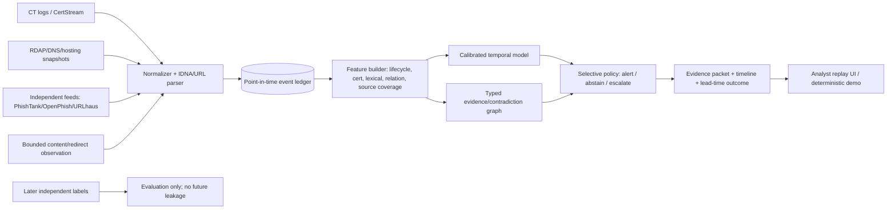

# AI-Powered Web Threat Detection & Digital Trust Intelligence
## HackMatrix ’26 research report

**Research cutoff/access date:** 9 November 2026. **Scope note:** This report synthesizes the 13 completed stream reports under `/home/ubuntu/research-streams/`. Citations link only to sources checked by those streams. A citation supports the proposition immediately preceding it; it does not imply that a source proves a broader claim than stated.

## 1. Executive Summary

The original problem statement is too broad to be a defensible student project. URL classification, API aggregation, CT monitoring, visual phishing detection, graph exploration, and explainable risk scores are all established independently and, in several cases, commercially packaged. The strongest recommendation is therefore a narrower research prototype:

> **TrustPulse: a point-in-time, provenance-preserving and uncertainty-calibrated early-warning system for suspicious domains/certificates, evaluated by lead time and alert budget rather than random-split accuracy.**

TrustPulse does not claim to invent phishing detection, CT monitoring, graph analytics, or multi-signal threat intelligence. Its defensible contribution is an auditable decision layer that (1) reconstructs only evidence available at each historical time, (2) keeps observations, feed assertions, model assessments, contradictions, missingness and verified findings as different typed objects, (3) predicts a later independent label or trust-degradation event, (4) reports calibrated risk, abstention and lead time at a fixed false-alert budget, and (5) exposes a replayable evidence timeline.

The eMudhra incident is verified as an October 2026 compromise involving eight subordinate-CA private keys with tiny predictable ECDSA P-384 scalars: six TLS issuing CAs and two code-signing CAs. Public evidence supports latent certificate-forgery capability and rapid ecosystem blocking, but does **not** establish pre-disclosure targeted interception, credential theft, code-signing abuse, or a complete global victim count. The exact ceremony/script root cause and complete downstream inventory remain unresolved.[1–9]

The project is feasible for a student team if bounded to public CT/CertStream observations, a documented sample of registration/DNS/hosting data, a small brand/confusable corpus, and two or more independent labels. The MVP should be a deterministic replay pipeline plus a calibrated tree model and evidence UI—not a universal scanner, browser replacement, blockchain network, or generic dashboard.

**Single recommendation:** build TrustPulse as a CT-first, time-aware trust-degradation benchmark and replay demo. The strongest novelty statement is: *relative to the reviewed prior art, TrustPulse operationalizes provenance-typed, contradiction-aware, point-in-time fusion with explicit abstention and lead-time evaluation for web/P​​KI risk; the underlying signals and components are established, so novelty is an extension and evaluation contribution, not a claim of first-ever detection.*

## 2. Problem Analysis

### 2.1 The threat is a campaign and trust-lifecycle problem

Phishing is not only a URL-string problem. APWG recorded 1,130,393 phishing attacks in Q2 2025, while CISA describes campaigns combining lure messages, first-stage domains, redirects, brand impersonation and legitimate remote-management tools.[10,11] A useful detector must reason over a sequence: registration or ownership change, DNS/hosting, certificate issuance, redirects, page/content/visual identity, external reports, takedown and possible reactivation.

The attack surface includes credential harvesting; fake banking, recruitment, university and government portals; typosquatting and IDN homographs; QR and redirect indirection; short-lived domains; AI-assisted social engineering; exposed services and web misconfiguration; certificate issuance and revocation delay; and custom trust stores that do not receive browser-vendor blocks. Unicode guidance and browser IDN behavior are nontrivial: an empirical USENIX study tested five desktop and two mobile browsers across more than 9,000 cases and found bypass opportunities in all tested browsers.[12,13]

### 2.2 AI changes attacker economics, not the need for evidence

The reviewed authoritative sources support AI as an enabler of more scalable spear phishing and social engineering, but they do not establish a universal detector or a reliable global percentage of AI-generated phishing websites.[14,15] Generated text, cloned visuals and adaptive templates increase distribution shift and evasion risk. A model should therefore treat content/visual outputs as evidence with uncertainty, not as ground truth.

### 2.3 Certificate and CT observations are not benignity proofs

Certificate Transparency (CT) makes certificate issuance publicly auditable and supports monitors, but CT does not prove domain ownership, legitimate content, or absence of compromise; RFC 6962 explicitly states that CT does not prevent misissuance.[16,17] Certificate-only features are insufficient for phishing classification. The RAID study reported 98% precision, 90% recall and 0.3% FPR in its specific evaluation, while emphasizing feature and dataset limitations.[18] The correct research question is not “does this certificate mean phishing?” but “what trust-degradation trajectory is visible at time *t*, what independent evidence later corroborates it, and how early can a calibrated alert be issued?”

### 2.4 Verified facts versus hypotheses

**Verified from checked sources:** feed disagreement exists; CT and passive DNS can provide pre-content signals; visual detectors degrade on real-world and adversarial distributions; custom trust stores and non-browser clients have uneven protection; weak labels are delayed, correlated and scope-specific; and registration-time and CT-based early prediction already have prior art.[18–27]

**Hypotheses worth testing:** typed provenance and contradiction metadata improve calibration; infrastructure relations add incremental value after campaign/infrastructure-disjoint splitting; selective abstention reduces harmful false positives; and a point-in-time ledger produces more honest lead-time estimates than random URL splits. These are not assumed findings.

## 3. eMudhra Incident Investigation

### 3.1 What is verified

Mozilla independently recovered eight intermediate private keys from public certificates. The affected keys were weak ECDSA P-384 private scalars small enough for trivial enumeration; six intermediates were TLS issuing CAs and two were code-signing CAs.[1] eMudhra stated that a key-generation/key-wrap ceremony script error produced weak keys despite the use of FIPS 140-2 Level 3 HSMs.[3,4] Google used SPKI-based emergency blocking so certificates sharing the affected keys were covered, and browser/ecosystem operators deployed emergency distrust or revocation measures.[2,5]

The weakness was therefore **insufficient randomness/key-generation operational control**, not a break of ECDSA P-384 or TLS encryption. A recovered TLS intermediate private key could enable arbitrary-domain certificate issuance and attempted impersonation/MITM against clients that retained trust and lacked effective CT/revocation controls. eMudhra reported that no affected intermediate had issued publicly trusted end-entity certificates and no infrastructure/data breach was known; Google reported no affected TLS leaf certificates CT-logged before its block.[2–4]

Cloudflare observed forged certificates after public disclosure but no evidence of interception in its telemetry; it explicitly qualified that targeted interception could not be excluded.[5,6] The public record therefore supports **capability and exposure**, not confirmed pre-disclosure exploitation.

### 3.2 Impact and attack scenario

A plausible attack scenario is: recover a subordinate CA key from a public certificate; mint a certificate for a targeted domain; rely on a client that still trusts the affected path and does not enforce effective CT/revocation; intercept or impersonate traffic. For code-signing intermediates, the analogous capability is fraudulent signing, but reviewed sources do not establish code-signing abuse.[1–6]

### 3.3 What failed or was weak

The incident exposes a control-chain failure: key-generation ceremony/script assurance, independent validation of key entropy and public-key binding, audit coverage, certificate inventory, cross-sign remediation, revocation/CT response, and protection of non-browser/custom trust consumers. HSM presence did not guarantee correct entropy if unsafe material was generated or wrapped before/around HSM use.[3,4]

### 3.4 What remains unresolved

The reviewed record does not provide the full CCADB root-cause report or faulty ceremony script; it does not prove or disprove carefully targeted interception before disclosure; it does not give a complete end-entity, OCSP/test-certificate and cross-signed inventory; it does not establish what audits tested; and it does not independently verify final remediation in every downstream trust store.[1–9] These gaps are important design motivation for evidence timelines, but TrustPulse must not claim that it could have predicted the eMudhra compromise from public telemetry.

## 4. Existing Product Landscape

| Product/service | Documented purpose and techniques | Access/certificate/TI scope | What it does not solve for this project |
|---|---|---|---|
| Google Safe Browsing / Web Risk | URL threat-list and hash-prefix lookup; commercial use directed to Web Risk.[28,29] | Broad reputation lookup; public docs do not establish CT analytics. | No public, auditable point-in-time cross-source trust trajectory. |
| Microsoft Defender SmartScreen | Suspicious-page analysis, dynamic phishing/malware lists, prevalence, signature/certificate reputation and endpoint integration.[30] | Strong endpoint/browser integration. | Not documented as a general public CT/P​​KI research API or neutral benchmark. |
| VirusTotal / Google Threat Intelligence | Aggregates URL/domain/IP reports, relationships and many engine results; public API has quota/commercial restrictions; Private Scanning omits partner verdicts.[31,32] | Broad pivot/TI surface and certificate context. | Engine counts are correlated assertions, not independent proof; provenance/calibration and point-in-time replay are not supplied as the proposed research object. |
| Cloudflare Intel | Model-scored phishing intelligence with domain/IP/ASN, pDNS, WHOIS and history; plan quotas apply.[33] | Strong commercial infrastructure intelligence. | Internal scoring/calibration and neutral longitudinal comparison are not public. |
| URLScan | Public/unlisted/private observation scans, redirects, requests, DNS-adjacent data, TLS, screenshots and verdicts.[34] | Excellent observation platform. | Scan visibility, PII, retention, quotas and dynamic cloaking limit ground truth. |
| PhishTank / OpenPhish | Community-verified records versus active/autonomous feed models with different semantics and retention.[35–38] | Useful labels/feeds, not universal truth. | Scope, delay, active-only bias and non-duplication make absence non-benign. |
| Cisco Talos, Check Point, Palo Alto | Enterprise reputation, prevention, samples, IOCs and campaign workflows.[39–41] | Valuable operational products. | Public documentation does not expose complete scoring, neutral coverage or reproducible CT lifecycle evaluation. |
| CT monitors | Public append-only issuance observation and alerting.[16,17,42] | Excellent certificate visibility. | CT is not a phishing verdict and does not solve content, ownership or downstream-client exposure. |

**Conclusion:** the reviewed products are specialized across reputation, endpoint prevention, observation, TI correlation or CT monitoring. Generic “combine their APIs into a dashboard” is rejected as low novelty.

## 5. Academic Research Landscape

| Research line | Checked evidence | Result/limitation relevant to TrustPulse |
|---|---|---|
| URL lexical/semantic ML | Multiple studies report high benchmark performance; later robustness work shows robust accuracy around 0.432 for several models under subdomain injection and SHAP top-K Jaccard around 0.526–0.535.[43–45] | Random-split accuracy is not deployment reliability; test mutations and explanation stability. |
| Visual similarity | VisualPhishNet and Phishpedia support zero-day/partial visual impersonation; USENIX 2025 evaluated 451,000+ real-world sites and found major degradation, logo-removal failures and transferable evasion.[46–49] | Use screenshot evidence as optional/tie-breaker, not core novelty or proof. |
| Multimodal models | A 2024 study reports URL-plus-screenshot F1 of 92.71% and 93.68% for Gemini 1.5 Flash and GPT-4o mini in its setting; staged URL-then-screenshot reduced cost.[50] | API/model drift, privacy, prompt dependence and calibration require controlled replay. |
| CT/pDNS phishing prediction | RAID 2022 combines CT, pDNS, historical certificates and lexical features and reports early detection in its evaluation.[18] | CT+pDNS fusion is established; TrustPulse must add stronger time/label/provenance evaluation rather than rebrand it. |
| Registration-time prediction | PREDATOR, Premadoma, BadDomains and proactive blacklisting establish pre-content/registration-time abuse prediction.[21,22,51,52] | Newly registered-domain ML alone is rejected as novel. |
| Infrastructure graphs/GNNs | Passive-DNS propagation and heterogeneous GNN/hosting work discover related malicious domains; shared hosting creates ambiguity and leakage risk.[20,23,53] | Test incremental graph value with campaign/infrastructure-disjoint splits. |
| Explainable security AI | SHAP/Grad-CAM/attention and natural-language explanations are established; faithfulness and stability remain under-tested.[44,54] | Store feature lineage and test explanation changes under attacker edits. |
| Federated CTI | FedCTI and secure aggregation establish privacy-preserving collaboration; federated learning alone does not prevent update leakage or poisoning.[55–59] | Not an MVP core; use only as a future extension after single-operator evidence semantics are validated. |

## 6. Open-Source Implementation Analysis

Representative repositories include Google Safe Browsing’s Go client, `urlscan-py`, CertSpotter, CertStream, StreamingPhish, dnstwist, phishdetect, the No Phishing extension, SpiderFoot, MISP, OpenCTI, Amass and threat-intelligence graph projects.[60–76]

**API wrappers/connectors:** Safe Browsing clients, `urlscan-py`, SpiderFoot modules, URLhaus/CertStream connectors. They are useful acquisition components, not original detection contributions.

**Genuine bounded detection logic:** dnstwist permutation/visual similarity; phishdetect rules/YARA; browser-local features; CertSpotter/CT watchlists; StreamingPhish CT-derived classification. Their limits are fixed brand lists, lexical brittleness, provider dependence, missing calibration and weak temporal evaluation.

**Reusable architecture patterns:** feed ingestion → normalization → features → classifier/rules → dashboard; CT stream → regex/watchlist; browser render → screenshot/HTML similarity; MISP/OpenCTI graph storage → analyst correlation. The technically superficial claims to reject are “real-time CT” that only filters a stream, graph visualization presented as graph detection, and random-split accuracy on bundled datasets.

**Missing implementation layer:** no sampled implementation demonstrates a common evidence object spanning URL, certificate, DNS, hosting, redirect, content, graph, source provenance, timestamp, freshness, contradiction and missingness, followed by calibrated selective decisions and reproducible lead-time measurement.

## 7. Research Gap Matrix

The opportunities below are deliberately qualified. “Novelty confidence” describes the defensible extension after reviewing the cited prior work, not patentability.

| # | Research gap | Existing solutions / evidence | Proposed innovation | Novelty / feasibility | Data and evaluation |
|---:|---|---|---|---|---|
| 1 | No common point-in-time ledger across registration, CT, DNS, content and delayed labels. | CT/pDNS and registration systems exist.[18,21,22] | Immutable event ledger with observation time, availability time and label time separated. | Medium / high. | CT, CertStream, RDAP/DNS samples; forward-chaining lead-time and survival analysis. |
| 2 | Feed disagreement is hidden by one risk score. | VT, Safe Browsing, PhishTank disagree in studied data.[18,31,35] | Typed assertions plus contradiction graph and source dependence. | Medium / high. | Multi-feed snapshots; calibration, contradiction ablation, selective risk. |
| 3 | “Risk score” is confused with verified finding. | Commercial aggregators and CT monitors expose verdicts/observations.[16,31,34] | Promotion rule: observation → assertion → assessment → corroborated finding. | Medium / high. | Independent later label; precision of promoted findings and audit review. |
| 4 | Lead-time claims are incomparable because clocks differ. | Early-warning papers report earlier detection with differing protocols.[18,21,22] | Common clock schema and alert-budget lead-time benchmark. | Medium / high. | Registration/CT/DNS/content/feed timestamps; median lead time at fixed FPR. |
| 5 | Graph value is confounded by shared hosting and leakage. | pDNS/GNN/hosting graphs show promise and false-positive risk.[20,23,53] | Relation typing and ablation-tested graph features under infrastructure-disjoint splits. | Medium / medium. | DNS/hosting/cert relations; unseen-provider and cluster holdouts. |
| 6 | CT certificate features are overinterpreted as maliciousness. | CT is observability, not benignity proof.[16,17] | Certificate lifecycle trajectory plus target/issuer/SAN history and uncertainty. | Low–medium / high. | CT snapshots; compare certificate-only, trajectory and fused models. |
| 7 | Ownership-change signals are incomplete and probabilistic. | RDAP/WHOIS and residual-trust research.[24,25] | Explicit ownership-transition likelihood with missingness, never deterministic attribution. | Medium / medium. | RDAP where available, DNS changes, certificate changes; reliability/calibration. |
| 8 | Selective escalation is not evaluated against cost and risk. | Multimodal staged policies reduce cost in one study.[50] | Risk-based URL→certificate/DNS→safe render escalation with abstention. | Medium / high. | Costed replay; coverage-risk curves, latency and privacy exposure. |
| 9 | Explanations are not tested for stability under edits. | SHAP/visual/XAI systems exist.[44,54] | Evidence lineage and explanation-stability metric under syntax/content mutations. | Medium / high. | Mutation suite; faithfulness, stability and human audit. |
| 10 | Lifecycle states (active, parked, redirected, reactivated) are collapsed. | CT/TI tools observe indicators but do not share lifecycle semantics.[60–76] | Domain/certificate state machine with reactivation detection. | Medium / high. | Longitudinal CT/DNS/content snapshots; state F1 and reactivation lead time. |
| 11 | Negative feed results are mistaken for benignity. | Feed terms and scopes differ.[35–38] | Missing/unknown class and source-coverage vector. | Medium / high. | Source-preserving labels; false-positive and unknown-risk evaluation. |
| 12 | Multilingual/Indian-script trust evidence is fragmented. | Indian official sources document payment/fake-service scams; no unified graph.[77–84] | Optional language/script and institution-claim evidence pack, without claiming prevalence. | Medium / medium. | Public advisories, confusable corpus, legitimate Indian-service set; language-stratified calibration. |
| 13 | Cross-source privacy collaboration lacks evidence semantics. | STIX/MISP, secure aggregation and FedCTI exist.[55–59,85,86] | Future signed aggregate evidence with accountable membership and poisoning tests. | Low–medium / low for MVP. | Synthetic/non-sensitive multi-party partitions; poisoning/Sybil benchmarks. |
| 14 | CT baselines drift by CA, TLD and era. | CT monitoring is established but common drift protocol absent in reviewed implementations.[16,17,42] | Drift-aware baselines and per-source freshness/coverage reporting. | Medium / high. | Historical CT windows; calibration drift and alert-budget stability. |
| 15 | Campaign/domain duplicates inflate scores. | Dataset studies warn of duplication and source dependence.[87–90] | Registrable-domain/campaign clustering before split and dedup manifest. | Medium / high. | Frozen hashes and cluster IDs; compare random vs grouped/temporal splits. |
| 16 | Adaptive cloaking is underrepresented in benchmarks. | Visual and dynamic detectors show evasion weaknesses.[47–49] | Safe selective render protocol and cloaking stress suite. | Medium / medium. | Controlled synthetic mutations and policy-safe pages; recall under evasion. |
| 17 | Evidence quality and freshness are not calibrated together. | Provenance and confidence metadata exist in CTI standards.[85,86] | Source-specific reliability, freshness decay and correction history. | Medium / high. | Historical assertions; Brier/ECE, temporal decay ablation. |
| 18 | Alert operations lack an auditable evidence packet. | TI platforms correlate and visualize.[31,39–41,70,71] | Replayable packet with every feature, timestamp, source and missing signal. | Medium / high. | Analyst task study or structured review; audit completeness and time-to-triage. |

**Rejected novelty claims:** simple phishing URL classifier; generic multi-API dashboard; ordinary browser extension; CT stream plus regex; visual logo matching alone; blockchain for “trust”; federated learning alone; and graph visualization without an incremental, leakage-resistant result. These are established or insufficiently differentiated.[18,31,46,55,60–76]

## 8. Dataset and Experimental Feasibility

| Source | Access / semantics | Main bias or constraint | Proposed use |
|---|---|---|---|
| PhishTank | Free community-verified records/API with rate limits.[35,36] | Community/provider status, no universal truth or stable cited row count. | One label stream; preserve verification time. |
| OpenPhish | Limited community feed and controlled academic access; terms restrict use/sharing.[37,38] | Active-only, 14-day non-duplication and survivorship bias. | Independent corroboration if access is approved; do not redistribute. |
| URLhaus | Malware-distribution URL feed/API; frequent dumps and Auth-Key requirements.[89,90] | Not general phishing; malware ontology mismatch. | Separate malware label, not relabeled phishing truth. |
| Tranco | Reproducible popularity list with permanent IDs/methodology.[91,92] | Popularity is not benignness; provider composition bias. | Benign/control sampling only, with caveats. |
| Common Crawl | Public web observations/terms.[93,94] | Crawl reachability, time and privacy bias. | Content observation/control sampling, not labels. |
| CT logs/CertStream | Public append-only issuance and streaming ecosystem.[16,17,42] | Issuance not legitimacy; incomplete historical/operational coverage. | Primary event source and replay ledger. |
| Public DNS/pDNS | Access varies; sources are heterogeneous.[24,95] | Vantage, privacy and shared-host ambiguity. | Bounded enrichment and graph features. |
| PhiUSIIL | Kaggle card reports 235,795 rows and CC BY-SA 4.0; UCI reports same dataset with different license metadata.[96,97] | Artifact/version/license discrepancy and URL-level leakage risk. | Baseline only; freeze exact artifact and manifest. |
| Indian advisories/datasets | CERT-In/RBI/I4C/MEA/UGC sources provide documented scenarios; a Dravidian SMS set is spam/ham, not verified web phishing.[77–84] | Fragmented fields, subscription/access limits, no unified attack graph. | Context and small language stress set, not universal prevalence. |

**Reproducible protocol:** hash raw snapshots; preserve source labels and acquisition times; normalize IDNA/URLs; deduplicate exact URLs and registrable domains; cluster campaigns/infrastructure; split chronologically and by domain/campaign; hold out future providers or unseen infrastructure where possible; model right-censoring and delayed labels; publish manifests, code, feature schemas and synthetic/replay data where raw indicators cannot be redistributed. Report PR-AUC, recall at fixed FPR/alerts per million, Brier score, expected calibration error, coverage-risk curves, median/quantile lead time, cost/latency, and source/evidence coverage—not accuracy alone.[87–90]

## 9. Five Candidate Innovations

### Candidate A — TrustPulse: provenance-first trust-degradation early warning

**Problem/gap:** existing early-warning and CT/pDNS systems establish the signals, but public implementations do not standardize point-in-time evidence, contradictions, missingness, promotion to verified finding, and alert-budget lead time. **Contribution:** typed event ledger, calibrated fusion, abstention and replayable packet. **Users:** SOC analysts, registrars, browser/security researchers. **Architecture/ML:** CT-first ingestion, temporal tabular model (LightGBM/logistic baseline), graph features, calibration and conformal/selective thresholding. **Evaluation/demo:** forward-chaining, campaign/infrastructure holdouts, lead-time curve and deterministic replay. **Difficulty:** medium-high. **Risks:** data access, label delay and novelty overclaim. **Judging advantage:** visible causal timeline and honest failure cases. **Novelty confidence:** medium as an extension; components low.

### Candidate B — Indian Digital Trust Lens

**Problem/gap:** Indian payment, government, recruitment and education abuse evidence is fragmented across official sources; multilingual/Indian-script coverage is underserved but not proven globally prevalent.[77–84] **Contribution:** institution-claim, language/script, certificate and infrastructure evidence pack for Indian services. **Users:** citizens, banks, public-service defenders. **Difficulty:** medium-high. **Risk:** small/biased labels and false assumption that India-specific equals novel. **Novelty confidence:** medium for application, low for methods. It is a good domain slice, but should be a TrustPulse stress-test rather than the sole research claim.

### Candidate C — Evidence promotion and contradiction engine

**Problem/gap:** observations, feed assertions, model scores and findings are routinely collapsed. **Contribution:** source-dependence-aware Bayesian/Dempster-style evidence ledger, explicit conflict and verification promotion. **Closest prior art:** STIX/MISP provenance and commercial correlation.[31,85,86] **Difficulty:** medium. **Novelty confidence:** medium-low; meaningful engineering/research extension, not new provenance itself.

### Candidate D — Cost-aware multimodal escalation

**Problem/gap:** visual/multimodal systems improve coverage but are costly, privacy-sensitive and distribution-shifted.[46–50] **Contribution:** escalate only uncertain/high-impact events from URL/CT to safe DOM/screenshot evidence, with cost-risk optimization and explanation stability. **Difficulty:** high. **Novelty confidence:** low-medium because staged multimodal policies already exist.

### Candidate E — Privacy-preserving collaborative web-risk learning

**Problem/gap:** organizations need collaboration but FL leaks/poisons and blockchain does not establish truth.[55–59,85,98–100] **Contribution:** signed aggregate evidence, accountable membership, secure aggregation and poisoning evaluation. **Difficulty:** high. **Novelty confidence:** low-medium; privacy-preserving CTI and secure aggregation are prior art. Not suitable as MVP core.

## 10. Deep Novelty Verification of Top Three

| Idea | Closest prior art checked | Classification | Defensible statement |
|---|---|---|---|
| TrustPulse | AlSabah CT+pDNS phishing prediction; PREDATOR/BadDomains; MANTIS/Unit 42 graphs; commercial DomainTools/VT/urlscan; CT monitors; temporal graph patents.[18,21–24,31,34,42,53,101–104] | **B — existing research with meaningful extension** | New relative to reviewed sources is the integrated operational protocol: typed provenance/contradiction/missingness, point-in-time replay, calibrated abstention and common lead-time/alert-budget evaluation. Not new are CT, pDNS, graphs, early prediction or risk scoring. |
| Indian Digital Trust Lens | CERT-In/RBI/MEA/UGC advisories and general phishing/visual/CT systems.[46–49,77–84] | **C — existing capability with new application** | Indian service/entity and language-specific evidence packaging is useful, but application geography alone is not technical novelty. |
| Collaborative evidence learning | STIX/MISP, FedCTI, Bonawitz secure aggregation, NIST privacy/poisoning guidance, FoolsGold and blockchain guidance.[55–59,85,86,98–100] | **D/B — mostly existing functionality with limited novelty for MVP** | A web-infrastructure-specific, poisoning-tested signed aggregate layer could be an extension, but it is too broad and unverified for a hackathon claim. |

**Verification conclusion:** no reviewed evidence supports “never done before.” The strongest claim is a reproducible integration/evaluation contribution around evidence semantics and time-aware selective decisions. A full patentability/FTO search would still be required before commercialization; commercial internals are not observable and inaccessible 2025–2026 hits were not treated as anticipation.[101–104]

## 11. Final Recommended Project

### TrustPulse: an auditable early-warning benchmark for web/P​​KI trust degradation

**Core research question:** Given only evidence available at time *t*, can a calibrated model identify domains/certificates that will receive an independent malicious label or enter a defined trust-degradation state within horizon *H*, earlier than a baseline, while controlling false alerts and abstaining under missing/conflicting evidence?

**Precise innovation:** a typed temporal evidence ledger and selective fusion policy—not a new URL feature. Each event carries `entity`, `event_type`, `observed_at`, `available_at`, `source`, `source_scope`, `raw_hash`, `transformation`, `freshness`, `confidence`, `contradictions`, and `missingness`. Decisions are `observation`, `assertion`, `assessment`, `abstention`, or `verified_finding`; only later independent corroboration promotes an assessment.

### Why Different

1. **Temporal honesty:** no future feed label, later DNS state or post-takedown screenshot leaks into an earlier feature vector.
2. **Evidence semantics:** a CT observation, OpenPhish assertion, model score and analyst-verified finding are not interchangeable.
3. **Contradiction and absence:** “not in this feed” is not benign; source scope and missingness are visible.
4. **Operational metric:** alerts per million, calibration, abstention and lead time replace headline accuracy.
5. **Reproducible replay:** judges can replay a frozen event slice and inspect every decision.

## 12. Technical Architecture

**Services:** ingestion workers; immutable raw snapshot store; normalized event store; feature/version registry; model service; evidence-packet API; static replay UI. Use SQLite/Parquet for MVP, DuckDB for analysis, NetworkX for bounded relations, and a conventional append-only log. Do not add blockchain: a single-team benchmark has no demonstrated multi-operator governance need, and blockchain does not solve privacy, poisoning, Sybil identity or truth.[98–100]

## 13. AI/ML Methodology

1. **Baselines:** lexical logistic regression/LightGBM; certificate-only; CT+lexical; independent feed rules; static graph features; and a commercial/API lookup baseline only where terms permit.
2. **Features:** IDNA/confusable distance; domain age/registration event; CT issuer/SAN/validity/issuance velocity; certificate reuse and issuer transitions; DNS/IP/ASN/NS relationships; redirect count; source coverage and freshness; content/screenshot only for an optional escalation slice.
3. **Temporal model:** gradient-boosted trees with time-windowed aggregates and missing indicators; compare a temporal survival model for time-to-independent-label. No future event may enter a feature vector.
4. **Calibration:** held-out isotonic or Platt calibration; report Brier/ECE by source, TLD, language and time window.
5. **Selective prediction:** choose alert and abstain thresholds on validation data for fixed alert budgets; report risk-coverage curves and abstention reasons.
6. **Explainability:** feature lineage plus SHAP only as a diagnostic; test faithfulness by masking top evidence and stability under syntax-preserving/adversarial mutations.[44,45]
7. **Graph contribution:** use typed relation aggregates first; compare against no-graph model and static graph/GNN only if data volume permits. A graph win must survive campaign and infrastructure-disjoint splits.

## 14. Data Pipeline

1. Freeze source manifests, licenses, hashes and acquisition timestamps.
2. Ingest CT/CertStream events and bounded DNS/RDAP/hosting observations.
3. Normalize URLs with safe parsing and IDNA rules; preserve raw values and parser version.
4. Create event rows with separate `observed_at`, `available_at`, `label_at`, and `takedown_at` where known.
5. Deduplicate exact URLs; group by registrable domain, certificate key/SAN, infrastructure and campaign heuristics.
6. Join labels without overwriting source semantics; represent unavailable/negative/unknown distinctly.
7. Build point-in-time feature snapshots using only events available by cutoff.
8. Train, calibrate and evaluate in forward windows; archive predictions and evidence packets.
9. Produce a report of coverage, missingness, conflicts, latency and label delay.

## 15. Evaluation Strategy

**Primary hypothesis H1:** provenance-aware temporal fusion improves calibrated recall/lead time at a fixed alert budget over URL-only and certificate-only baselines. **H2:** graph relations add incremental value after infrastructure-disjoint splitting. **H3:** abstention reduces high-cost false positives under missing/conflicting modalities. **H4:** evidence explanations are more stable than raw URL-only explanations under controlled mutations.

**Splits:** rolling temporal train/validation/test; registrable-domain and campaign-disjoint; unseen infrastructure/provider holdout where feasible; external feed used only as later label in one protocol. Include a benign long-tail sample from Tranco/Common Crawl with explicit non-benignness caveat.[91–94]

**Metrics:** PR-AUC; recall at fixed FPR and alerts/million; precision of promoted findings; Brier/ECE; risk-coverage; median and 90th-percentile lead time to independent label; time-to-triage; feature/telemetry coverage; cost/latency; and explanation faithfulness/stability. Report confidence intervals via domain/campaign bootstrap.

**Ablations:** remove provenance; remove contradiction/missingness; remove graph; remove CT; remove registration; remove calibration; random split versus temporal/disjoint split; and no-abstention versus selective policy.

**Robustness:** confusable Unicode/IDNA variants; subdomain injection; token insertion/reordering; certificate/SAN changes; shared-host controls; parked/redirected/reactivated lifecycle; screenshot/logo removal only in the optional modality. Never run harmful live phishing experiments.

## 16. MVP Implementation Plan

**Phase 1 (days 1–3):** schema, manifests, safe parser, CT sample and replay ledger.

**Phase 2 (days 4–7):** certificate/lexical/lifecycle features, one bounded DNS/hosting enrichment, source-preserving labels and deduplication.

**Phase 3 (days 8–11):** baselines, temporal/disjoint splits, calibration, alert-budget metrics and ablations.

**Phase 4 (days 12–15):** evidence packet API/UI, timeline, contradiction/missingness display, deterministic replay and export.

**Phase 5 (days 16–18):** robustness tests, failure analysis, frozen demo dataset, documentation and reproducibility package.

**Minimum viable implementation:** CT/CertStream ingestion; safe normalization; certificate lifecycle and lexical features; two independent labels if obtainable; LightGBM/logistic baseline; calibrated alert/abstain policy; evidence timeline; and one no-network replay scenario. If pDNS/RDAP access fails, explicitly report missingness and use synthetic/archived bounded relations rather than fabricate coverage.

## 17. Hackathon Demo Strategy

1. Start with a frozen replay clock: show a domain/certificate at the first CT event.
2. Reveal successive DNS/relationship/feed events as they become available.
3. Show an early calibrated alert with “why,” source timestamps, missing signals and confidence.
4. Show a contradiction case where one feed is positive and another has no record; the system abstains or labels “insufficient evidence,” not “safe.”
5. Compare URL-only versus TrustPulse on lead time and alerts per million.
6. Replay an eMudhra-inspired **synthetic** weak-key/key-reuse scenario only as a trust-infrastructure demonstration; clearly label it synthetic and do not claim prediction of the real incident.
7. End with failure cases: shared hosting, parked domain, cloaked content and missing telemetry.

Judges should see original event semantics, a real temporal split, calibrated uncertainty, ablation results and a deterministic replay—not a vendor score copied into a dashboard.

## 18. Risks and Failure Scenarios

- **Label delay/correlation:** feeds may confirm each other or arrive after takedown. Preserve source and label times; use independent later labels where possible.
- **Shared hosting false positives:** relation edges are probabilistic; require typed edges and disjoint evaluation.
- **Coverage bias:** CT, DNS, RDAP and crawls are incomplete. Report source coverage and abstain.
- **Cloaking and dynamic content:** one scan cannot prove legitimacy; content is optional evidence.
- **IDN/parser errors:** use current IDNA/browser tests and preserve parser versions; do not rely on legacy Unicode assumptions.[12,13]
- **Privacy/legal exposure:** do not crawl credentials or submit live forms; respect feed terms, URLScan visibility and OpenPhish restrictions.[34,37,38]
- **Novelty overclaim:** component novelty is low; state the integration/evaluation claim precisely.
- **eMudhra overinterpretation:** no evidence that public telemetry could have predicted the compromise or that exploitation occurred before disclosure.
- **Operational drift:** calibrate by time/TLD/source and rerun rolling evaluation.
- **Team scope:** omit FL, blockchain, full multimodal LMM and global owner attribution from MVP.

## 19. Research References

1. Mozilla Bugzilla, “eMudhra compromised intermediate CA certificates,” incident record, 2026, https://bugzilla.mozilla.org/show_bug.cgi?id=2083449 (accessed 2026-11-09).
2. Google, “Protecting Chrome and Android users from compromised eMudhra intermediate CA certificates,” 2026, https://blog.google/security/protecting-chrome-and-android-users-from-compromised-emudhra-intermediate-ca-certificates/ (accessed 2026-11-09).
3. eMudhra, “Certificate security incident,” 2026, https://emudhra.com/en/post/certificate-security-incident (accessed 2026-11-09).
4. eMudhra incident information, 2026, https://emudhra.we-have-a-problem.com/ (accessed 2026-11-09).
5. Cloudflare, “eMudhra certificate compromise,” 2026, https://blog.cloudflare.com/emudhra-certificate-compromise (accessed 2026-11-09).
6. Cloudflare, “eMudhra patching,” 2026, https://blog.cloudflare.com/emudhra-patching (accessed 2026-11-09).
7. BoostSecurity, “eMudhra CA incident research,” 2026, https://github.com/boostsecurityio/emBarrass/blob/main/docs/research/emudhra-ca-incident.md (accessed 2026-11-09).
8. Mozilla Bugzilla, follow-up incident record, 2026, https://bugzilla.mozilla.org/show_bug.cgi?id=2084101 (accessed 2026-11-09).
9. Palo Alto Networks Unit 42, “eMudhra certificate compromise,” 2026, https://unit42.paloaltonetworks.com/emudhra-certificate-compromise/ (accessed 2026-11-09).
10. APWG, “Phishing Activity Trends Report, Q2 2025,” https://docs.apwg.org/reports/apwg_trends_report_q2_2025.pdf (accessed 2026-11-09).
11. CISA, AA23-025A, https://www.cisa.gov/news-events/cybersecurity-advisories/aa23-025a (accessed 2026-11-09).
12. Hu and colleagues, USENIX Security 2021 IDN homograph study, https://www.usenix.org/conference/usenixsecurity21/presentation/hu-hang (accessed 2026-11-09).
13. IETF RFC 5890 and Unicode TR36, https://www.rfc-editor.org/rfc/rfc5890.html and https://www.unicode.org/reports/tr36/ (accessed 2026-11-09).
14. Microsoft, Digital Defense Report 2024, https://www.microsoft.com/en-us/security/security-insider/threat-landscape/microsoft-digital-defense-report-2024 (accessed 2026-11-09).
15. CERT-In, Digital Threat Report 2024, https://www.cert-in.org.in/PDF/Digital_Threat_Report_2024.pdf (accessed 2026-11-09).
16. Certificate Transparency, “How CT works,” https://certificate.transparency.dev/howctworks (accessed 2026-11-09).
17. RFC 6962, Certificate Transparency, https://www.rfc-editor.org/rfc/rfc6962 (accessed 2026-11-09).
18. AlSabah et al., “Phishious: content-agnostic phishing detection using CT and passive DNS,” RAID 2022, https://alleychoo.github.io/papers/raid_phicious.pdf (accessed 2026-11-09).
19. Google Web Risk lists, https://docs.cloud.google.com/web-risk/docs/lists (accessed 2026-11-09).
20. Passive-DNS graph analysis paper, https://www.covert.io/research-papers/security/Discovering%20Malicious%20Domains%20through%20Passive%20DNS%20Data%20Graph%20Analysis.pdf (accessed 2026-11-09).
21. PREDATOR paper, ACM Digital Library, https://dl.acm.org/doi/abs/10.1145/2976749.2978317 (accessed 2026-11-09).
22. BadDomains, arXiv, https://arxiv.org/html/2501.06912v1 (accessed 2026-11-09).
23. MANTIS/hosting-infrastructure prior work, https://arxiv.org/html/2405.05206v1 (accessed 2026-11-09).
24. ICANN RDAP, https://www.icann.org/rdap (accessed 2026-11-09).
25. Residual-trust/expired-domain study, https://dl.acm.org/doi/pdf/10.1145/2487575.2487647 (accessed 2026-11-09).
26. USENIX Security 2025 real-world visual phishing evaluation, https://www.usenix.org/system/files/conference/usenixsecurity25/sec25cycle1-prepub-483-ji.pdf (accessed 2026-11-09).
27. RAID/early-warning and dataset studies, https://arxiv.org/html/2411.09813v2 (accessed 2026-11-09).
28. Google Safe Browsing reference, https://developers.google.com/safe-browsing/reference (accessed 2026-11-09).
29. Google Web Risk documentation, https://developers.google.com/safe-browsing (accessed 2026-11-09).
30. Microsoft Defender SmartScreen, https://learn.microsoft.com/en-us/windows/security/operating-system-security/virus-and-threat-protection/microsoft-defender-smartscreen/ (accessed 2026-11-09).
31. VirusTotal API overview, https://docs.virustotal.com/reference/overview (accessed 2026-11-09).
32. VirusTotal Private Scanning, https://docs.virustotal.com/docs/private-scanning (accessed 2026-11-09).
33. Cloudflare Intelligence APIs, https://developers.cloudflare.com/security-center/intel-apis/ (accessed 2026-11-09).
34. URLScan API introduction, https://docs.urlscan.io/pages/api-intro (accessed 2026-11-09).
35. PhishTank developer information, https://phishtank.net/developer_info.php (accessed 2026-11-09).
36. PhishTank API information, https://phishtank.net/api_info.php (accessed 2026-11-09).
37. OpenPhish feeds, https://openphish.com/phishing_feeds.html (accessed 2026-11-09).
38. OpenPhish academic use and terms, https://openphish.com/academic_use.html and https://openphish.com/terms.html (accessed 2026-11-09).
39. Cisco Talos, https://www.talosintelligence.com/ (accessed 2026-11-09).
40. Check Point Harmony Browse documentation, https://sc1.checkpoint.com/documents/Infinity_Portal/WebAdminGuides/EN/Harmony-Browse-Admin-Guide/Default.htm (accessed 2026-11-09).
41. Palo Alto AutoFocus, https://docs.paloaltonetworks.com/autofocus/autofocus-admin/get-started-with-autofocus/first-look-at-the-autofocus-portal (accessed 2026-11-09).
42. Let’s Encrypt CT logs, https://letsencrypt.org/docs/ct-logs/ (accessed 2026-11-09).
43. URL phishing ML study, https://www.sciencedirect.com/science/article/abs/pii/S0140366421001675 (accessed 2026-11-09).
44. Robustness protocol and explanation stability, https://www.frontiersin.org/journals/computer-science/articles/10.3389/fcomp.2026.1834407/full (accessed 2026-11-09).
45. Related explainability/robustness study, https://arxiv.org/html/2402.13871v2 (accessed 2026-11-09).
46. VisualPhishNet, https://s-abdelnabi.github.io/VisualPhishNet/ (accessed 2026-11-09).
47. Phishpedia, USENIX Security 2021, https://www.usenix.org/conference/usenixsecurity21/presentation/lin (accessed 2026-11-09).
48. Global/local visual similarity study, https://www.sciencedirect.com/science/article/pii/S0957417424009862 (accessed 2026-11-09).
49. USENIX Security 2025 visual robustness paper, https://www.usenix.org/conference/usenixsecurity25/presentation/ji (accessed 2026-11-09).
50. Multimodal phishing-agent study, https://arxiv.org/html/2412.02301v1 (accessed 2026-11-09).
51. Proactive blacklisting/registration research, https://ieeexplore.ieee.org/abstract/document/7546530 (accessed 2026-11-09).
52. Premadoma/registration prediction paper, https://tugraz.elsevierpure.com/ws/portalfiles/portal/25394076/156259641564590.pdf (accessed 2026-11-09).
53. Unit 42 graph neural network research, https://unit42.paloaltonetworks.com/graph-neural-networks/ (accessed 2026-11-09).
54. Explainable multimodal phishing research, https://arxiv.org/html/2405.19598v1 (accessed 2026-11-09).
55. FedCTI paper, https://dl.acm.org/doi/10.1145/3627050.3627064 (accessed 2026-11-09).
56. NIST privacy attacks in federated learning, https://www.nist.gov/blogs/cybersecurity-insights/privacy-attacks-federated-learning (accessed 2026-11-09).
57. Bonawitz secure aggregation, https://eprint.iacr.org/2017/281.pdf (accessed 2026-11-09).
58. NIST implementation challenges, https://www.nist.gov/blogs/cybersecurity-insights/implementation-challenges-privacy-preserving-federated-learning (accessed 2026-11-09).
59. Fung et al. Sybil poisoning, https://www.usenix.org/system/files/raid20-fung.pdf (accessed 2026-11-09).
60. Google Safe Browsing GitHub client, https://github.com/google/safebrowsing (accessed 2026-11-09).
61. urlscan-py, https://github.com/heywoodlh/urlscan-py (accessed 2026-11-09).
62. CertSpotter, https://github.com/SSLMate/certspotter (accessed 2026-11-09).
63. CertStream, https://certstream.calidog.io/ (accessed 2026-11-09).
64. StreamingPhish, https://github.com/wesleyraptor/streamingphish (accessed 2026-11-09).
65. dnstwist, https://github.com/elceef/dnstwist (accessed 2026-11-09).
66. phishdetect, https://github.com/phishdetect/phishdetect (accessed 2026-11-09).
67. No Phishing extension, https://github.com/cprite/phishing-detection-ext (accessed 2026-11-09).
68. SpiderFoot, https://github.com/smicallef/spiderfoot (accessed 2026-11-09).
69. URLhaus, https://urlhaus.abuse.ch/ (accessed 2026-11-09).
70. MISP, https://www.misp-project.org/ (accessed 2026-11-09).
71. OpenCTI, https://github.com/OpenCTI-Platform/opencti (accessed 2026-11-09).
72. Threat-intelligence knowledge graphs, https://github.com/imouiche/Threat-Intelligence-Knowledge-Graphs (accessed 2026-11-09).
73. Amass, https://github.com/owasp-amass/amass (accessed 2026-11-09).
74. ProtonMail CT monitor, https://github.com/ProtonMail/ct-monitor (accessed 2026-11-09).
75. CertStream server, https://github.com/calidog/certstream-server (accessed 2026-11-09).
76. Watcher, https://github.com/thalesgroup-cert/Watcher (accessed 2026-11-09).
77. CERT-In payment fraud advisory, https://www.cert-in.org.in/s2cMainServlet?pageid=PUBADV01&CACODE=CICA-2021-2948 (accessed 2026-11-09).
78. RBI payment security controls, https://www.rbi.org.in/Scripts/NotificationUser.aspx?Id=12032 (accessed 2026-11-09).
79. RBI customer safety guidance, https://www.rbi.org.in/Scripts/BS_PressReleaseDisplay.aspx?prid=53185 (accessed 2026-11-09).
80. CERT-In vulnerability/advisory record, https://www.cert-in.org.in/s2cMainServlet?pageid=PUBVLNOTES02&VLCODE=CIAD-2024-0050 (accessed 2026-11-09).
81. I4C advisories, https://i4c.mha.gov.in/advisories.aspx (accessed 2026-11-09).
82. MEA fake job racket advisory, https://www.mea.gov.in/press-releases?dtl/35763/Advisory_regarding_fake_job_rackets_targeting_IT_skilled_youth (accessed 2026-11-09).
83. UGC fake-university list, https://www.ugc.gov.in/universitydetails/Fakeuniversity (accessed 2026-11-09).
84. .IN IDN and anti-abuse resources, https://www.registry.in/internationalized-domain-names-idns and https://www.registry.in/anti-abuse (accessed 2026-11-09).
85. STIX 2.1, https://docs.oasis-open.org/cti/stix/v2.1/os/stix-v2.1-os.html (accessed 2026-11-09).
86. MISP, https://www.misp-project.org/ (accessed 2026-11-09).
87. Dataset and cross-source study, https://arxiv.org/html/2411.09813v2 (accessed 2026-11-09).
88. Common Crawl, https://commoncrawl.org/get-started (accessed 2026-11-09).
89. URLhaus API, https://urlhaus.abuse.ch/api/ (accessed 2026-11-09).
90. URLhaus FAQ, https://urlhaus.abuse.ch/faq/ (accessed 2026-11-09).
91. Tranco list, https://tranco-list.eu/ (accessed 2026-11-09).
92. Tranco methodology, https://tranco-list.eu/methodology (accessed 2026-11-09).
93. Common Crawl terms, https://commoncrawl.org/terms-of-use (accessed 2026-11-09).
94. CT log list, https://certificate.transparency.dev/logs/ (accessed 2026-11-09).
95. CIRCL passive DNS, https://www.circl.lu/services/passive-dns/ (accessed 2026-11-09).
96. Kaggle PhiUSIIL dataset, https://www.kaggle.com/datasets/kaggleprollc/phishing-url-websites-dataset-phiusiil (accessed 2026-11-09).
97. UCI PhiUSIIL dataset, https://archive.ics.uci.edu/dataset/967/phiusiil+phishing+url+dataset (accessed 2026-11-09).
98. NIST blockchain guidance, https://www.nist.gov/blockchain (accessed 2026-11-09).
99. Hyperledger Fabric overview, https://hyperledger-fabric.readthedocs.io/en/latest/whatis.html (accessed 2026-11-09).
100. FoolsGold, https://ar5iv.labs.arxiv.org/html/1808.04866 (accessed 2026-11-09).
101. US20180219888A1, https://patents.google.com/patent/US20180219888A1/en (accessed 2026-11-09).
102. US12081569B2, https://patents.google.com/patent/US12081569B2/en (accessed 2026-11-09).
103. Provenance-scored cybersecurity knowledge graphs, https://par.nsf.gov/servlets/purl/10321535 (accessed 2026-11-09).
104. Microsoft Threat Intelligence API, https://learn.microsoft.com/en-us/graph/api/resources/security-threatintelligence-overview?view=graph-rest-1.0 (accessed 2026-11-09).

## 20. Direct Answers to Final-Decision Questions

**Which project direction should the team pursue?** TrustPulse: CT-first, point-in-time, provenance-preserving and uncertainty-calibrated early warning for web/P​​KI trust degradation.

**What is the precise innovation?** A typed temporal evidence ledger and selective fusion policy that separates observation, assertion, assessment, abstention and verified finding, then measures lead time at fixed alert budgets.

**What existing products or papers are closest?** AlSabah/Phishious; PREDATOR and BadDomains; passive-DNS/GNN and hosting-graph work; CT monitors; DomainTools, VirusTotal and URLScan; and STIX/MISP provenance systems.[18,21–24,31,34,42,53,85,86]

**What remains unexplored or insufficiently addressed?** In the reviewed sources: a reproducible common protocol joining heterogeneous web/PKI evidence with point-in-time availability, explicit contradiction/missingness, calibrated abstention, typed promotion to finding, and comparable lead-time/alert-budget evaluation.

**What evidence supports the gap?** Existing work proves the component signals and also documents feed disagreement, shared-host ambiguity, label delay, visual/URL robustness failures, and CT’s non-verdict nature.[16–18,20,26,31,47–50]

**Can a student team realistically build and evaluate it?** Yes, with CT/CertStream, bounded DNS/RDAP/hosting data, preserved public feed snapshots where permitted, a small control set and a strict replay protocol. Global coverage, universal ownership attribution, and real-time worldwide benignity classification are not realistic.

**What is the minimum viable implementation?** CT/CertStream ingestion; safe URL/IDNA normalization; certificate lifecycle, lexical and bounded relation features; two source-preserving labels; calibrated LightGBM/logistic model; abstention; evidence timeline; and deterministic replay with temporal/disjoint metrics.

**What should the team avoid building?** A simple URL classifier; API aggregation; generic browser extension; chatbot; ordinary screenshot/logo matcher; blockchain ledger; FL system; or dashboard whose novelty is only a risk score.

**What would make judges consider it genuinely innovative?** A real temporal split, no-leakage manifest, measurable incremental value over strong baselines, alert-budget/lead-time results, calibrated abstention, contradiction cases, reproducible evidence packets and honest failure analysis.

**What is the strongest technically defensible novelty claim?** “TrustPulse contributes a reproducible, provenance-typed and contradiction-aware point-in-time evaluation and selective decision layer for web/P​​KI trust-degradation early warning, with calibration, abstention and lead-time measurement; its detection modalities are established and are not claimed as individually novel.”
