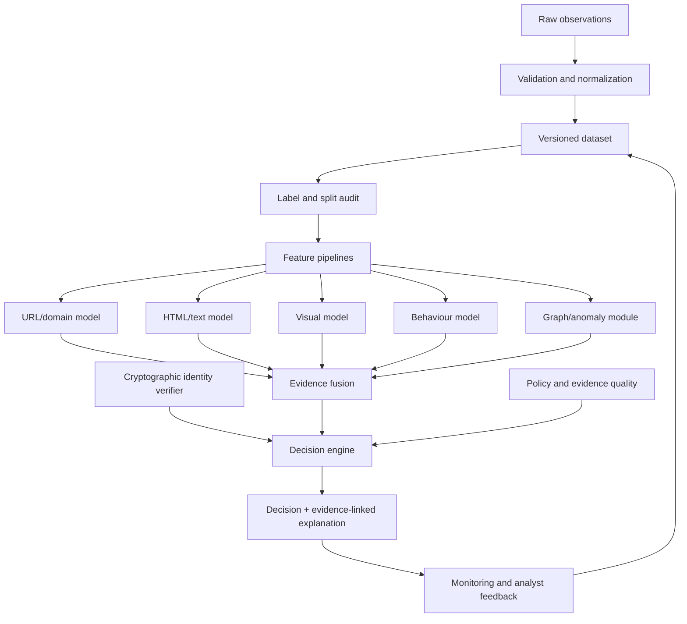

# TRUSTTRACE — Complete Machine Learning Research & Engineering Handbook

**Version:** 1.0  
**Prepared:** 9 November 2026  
**Scope:** Machine-learning workstream for a four-person research-engineering project  
**Status:** Technical blueprint and execution handbook — not a claim of completed experiments or validated performance

---

## How to use this handbook

This is the dedicated ML reference for TRUSTTRACE. It is intended to guide the ML owner from first principles through a reproducible research-grade implementation. It explains what to build, why each decision matters, what can go wrong, how to test it, and what evidence is required before making a research claim.

The handbook is organised around the actual lifecycle:

1. Define the prediction tasks and decision boundaries.
2. Establish data governance and collection protocols.
3. Build raw, normalized and curated datasets.
4. Define labels, uncertainty and annotation quality.
5. Prevent leakage and design valid train/validation/test splits.
6. Engineer features and build classical baselines.
7. Add neural, visual, language and graph models only when justified.
8. Fuse evidence from multiple modalities.
9. Evaluate, calibrate and choose operating thresholds.
10. Explain predictions and represent uncertainty.
11. Package, deploy and monitor models.
12. Test robustness, drift, privacy and adversarial failure.
13. Maintain reproducible experiments and research documentation.

**Non-negotiable principle:** TRUSTTRACE is not one binary classifier. It is an evidence system. Statistical models estimate patterns from data; cryptographic verifiers check signatures and delegation; deterministic policy code applies explicit rules; the final decision layer combines these outputs while preserving uncertainty and provenance.

## 1. Research problem and ML objectives

### 1.1 The research question

The central research question is:

> Can TRUSTTRACE combine web identity evidence, page content, visual similarity, infrastructure context and observed browser behaviour to distinguish legitimate services, impersonation, compromise and unresolved uncertainty more reliably—and with lower investigation cost—than conventional URL- or reputation-only detection?

ML should help answer specific measurable sub-problems. It should not be used as a substitute for cryptographic verification or security policy.

### 1.2 Separate prediction tasks

Do not collapse every threat into a single `benign/phishing` label. Define separate tasks and preserve their outputs.

| Task | Input | Output | Appropriate method |
|---|---|---|---|
| URL risk classification | URL string and lexical features | Statistical risk score/class | Character n-gram, linear model, boosted trees, character neural model |
| Page threat classification | URL, HTML/DOM and page text | Page-level risk estimate | Tree models, text encoder, late fusion |
| Visual impersonation | Screenshot, OCR and trusted brand references | Similarity/impersonation evidence | Image embeddings, OCR, visual classifier |
| Runtime destination risk | Forms, redirects, requests and scripts | Suspicious flow evidence | Rules plus supervised model where labelled flows exist |
| Infrastructure anomaly | DNS, TLS, RDAP and temporal observations | Anomaly score | Statistical baselines, Isolation Forest, temporal analysis |
| Graph relationship risk | Domains, certificates, IPs, pages and typed relations | Relationship/cluster evidence | Graph statistics, then GNN if justified |
| Investigation action selection | Current evidence, uncertainty and action costs | Next safe evidence action | Value-of-information or contextual bandit |
| Final trust decision | All verified evidence, model outputs and policy | Explainable state with abstention | Deterministic decision engine; not just an ML classifier |

The labels and model outputs should be task-specific. A page can be visually similar to a brand without being malicious; a domain can be unusual without being malicious; a model can be uncertain because a modality failed.

### 1.3 Threat taxonomy and target labels

Start with a documented taxonomy. A practical initial page-level taxonomy:

- `verified_legitimate`: independently verified legitimate page/domain under a documented protocol.
- `malicious_phishing`: page intended to deceive users into disclosing credentials or sensitive information.
- `malicious_malware`: page or download associated with malware delivery.
- `malicious_impersonation`: page falsely represents a named organisation or service.
- `compromised_legitimate`: legitimate organisation or domain with a compromised page or injected malicious behaviour.
- `suspicious_unconfirmed`: meaningful threat indicators exist, but ground truth is insufficient.
- `unknown_unlabelled`: no defensible label is available.
- `inaccessible_or_invalid`: collection failed or target could not be evaluated.

A multi-label representation may be more accurate than a forced single class. For example, `compromised_legitimate` and `credential_collection` can both be true.

Keep three concepts separate:

1. **Ground truth:** adjudicated label supported by evidence.
2. **Weak label:** a provider feed, heuristic or automated inference.
3. **Unknown:** no reliable conclusion.

A URL missing from a blocklist is not a verified benign example. An identity manifest missing from a domain is not evidence of malice.

### 1.4 What ML must not decide

The following should be handled by deterministic verification and policy:

- cryptographic signature validity;
- certificate-chain validation;
- manifest schema validity;
- delegation scope, expiry and revocation checks;
- whether an issuer is in the configured trust store;
- URL/redirect egress safety;
- whether an IP address is private, loopback, link-local or a metadata endpoint;
- access-control and tenant-isolation decisions.

A model can estimate whether observed page content resembles an impersonation campaign. It cannot establish that a digital signature is mathematically valid.

---

## 2. System architecture and boundaries

### 2.1 Recommended architecture

Start with a modular monolith and separately isolated browser worker. Avoid premature microservices.



### 2.2 Responsibilities

- **Data pipeline:** ingestion, provenance, validation, redaction, normalization, deduplication and versioning.
- **Feature pipeline:** deterministic transformations from approved observations into typed features.
- **Model services:** inference for one clearly defined task per model.
- **Fusion service:** combines model evidence while tracking modality availability and reliability.
- **Identity verifier:** performs cryptographic and delegation checks outside the learned model.
- **Decision engine:** applies thresholds, policy, evidence sufficiency and abstention.
- **Monitoring:** tracks model, data, latency, source availability and feedback.

### 2.3 Contracts between modules

Every prediction should include:

```json
{
  "task": "page_threat_classification",
  "model_name": "page_fusion_v1",
  "model_version": "0.1.0",
  "prediction": "suspicious",
  "raw_score": 0.87,
  "calibrated_probability": null,
  "threshold_policy": "analyst_triage_v1",
  "modality_availability": {
    "url": true,
    "html": true,
    "visual": false,
    "runtime": true
  },
  "evidence_ids": ["ev_001", "ev_002"],
  "limitations": ["visual_capture_unavailable"],
  "created_at": "ISO-8601 timestamp"
}
```

The example score is illustrative. Never label a raw score as a probability unless calibration has been evaluated and the value is genuinely calibrated for the intended population.

---

## 3. Data strategy: the most important part of the ML workstream

A sophisticated model trained on invalid data produces sophisticated-looking errors. Data quality, labels and split design are often more important than model complexity.

### 3.1 Data sources

Potential sources, subject to terms, access limits, privacy review and permitted research use:

- curated phishing and malware feeds;
- verified benign organisation domains and official service directories;
- public URL/page datasets;
- DNS and RDAP observations;
- Certificate Transparency observations;
- TLS certificate metadata;
- browser-collected page metadata;
- HTML/DOM and visible text from authorised collection;
- screenshots and OCR output;
- redirect, form and network-destination metadata;
- controlled synthetic test pages with known ground truth;
- analyst-reviewed cases.

For every source, document:

- source name and owner;
- access method and date;
- licence/terms and permitted purpose;
- collection frequency and rate limits;
- label meaning and known limitations;
- whether records are original or derived;
- whether the source itself aggregates another source;
- retention and deletion requirements;
- attribution requirements.

Do not assume that public availability means unrestricted redistribution or model-training permission.

### 3.2 Keep separate data populations

Maintain logically separate collections for:

1. public research datasets;
2. production or user-requested scan observations;
3. provider-feed indicators;
4. controlled synthetic and adversarial test pages;
5. analyst-adjudicated ground truth.

Do not silently merge these populations. Their selection processes and label quality differ. A model can appear accurate by learning which source produced a record rather than learning threat characteristics.

### 3.3 Immutable raw layer

Use a layered pipeline:

- **Raw/Bronze:** original permitted artefacts and source metadata, immutable where feasible.
- **Normalized/Silver:** parsed and normalized records with validation results.
- **Curated/Gold:** deduplicated, labelled, split-assigned records approved for a specific experiment.
- **Feature layer:** versioned numeric, categorical, text, visual and graph features.
- **Model artefacts:** trained weights, preprocessing, calibration and evaluation reports.

Each record should have a stable internal ID, source ID, collection timestamp, content hash, schema version and provenance pointer.

Raw HTML and URLs can contain personal data, credentials, reset tokens, session identifiers and private query values. Restrict access, redact before routine analysis, define retention periods, and avoid storing secrets in experiment logs.

### 3.4 Normalization

Normalize carefully:

- timestamps to UTC, retaining source timezone if known;
- domain names with IDNA handling and both ASCII/Unicode representations where appropriate;
- IP addresses to canonical forms;
- URL components into scheme, host, port, path and query;
- public-suffix boundaries using a maintained Public Suffix List;
- certificate fingerprints and serial encodings;
- labels into a controlled taxonomy;
- provider identifiers into internal source IDs;
- text encoding and HTML entities.

Do not over-normalize URLs. Paths and query strings may carry useful evidence. Keep protected raw values where permitted and separate redacted/model-safe representations.

### 3.5 Cleaning checklist

- [ ] Parse and validate URL structure.
- [ ] Record invalid or unsupported schemes with a reason.
- [ ] Detect empty, corrupt or truncated HTML.
- [ ] Record MIME type and content mismatch.
- [ ] Normalize text encoding and whitespace.
- [ ] Remove or redact credentials, session tokens, reset tokens and PII.
- [ ] Preserve raw artefacts separately from derived cleaned fields.
- [ ] Represent missing values explicitly.
- [ ] Detect duplicated and near-duplicated records.
- [ ] Validate label/source consistency.
- [ ] Record collection failures separately from negative examples.
- [ ] Generate a data-quality report before training.

Never turn a failed fetch into a benign label. Never fill unavailable evidence with a numeric zero unless zero has a real semantic meaning and a separate missingness indicator is present.

### 3.6 Deduplication

Use several levels:

- exact raw URL hash;
- canonical URL hash under a documented policy;
- registrable-domain grouping;
- HTML content hash;
- DOM structural fingerprint;
- screenshot perceptual hash or embedding similarity;
- near-duplicate path/template detection;
- known campaign/source grouping.

Deduplication must not erase meaningful temporal changes. The same domain observed at different times can have different content or compromise state. Preserve event time and snapshot identity.

### 3.7 Data quality report

Every curated dataset release must report:

- total records and unique domains;
- class counts and class prevalence;
- counts by source and collection date;
- label-confidence distribution;
- missingness per field and modality;
- fetch failure and invalid-record rates;
- exact and near-duplicate rates;
- domain/campaign/organisation overlap across splits;
- temporal coverage and label delay;
- licence/permission status;
- redaction counts;
- schema version and checksums.

Block model training if there is unresolved split leakage, an unapproved source, invalid schema, or an unexplained label collapse.

---

## 4. Labels, annotation and ground truth

### 4.1 Label confidence

Use confidence tiers:

- **High confidence:** analyst-adjudicated or supported by strong, independent evidence.
- **Medium confidence:** credible source with some uncertainty or incomplete corroboration.
- **Weak:** heuristic or single provider signal.
- **Unknown:** insufficient evidence.

Store label, confidence, source, evidence IDs, reviewer, review date, rationale and any later correction. Keep label history rather than overwriting old labels without trace.

### 4.2 Annotation protocol

Write a label guide before labelling. It must specify:

- what qualifies as phishing, malware, impersonation and compromise;
- what evidence is sufficient;
- how to label inaccessible pages;
- how to handle parked domains, redirects and expired campaigns;
- how to handle legitimate third-party identity providers;
- how to handle brand-owned subdomains and delegated services;
- when to assign `unknown`;
- how disagreements are adjudicated.

For a research evaluation set, use two independent annotators for a subset or all records where feasible. Track inter-annotator agreement (Cohen's kappa for two annotators; an appropriate multi-rater statistic for more). Agreement does not prove labels are correct, but disagreement reveals ambiguous definitions.

### 4.3 Avoid circular labels

If a threat feed labels a domain malicious, do not use that same feed's output as both a feature and the sole ground truth for evaluating the model. This creates target leakage and circular validation.

Keep source features separate from adjudicated labels. When a feed is used as a weak labelling function, document dependencies and evaluate on a separately adjudicated set.

### 4.4 Weak supervision and positive–unlabelled data

The public web is not fully labelled. Unlabelled does not mean benign.

Possible approaches:

- **Weak supervision:** multiple labelling functions from feeds, verified-domain lists and observable heuristics. Measure conflicts and correlated sources.
- **Positive–unlabelled (PU) learning:** high-confidence malicious positives plus an unlabelled pool. State assumptions about how positives are selected.
- **Semi-supervised learning:** use a small labelled set and larger unlabelled pool, with safeguards against reinforcing incorrect pseudo-labels.
- **Active learning:** send uncertain, novel or high-impact examples for human review. Record selection policy to understand sampling bias.

Always maintain a manually adjudicated evaluation set untouched by pseudo-labelling.

---

## 5. Train, validation and test design — leakage prevention

Random row splitting is usually inadequate for phishing/web threat research.

### 5.1 Why leakage occurs

Leakage can happen when:

- the same domain appears in train and test;
- near-identical page templates cross splits;
- a campaign's URLs are divided across train and test;
- provider feed labels encode the target;
- future DNS/certificate observations appear in training for an earlier test date;
- preprocessing is fitted on the full dataset;
- duplicate screenshots or HTML snapshots cross splits;
- multiple rows from one organisation appear across splits.

### 5.2 Required evaluation splits

Create several distinct evaluation protocols:

1. **Domain-disjoint:** no registrable domain shared across train and test.
2. **Campaign-disjoint:** known campaign clusters stay in one split.
3. **Organisation-disjoint:** test organisations are not represented in training.
4. **Chronological:** train on earlier observations, validate on a later window, test on the latest window.
5. **Cross-source:** evaluate on a source not used for training, where feasible.
6. **Cross-language/script:** evaluate language and script generalisation where relevant.

Not every split is possible for every dataset. Explain the constraints rather than claiming all forms of generalisation.

### 5.3 Split procedure

- Freeze a dataset snapshot.
- Create grouping keys (domain, campaign, organisation, template where available).
- Choose a time cutoff before fitting any model.
- Assign groups to partitions.
- Fit imputation, scaling, vocabulary, feature selection and token statistics on training data only.
- Tune hyperparameters and thresholds on validation data only.
- Use test data once for final reporting.
- Store split IDs and a split manifest.
- Run automated overlap checks.

For small datasets, use grouped cross-validation and a final untouched temporal holdout. Never use the final test set for iterative model selection.

---

## 6. Feature engineering

Create a feature dictionary. For each feature record its name, definition, type, source, missingness semantics, transformation, version, privacy impact and expected limitations.

### 6.1 URL lexical features

Candidate features:

- total URL length;
- hostname length;
- number of hostname labels;
- subdomain depth;
- number of digits and hyphens;
- unusual separator counts;
- IP-literal host indicator;
- percent-encoding ratio;
- suspicious token counts;
- path/query length and entropy;
- unusual port indicator;
- user-info component presence;
- IDN/Punycode indicators;
- Unicode script mixture and confusable indicators;
- character n-grams;
- edit distance or similarity to a claimed brand;
- ratio of host text to path text.

A feature is not a verdict. A long URL, a new domain or a mixed-script IDN can be legitimate.

### 6.2 Domain and infrastructure features

Potential inputs:

- RDAP creation/update/expiry metadata;
- registrar and nameserver context;
- DNS record types, TTL and change history;
- IP/ASN and hosting context;
- number of observed domains sharing infrastructure;
- certificate SAN count and overlap;
- certificate issuer and validity metadata;
- CT first-seen and issuance history;
- historical infrastructure change frequency;
- reputation observations with timestamps and source reliability.

Avoid simplistic rules such as “new domain = malicious” or “cloud IP = malicious”. Shared hosting and CDNs create legitimate relationships.

### 6.3 HTML/DOM/text features

- title and visible text;
- language and charset;
- login, password, email and OTP input presence;
- form action, method and target origin;
- external resource origin counts;
- script count and script-origin diversity;
- hidden elements and deceptive overlays;
- iframe origins;
- favicon and logo source;
- link destination versus visible anchor text;
- DOM depth, node counts and structural fingerprints;
- text/brand claim mismatch;
- page text embeddings and OCR text.

Do not use raw HTML blindly. Remove or neutralise script execution in preprocessing and treat content as untrusted input.

### 6.4 Visual features

- OCR text and detected language;
- logo/object detections;
- perceptual hash;
- structural similarity where appropriate;
- visual embeddings;
- layout regions and screenshot crops;
- similarity to verified brand references;
- mismatch between claimed organisation and observed page content.

Visual similarity is evidence, not proof. Legitimate pages may use common templates or embed brand assets.

### 6.5 Behavioural features

- redirect count and chain;
- redirect destination domains;
- form destination origin;
- fetch/XHR destination origins;
- script-origin relationships;
- WebSocket destination metadata;
- download and MIME metadata;
- pop-ups and permission prompts;
- navigation sequence;
- storage/cookie metadata where justified;
- page changes across browser contexts;
- controlled canary appearance in outbound requests in an authorised test lab.

Never submit real credentials to arbitrary websites. Runtime collection must be authorised and sandboxed.

### 6.6 Feature engineering discipline

- Keep transformations deterministic and versioned.
- Avoid fitting transformations on validation/test data.
- Record missingness explicitly.
- Avoid features that directly encode source or label unless the task is explicitly source prediction.
- Test feature stability over time.
- Measure feature cost and availability.
- Keep a baseline with simple features.
- Use ablation to establish whether a feature family contributes.

---

## 7. Classical machine learning — build these first

### 7.1 Recommended sequence

1. Majority-class baseline.
2. Simple rule-based baseline (reported separately from ML).
3. Logistic Regression.
4. Character TF-IDF n-grams + Linear SVM or Logistic Regression.
5. Decision Tree (interpretability baseline).
6. Random Forest / Extra Trees.
7. Gradient boosting: LightGBM, XGBoost or CatBoost as appropriate.
8. Isolation Forest or another anomaly baseline for a separate anomaly task.
9. Calibrated ensemble or late-fusion model.

Do not skip baselines to jump directly to neural networks.

### 7.2 Model roles and trade-offs

| Model | Strength | Weakness / caution | Use |
|---|---|---|---|
| Logistic Regression | Fast, interpretable coefficients, strong baseline | Linear decision boundary | Numeric features and sparse text |
| Naive Bayes | Fast text baseline | Strong independence assumptions; calibration can be poor | Baseline only |
| Decision Tree | Easy to inspect | High variance and overfitting | Explainable baseline |
| Random Forest | Nonlinear interactions, robust baseline | Can be large; probability calibration may need work | Tabular features |
| Extra Trees | Randomised ensemble, useful baseline | Similar limitations to forests | Tabular features |
| Gradient Boosting | Often strong on tabular data | Requires tuning and careful validation | Main tabular candidate |
| Linear SVM | Strong sparse high-dimensional text baseline | Native probabilities not direct | Character n-grams |
| Isolation Forest | Finds unusual observations | Anomaly is not maliciousness | Contextual anomaly signal |
| One-Class SVM | Boundary-based novelty detection | Sensitive to scaling and data assumptions | Small, carefully scaled datasets |

A Decision Tree is a classical ML model. An ANN/MLP is a neural network. The system's **Decision Engine** is a separate software component that combines evidence and policies.

### 7.3 Baseline requirements

Every baseline must record:

- dataset and split version;
- feature schema version;
- preprocessing version;
- model hyperparameters;
- random seed;
- training time and hardware;
- inference latency;
- model size;
- metrics and confidence intervals;
- calibration method;
- selected threshold;
- failure cases and limitations.

---

## 8. Deep learning

Use deep learning when there is enough data, a well-defined task and a meaningful comparison against strong classical baselines. More parameters do not automatically mean better research.

### 8.1 Neural network foundations

The ML owner should understand:

- tensors and tensor shapes;
- forward pass;
- activation functions;
- loss functions;
- automatic differentiation;
- backpropagation;
- optimisers;
- batch size and epochs;
- learning rate and schedules;
- regularisation;
- dropout;
- weight decay;
- batch/layer normalisation;
- early stopping;
- checkpoints;
- random seeds and nondeterminism;
- GPU memory and mixed precision.

For a model \(f_\theta(x)\), training adjusts parameters \(\theta\) to minimise a loss over training examples. Validation data is used for model selection; the test set is reserved for final evaluation.

### 8.2 MLP / ANN for tabular features

A multilayer perceptron can learn nonlinear interactions among engineered numeric and categorical features.

Typical structure:

- input feature vector;
- optional embedding layers for high-cardinality categorical features;
- dense layers;
- ReLU/GELU activations;
- dropout and/or weight decay;
- output logit(s);
- sigmoid for binary probability or softmax for mutually exclusive classes.

Start with a modest architecture. Compare it against gradient-boosted trees. For medium-sized tabular datasets, tree ensembles are often highly competitive or stronger.

### 8.3 Loss functions

For binary classification, binary cross-entropy is a standard baseline:

\[
L_{BCE}=-\frac{1}{N}\sum_{i=1}^{N}
[y_i\log(p_i)+(1-y_i)\log(1-p_i)]
\]

Class-weighted BCE can address class imbalance, but weights change the optimisation objective and may affect calibration.

Focal loss down-weights easy examples and may be worth testing when easy negatives dominate. It is not automatically superior. Compare it experimentally and recalibrate the resulting scores.

For multi-class tasks, use categorical cross-entropy with a clearly defined class mapping. For multi-label tasks, use per-label binary losses and evaluate each label separately.

### 8.4 Optimisers and training controls

Common choices:

- SGD with momentum;
- Adam;
- AdamW.

Tune learning rate before adding architectural complexity. Track training and validation loss. Diverging training/validation curves often indicate overfitting. Save the best validation checkpoint, not automatically the final epoch.

Use early stopping with a defined patience and monitored metric. Log the full learning curve.

### 8.5 Character-level URL models

A character CNN or character Transformer can learn patterns from raw URL strings. It should be compared against character TF-IDF + a linear model and boosted-tree features.

Risks:
- memorising dataset-specific tokens;
- over-reliance on domain suffixes or source artefacts;
- sensitivity to adversarial character changes;
- poor transfer to unseen languages or URL formats.

Evaluate on domain-disjoint and temporal splits and use controlled URL mutations.

### 8.6 NLP and language models

Use language models for visible page text, titles, login prompts, deceptive claims and multilingual content.

Pipeline:

1. extract visible text and metadata;
2. redact secrets and PII;
3. detect language/script;
4. pin tokenizer and model versions;
5. obtain embeddings or fine-tune a classifier;
6. calibrate predictions;
7. evaluate unseen domains, time periods and languages.

Candidate families include compact encoder-only transformer models and multilingual encoders. Verify model licence, training provenance, size, inference cost and language coverage before selection.

Do not send arbitrary page contents to an external LLM without privacy, prompt-injection and retention analysis. Treat webpage instructions as untrusted content, never as instructions to the model pipeline.

### 8.7 Computer vision

Potential components:

- OCR for text extraction;
- image embeddings for page/logo similarity;
- object/logo detection;
- screenshot layout classification;
- region/crop similarity.

Start with pretrained embeddings and a simple similarity baseline. Fine-tune a CNN or Vision Transformer only if there is sufficient labelled visual data and compute.

A visual pipeline must account for:
- viewport and device dimensions;
- scaling and compression;
- dynamic content;
- font and language variation;
- screenshot capture failure;
- dark/light mode;
- legitimate brand redesigns;
- outdated reference assets.

### 8.8 Transfer learning

Transfer learning can reduce the need for labelled data, but introduces domain-shift and provenance risks.

Record:
- base model name and immutable revision;
- licence;
- tokenizer/processor version;
- pretraining task if known;
- frozen versus fine-tuned layers;
- training data used for adaptation;
- evaluation on target-specific and out-of-domain sets.

Compare frozen embeddings + shallow classifier against fine-tuning. Do not assume fine-tuning is better.

---

## 9. Multimodal learning and evidence fusion

TRUSTTRACE may observe four main modalities:

1. URL/domain;
2. HTML/DOM/text;
3. screenshot/visual/OCR;
4. runtime behaviour/network metadata.

### 9.1 Start with late fusion

Train independent modality models and combine their outputs or embeddings in a separate fusion layer. This is easier to debug, permits missing modalities and gives a clear ablation path.

For each modality, retain:
- model version;
- output score;
- calibration status;
- evidence IDs;
- availability;
- capture time;
- quality/reliability metadata;
- limitations.

### 9.2 Fusion approaches

- **Rule-based fusion:** transparent baseline using verified evidence and fixed policy.
- **Score-level late fusion:** combine calibrated modality scores.
- **Embedding-level fusion:** concatenate or project modality embeddings.
- **Gated fusion:** learn weights based on modality content and reliability.
- **Cross-attention:** allow modalities to attend to each other; advanced experiment after baselines.

A conceptual gated fusion:

\[
g_m=\frac{\exp(s_m)}{\sum_j a_j\exp(s_j)}
\]

\[
z_{fusion}=\sum_m a_m g_m z_m
\]

Here \(a_m\) is a modality-availability mask. The mask prevents an unavailable modality from being treated as a genuine zero-valued observation.

### 9.3 Missing-modality experiments

Evaluate at least:

- URL only;
- URL + HTML;
- URL + visual;
- URL + runtime;
- URL + HTML + visual;
- URL + HTML + runtime;
- all available modalities;
- realistic missing-modality patterns.

Report both performance and coverage. “Screenshot unavailable” must not silently become “safe” or “malicious”.

### 9.4 Modality reliability

A modality can be present but poor quality. Track:
- capture success;
- parse completeness;
- observation age;
- screenshot resolution;
- OCR confidence;
- browser execution limits;
- source reliability;
- evidence provenance.

Test whether reliability metadata improves fusion and calibration.

### 9.5 Required ablations

Compare:
- each modality alone;
- all modalities;
- all minus URL;
- all minus HTML;
- all minus visual;
- all minus runtime;
- fusion without reliability metadata;
- fusion with reliability metadata;
- fusion under missing-modality stress.

A multimodal model is only justified if it improves a meaningful metric or operating objective over simpler alternatives.

---

## 10. Graph intelligence

### 10.1 Graph representation

Potential node types:
- domain;
- URL/page;
- IP address;
- ASN;
- TLS certificate;
- organisation;
- brand;
- script/resource;
- redirect endpoint;
- issuer/delegated service.

Potential typed edges:
- `RESOLVES_TO`;
- `HOSTED_ON`;
- `PRESENTS_CERTIFICATE`;
- `REDIRECTS_TO`;
- `LOADS_SCRIPT_FROM`;
- `CLAIMS_IDENTITY_OF`;
- `DELEGATED_BY`;
- `OBSERVED_WITH`;
- `SHARES_TEMPLATE_WITH`.

Every edge needs provenance, observation time and confidence/quality. Shared infrastructure is not proof of common ownership or maliciousness.

### 10.2 Build graph baselines first

Before GNNs, measure:
- degree and weighted degree;
- connected components;
- temporal edge changes;
- common-neighbour features;
- relation-specific counts;
- graph motifs where useful;
- similarity to known adjudicated clusters.

Start with PostgreSQL edge tables and NetworkX for research-scale analysis. Consider a graph database only when query needs justify it.

### 10.3 GNN options

- **GCN:** graph convolution over neighbourhoods; commonly transductive in basic form.
- **GraphSAGE:** neighbourhood sampling and aggregation; useful for inductive settings.
- **GAT:** attention-weighted neighbourhood aggregation.
- **R-GCN:** handles multiple relation types.
- **Heterogeneous GNN:** supports multiple node and edge types.
- **Temporal GNN:** models time-ordered graph events.

Choose architecture based on graph structure and task, not novelty appeal.

### 10.4 Graph leakage and evaluation

- Keep campaign/domain groups disjoint.
- Avoid edges created using future observations in historical tests.
- Prevent test labels from influencing training neighbourhoods.
- Separate transductive and inductive evaluation.
- Report unseen-node and unseen-domain performance.
- Test sensitivity to missing and noisy edges.
- Do not infer maliciousness from a shared IP, ASN or certificate issuer alone.

---

## 11. Unsupervised, semi-supervised and other learning paradigms

| Paradigm | Use in TRUSTTRACE | Main caution |
|---|---|---|
| Supervised | Main labelled threat classification | Label bias and incomplete coverage |
| Unsupervised | Novel infrastructure/behaviour patterns | Anomaly is not malice |
| Semi-supervised | Few labels plus unlabelled pages | Pseudo-label feedback loops |
| Self-supervised | Learn URL, text or graph representations | Pretext task may not help threat task |
| Weak supervision | Combine rules and feeds for provisional labels | Correlated noisy sources |
| Positive–unlabelled | Known malicious positives plus unknown web corpus | Positive selection assumptions |
| Transfer learning | Reuse pretrained text/vision encoders | Licence, provenance and domain shift |
| Active learning | Prioritise analyst review | Sampling bias |
| Online learning | Adapt to verified sequential feedback | Poisoning and catastrophic forgetting |
| Reinforcement learning/bandits | Select next safe investigation action | Reward design and safe exploration |

### 11.1 Anomaly detection

Candidate methods:
- Isolation Forest;
- Local Outlier Factor;
- One-Class SVM;
- robust covariance where assumptions fit;
- autoencoders;
- graph anomaly methods;
- temporal change-point detection.

Potential signals:
- unusual certificate combinations;
- rapid DNS/infrastructure changes;
- uncommon redirect structures;
- new script-origin relationships;
- rare graph neighbourhoods;
- unusual behaviour relative to a verified site's own history.

An anomaly score should be emitted as an evidence item, not a malicious verdict.

### 11.2 Active learning

Useful sample-selection strategies:
- uncertainty sampling;
- query-by-committee;
- diversity sampling;
- expected error reduction;
- high-impact review prioritisation.

Measure label efficiency: performance gained per human-reviewed example. Preserve the selection policy and sampling probabilities so the evaluation can account for selection bias.

### 11.3 Adaptive evidence acquisition

The investigator may choose a next safe action, such as:
- fetch DNS/RDAP evidence;
- inspect certificate metadata;
- capture a screenshot;
- parse a page;
- inspect a redirect chain;
- collect additional runtime metadata.

Start with a cost-aware value-of-information heuristic:

\[
VOI(a)=\mathbb{E}[\text{decision improvement}\mid a]-\lambda_c Cost(a)-\lambda_p PrivacyRisk(a)-\lambda_s SafetyRisk(a)
\]

Only later test contextual bandits. Do not jump directly to deep reinforcement learning. Do not reward actions that submit credentials, bypass controls or create unsafe interactions.

---

## 12. Evaluation: prove that the model works

### 12.1 Confusion matrix

For a malicious-positive class:

- TP: malicious correctly flagged;
- FP: legitimate incorrectly flagged;
- TN: legitimate correctly not flagged;
- FN: malicious missed.

\[
Precision=\frac{TP}{TP+FP}
\]

\[
Recall=\frac{TP}{TP+FN}
\]

\[
F1=2\cdot\frac{Precision\cdot Recall}{Precision+Recall}
\]

\[
FPR=\frac{FP}{FP+TN},\qquad FNR=\frac{FN}{FN+TP}
\]

### 12.2 Metrics to report

At minimum:
- precision;
- recall;
- F1;
- false-positive rate;
- false-negative rate;
- confusion matrix;
- PR-AUC;
- ROC-AUC;
- precision at fixed recall;
- recall at a specified low FPR;
- calibration metrics;
- confidence intervals;
- inference latency and resource use.

Accuracy alone is not adequate, especially under severe class imbalance.

### 12.3 Base-rate problem

Suppose malicious prevalence is 0.1%, recall is 95% and FPR is 0.1% across 100,000 URLs:

- 100 malicious examples;
- 95 true positives;
- 99,900 legitimate examples;
- approximately 100 false positives;
- precision is \(95/(95+100)\), about 48.7%.

A seemingly tiny false-positive rate can still create a large false-alert workload. Include realistic low-prevalence evaluation sets.

### 12.4 Confidence intervals and statistical comparison

Do not report only a single metric. Use bootstrap confidence intervals or another suitable statistical method. When comparing models, use paired evaluation on the same examples and report uncertainty around the difference.

For repeated experiments:
- report seeds;
- report mean and standard deviation where appropriate;
- preserve per-example predictions;
- avoid selecting the best seed and hiding the rest.

### 12.5 Calibration

A model can rank examples well but be overconfident.

Methods to compare:
- no calibration;
- Platt/logistic scaling;
- isotonic regression;
- temperature scaling for neural networks.

Metrics:
- Brier score;
- log loss;
- Expected Calibration Error (ECE);
- reliability diagrams.

Fit calibration only on validation/calibration data, never the final test set. Recheck calibration across time, source, language and modality-availability groups.

### 12.6 Threshold selection

Thresholds depend on the use case. An analyst-triage threshold, user-warning threshold and enterprise-blocking threshold need not be identical.

Choose thresholds on validation data using explicit costs:
- false positive impact;
- false negative impact;
- review capacity;
- action reversibility;
- evidence quality.

Consider three zones:
- lower risk: no strong threat evidence detected; not a safety guarantee;
- middle: inconclusive; gather evidence or request review;
- high: strong threat evidence; explain supporting observations.

Do not choose thresholds by maximising accuracy alone.

### 12.7 Subgroup evaluation

Report performance by:
- domain age;
- language/script;
- top-level domain;
- organisation/brand;
- hosting category;
- source;
- collection time;
- device/viewport;
- modality availability;
- threat subtype.

This reveals hidden failure pockets and bias.

### 12.8 Error analysis

Manually inspect:
- false positives;
- false negatives;
- high-confidence errors;
- uncertain cases;
- new domains and unseen campaigns;
- legitimate third-party login providers;
- compromised legitimate domains;
- multilingual and IDN cases;
- pages with missing modalities.

Create an error taxonomy and link each error to a reproducible observation. Do not merely tune until the test set looks good.

---

## 13. Explainability and evidence-linked output

### 13.1 Explain the evidence, not just the score

An explanation should identify:
- what was observed;
- when it was observed;
- which collector produced it;
- which model/policy used it;
- how reliable it is;
- which evidence IDs support the statement;
- what remains unknown.

### 13.2 Tools and limits

- SHAP can help explain tabular model outputs.
- Permutation importance can estimate feature contribution at dataset level.
- Saliency maps can inspect image-model sensitivity but do not prove causal reasoning.
- Attention weights should not be presented as a complete explanation.
- Counterfactuals can illustrate which input changes affect a prediction, but are not guaranteed remediation.

Natural-language explanations should be generated from structured findings, not invented by a language model. Every factual claim in the report must link to a real observation or verified policy result.

### 13.3 Explanation example

Good:
- “The page contains a password form.”
- “The form's observed destination is a different registrable domain from the claimed organisation.”
- “The visual module found similarity to the supplied brand reference.”
- “The organisation's service delegation could not be verified.”
- “The page could not be fully rendered; the visual result is unavailable.”

Bad:
- “This is definitely a scam because it looks suspicious.”
- “The certificate is valid, therefore the website is safe.”
- “The model is 99% certain” when the score is uncalibrated.

---

## 14. Robustness and adversarial ML

Threat detection is adversarial. Evaluate deliberate evasion and accidental distribution changes.

### 14.1 Evasion tests

Controlled transformations may include:
- URL character substitutions;
- inserted separators and subdomains;
- Unicode confusables and mixed scripts;
- benign-looking path/query changes;
- HTML boilerplate changes;
- CSS/layout changes;
- logo resizing/cropping;
- OCR obfuscation;
- redirect changes;
- delayed or context-dependent content;
- changed script origins;
- partial modality failure.

Use only controlled, authorised test pages and safe transformations. Do not deploy evasion payloads against third-party websites.

### 14.2 Poisoning risks

Potential sources:
- malicious or compromised feed records;
- false analyst labels;
- coordinated submissions;
- polluted pseudo-labels;
- manipulated graph edges;
- repeated examples that dominate training.

Mitigations:
- source reputation and provenance;
- review of high-impact label changes;
- rate limits and anomaly detection on feedback;
- immutable dataset snapshots;
- delayed incorporation of unverified feedback;
- separate training and evaluation sources;
- rollback capability.

### 14.3 Distribution shift

Monitor changes in:
- URL token distributions;
- language and script;
- hosting providers;
- page templates;
- threat campaign patterns;
- modality availability;
- source mix;
- label prevalence.

Drift detection methods can include PSI, KS tests, Jensen–Shannon divergence, ADWIN, Page-Hinkley or DDM/EDDM where appropriate. A drift alert is a prompt for investigation, not an automatic retraining command.

---

## 15. MLOps and reproducibility

### 15.1 Toolchain

Recommended initial toolchain:

| Need | Tool |
|---|---|
| Numerical computing | NumPy |
| Tabular processing | Pandas or Polars |
| Columnar storage | PyArrow / Parquet |
| Classical ML | scikit-learn |
| Boosted trees | LightGBM / XGBoost / CatBoost |
| Deep learning | PyTorch |
| NLP models | Hugging Face Transformers |
| Image processing | Pillow / OpenCV / torchvision |
| OCR | PaddleOCR or another evaluated OCR engine |
| Graph analysis | NetworkX; PyTorch Geometric later |
| Experiment tracking | MLflow |
| Data/version pipeline | DVC |
| Data validation | Pandera or Great Expectations |
| Testing | pytest, Hypothesis |
| Packaging | Docker |
| CI | GitHub Actions |

Pin versions and maintain a lockfile. Do not let notebooks become the only place where the pipeline works.

### 15.2 Experiment tracking

Every experiment must record:

- experiment ID and hypothesis;
- code commit;
- dataset version and split manifest;
- feature schema and preprocessing version;
- model architecture and hyperparameters;
- random seed;
- hardware/software environment;
- training duration;
- metrics and confidence intervals;
- calibration method;
- threshold policy;
- artefact hashes;
- reviewer and decision.

MLflow can track parameters, metrics and artefacts. DVC can version data references and pipeline definitions. Git tracks code. These are complementary, not interchangeable.

### 15.3 Model registry and release manifest

For each model version, persist:
- model name/version;
- architecture;
- code commit;
- dataset version and label policy;
- feature schema;
- preprocessing pipeline;
- training parameters and seeds;
- split IDs;
- evaluation and calibration results;
- artifact hash;
- intended use;
- limitations;
- approval date.

### 15.4 Model release gates

Do not deploy merely because training completed. Require:

- data-quality checks pass;
- no unresolved leakage;
- reproducible training run;
- baseline comparison;
- agreed minimum metrics;
- acceptable false-positive rate;
- calibration check;
- robustness tests;
- latency/resource test;
- security and privacy review;
- model card and rollback plan.

### 15.5 Deployment pattern

Start with batch/offline evaluation and a simple inference endpoint. Package preprocessing and model together. Ensure training-serving parity: the same feature definitions, missing-value handling and encodings must be used in training and inference.

Possible deployment:
- API service receives an observation reference;
- feature service loads versioned features;
- model service returns task-specific outputs;
- fusion and decision engine combine evidence;
- output includes model versions and evidence IDs.

Do not expose internal model artefacts or sensitive training data through the public API.

### 15.6 Monitoring

Monitor:
- feature distributions;
- prediction distributions;
- delayed ground-truth performance;
- calibration;
- false-positive feedback;
- modality availability;
- source failures;
- inference latency;
- CPU/RAM/GPU;
- model version distribution;
- data schema violations.

Retraining must be reviewed and tested against a time-separated holdout. Never automatically retrain on unverified user feedback.

---

## 16. Privacy, security and safe data handling

ML data can contain credentials, personal information, private URLs and sensitive organisational data.

- Minimise collection to task-required fields.
- Redact credentials, tokens, email addresses and personal data where feasible.
- Keep raw data access restricted.
- Encrypt data in transit and at rest.
- Define retention and deletion policies.
- Avoid putting raw page contents in logs.
- Do not send private content to third-party model APIs without explicit approval and review.
- Treat HTML, scripts, OCR text and page prompts as untrusted input.
- Keep browser workers isolated from model-training infrastructure.
- Do not use real credentials in tests.
- Use synthetic canary values only on controlled, authorised pages.
- Record data access and export events.

The browser collection worker is an untrusted execution boundary. ML preprocessing should consume sanitised observations, not execute arbitrary page scripts.

---

## 17. Research methodology and publication discipline

### 17.1 Hypotheses

Turn broad claims into testable hypotheses, for example:

- H1: Adding page structure to URL lexical features improves detection on domain-disjoint evaluation.
- H2: Visual evidence improves impersonation detection over URL+HTML baselines for pages with available, sufficiently high-quality screenshots.
- H3: Runtime destination observations identify a subset of credential-collection behaviours missed by static features.
- H4: Evidence-quality-aware fusion improves calibration and robustness under missing modalities.
- H5: Adaptive evidence acquisition reduces investigation cost at a fixed target recall.

For each hypothesis specify:
- independent variable;
- outcome metric;
- baseline;
- evaluation split;
- expected effect;
- statistical analysis;
- confounders;
- failure condition.

### 17.2 Experimental discipline

- Predefine the main evaluation protocol.
- Maintain a baseline before adding complexity.
- Change one major factor at a time where practical.
- Run ablations.
- Keep failed experiments.
- Report negative results.
- Do not tune on the final test set.
- Separate exploratory experiments from confirmatory evaluation.
- State dataset limitations and source bias.
- Do not claim real-world generalisation from random splits alone.

### 17.3 Claim-to-evidence table

Maintain a table:

| Proposed claim | Required evidence |
|---|---|
| “Improves detection” | Strong baseline comparison on a valid holdout |
| “Generalises to unseen domains” | Domain-disjoint test |
| “Works over time” | Chronological evaluation |
| “Multimodal fusion helps” | Per-modality results and ablations |
| “Calibrated risk” | Brier/ECE/reliability analysis |
| “Robust to missing evidence” | Missing-modality experiments |
| “Reduces analyst effort” | Review-cost or time study |
| “Identity is verified” | Cryptographic chain, issuer trust and delegation-policy evidence |

Do not state a claim until the required evidence exists.

---

## 18. Practical implementation roadmap

This is an ML-specific execution sequence. It aligns with the broader 24-week team plan but gives the ML owner concrete deliverables.

### Phase 0 — Research and specification (Weeks 1–2)

Deliver:
- task definitions;
- threat taxonomy;
- label guide;
- source register and licence review;
- data schema;
- feature dictionary draft;
- split strategy;
- baseline experiment plan.

Exit criteria:
- every ML task has a target and evaluation protocol;
- no data source is used without a documented permission/terms decision;
- unknown is a valid label state.

### Phase 1 — Dataset and quality pipeline (Weeks 3–4)

Deliver:
- raw/normalized/curated schemas;
- ingestion scripts;
- redaction;
- URL/domain normalization;
- deduplication;
- label provenance;
- dataset report;
- split manifest and leakage checks.

Exit criteria:
- dataset rebuild is reproducible;
- records have provenance;
- failed fetches are not benign;
- domain/campaign overlap audit passes.

### Phase 2 — Classical baselines (Weeks 5–7)

Deliver:
- majority baseline;
- rules baseline;
- Logistic Regression;
- character TF-IDF linear model;
- Decision Tree and Random Forest;
- boosted-tree model;
- baseline report and error analysis.

Exit criteria:
- same frozen split used for all comparisons;
- metrics and confidence intervals reported;
- preprocessing is train-only fitted.

### Phase 3 — Calibration and evaluation (Weeks 8–9)

Deliver:
- calibration comparison;
- threshold analysis;
- subgroup metrics;
- false-positive and false-negative review;
- base-rate analysis.

Exit criteria:
- thresholds chosen from validation data;
- no final-test tuning;
- intended operating point documented.

### Phase 4 — Modality models (Weeks 10–13)

Deliver, where data supports them:
- text model;
- visual/OCR baseline;
- runtime-behaviour feature model;
- modality availability and reliability schema;
- per-modality evaluation.

Exit criteria:
- each modality adds measurable value or is explicitly deferred;
- privacy and provenance controls pass.

### Phase 5 — Fusion and robustness (Weeks 14–17)

Deliver:
- late-fusion baseline;
- missing-modality tests;
- ablations;
- controlled evasion tests;
- calibration and subgroup review.

Exit criteria:
- fusion is better than or operationally preferable to simpler baselines;
- failure cases are documented.

### Phase 6 — Graph and adaptive investigation research (Weeks 18–20)

Deliver:
- typed graph schema;
- graph-feature baseline;
- temporal/inductive evaluation;
- value-of-information action policy prototype;
- investigation-cost evaluation.

Exit criteria:
- graph edges are provenance-aware;
- future information does not leak into past tests;
- action policy respects safety and privacy constraints.

### Phase 7 — MLOps and release (Weeks 21–22)

Deliver:
- MLflow tracking;
- DVC pipeline/data references;
- model registry manifest;
- inference packaging;
- CI checks;
- model card;
- rollback procedure.

Exit criteria:
- clean environment can reproduce a selected run;
- inference uses the same feature schema as training.

### Phase 8 — Final research evaluation (Weeks 23–24)

Deliver:
- frozen final evaluation;
- confidence intervals;
- ablations;
- subgroup/error analysis;
- limitations;
- reproducibility bundle;
- paper-ready tables and plots.

Exit criteria:
- all claims are backed by results;
- no unverified performance claim appears in the abstract or demo.

---

## 19. ML owner's weekly operating routine

Every week:

1. Review data source and pipeline health.
2. Check new schema and label changes.
3. Run data-quality and leakage tests.
4. Review the current baseline before starting a new model.
5. Write one experiment hypothesis.
6. Run a controlled experiment.
7. Save parameters, metrics, predictions and artefacts.
8. Inspect false positives and false negatives.
9. Update the experiment log and claim-to-evidence table.
10. Share blockers and integration changes with the team.

A good weekly update answers:
- What changed?
- What experiment was run?
- What data/split/model version was used?
- What result changed and by how much?
- What failed?
- What is the next experiment?
- What interface or schema changed?

---

## 20. Suggested ML repository structure

```text
trusttrace/
├── ml/
│   ├── README.md
│   ├── configs/
│   │   ├── data.yaml
│   │   ├── baseline.yaml
│   │   └── fusion.yaml
│   ├── data/
│   │   ├── schemas/
│   │   ├── ingestion/
│   │   ├── validation/
│   │   ├── normalization/
│   │   ├── deduplication/
│   │   ├── labelling/
│   │   └── splits/
│   ├── features/
│   │   ├── url_features.py
│   │   ├── domain_features.py
│   │   ├── html_features.py
│   │   ├── visual_features.py
│   │   ├── behaviour_features.py
│   │   └── graph_features.py
│   ├── models/
│   │   ├── baselines/
│   │   ├── classical/
│   │   ├── text/
│   │   ├── vision/
│   │   ├── graph/
│   │   └── fusion/
│   ├── training/
│   ├── evaluation/
│   ├── calibration/
│   ├── inference/
│   ├── monitoring/
│   ├── explainability/
│   ├── tests/
│   ├── notebooks/
│   └── reports/
├── dvc.yaml
├── pyproject.toml
└── README.md
```

Keep notebooks for exploration, not as the only implementation. Move stable transformations and training code into tested Python modules.

---

## 21. Testing checklist

### Data tests
- [ ] Schema validation.
- [ ] Required provenance fields.
- [ ] Valid timestamps and URL parsing.
- [ ] Redaction tests.
- [ ] Duplicate and near-duplicate tests.
- [ ] Label ontology validation.
- [ ] Missingness report.
- [ ] Licence/permission gate.
- [ ] Split overlap audit.

### Feature tests
- [ ] Deterministic output for same input.
- [ ] Expected output types and ranges.
- [ ] Missing input behaviour.
- [ ] Unicode and IDN edge cases.
- [ ] No target leakage.
- [ ] No future data dependency.
- [ ] Feature schema versioning.

### Model tests
- [ ] Training pipeline runs from clean environment.
- [ ] Baseline metrics are reproducible within expected tolerance.
- [ ] Model input schema is validated.
- [ ] Empty or malformed input fails safely.
- [ ] Probability output is finite and within range.
- [ ] Calibration artefact matches model version.
- [ ] Model artefact hash is recorded.
- [ ] Inference latency is measured.

### Evaluation tests
- [ ] Domain-disjoint evaluation.
- [ ] Chronological evaluation.
- [ ] Class-imbalance metrics.
- [ ] Confidence intervals.
- [ ] Calibration.
- [ ] Threshold analysis.
- [ ] Subgroup performance.
- [ ] Missing-modality evaluation.
- [ ] Error analysis.

### Operations tests
- [ ] Model and feature versions are returned.
- [ ] Logs contain no secrets.
- [ ] Monitoring captures latency and failures.
- [ ] Rollback works.
- [ ] Old model remains available during staged release.
- [ ] Retraining requires approval.

---

## 22. Common mistakes to avoid

1. **Starting with deep learning:** build baselines first.
2. **Using accuracy alone:** report precision, recall, FPR, PR-AUC and calibration.
3. **Random URL split only:** use domain/campaign/time-aware splits.
4. **Treating unlabelled as benign:** preserve unknown and use PU/weak supervision carefully.
5. **Using feed labels as ground truth and features simultaneously:** creates circular evaluation.
6. **Training on duplicates:** causes leakage and inflated scores.
7. **Fitting preprocessing on all data:** leaks validation/test information.
8. **Calling raw logits probabilities:** calibrate and verify.
9. **Treating anomalies as attacks:** anomaly is contextual evidence.
10. **Assuming ANN beats trees:** test against boosted-tree baselines.
11. **Adding a GNN for novelty:** graph construction and evaluation must justify it.
12. **Using an LLM as a verdict engine:** use structured evidence and measured models.
13. **Ignoring missing modalities:** represent availability and quality explicitly.
14. **Overclaiming visual/runtime coverage:** state capture limitations.
15. **Retraining automatically on feedback:** verify labels and poisoning risk first.
16. **Not saving failed experiments:** negative results are research evidence.
17. **Using the test set repeatedly:** invalidates final evaluation.
18. **No reproducibility metadata:** a model file without lineage is not a research result.

---

## 23. What the ML team should learn

The ML owner should develop the following foundations in order.

### Mathematics
- probability and conditional probability;
- distributions, sampling and Bayes' rule;
- expectation, variance and confidence intervals;
- hypothesis testing;
- vectors, matrices, dot products and norms;
- derivatives, gradients and optimisation;
- entropy and information gain;
- graph theory basics.

### Programming and data
- Python;
- NumPy;
- Pandas/Polars;
- Matplotlib;
- SQL basics;
- data schemas and validation;
- reproducible environments;
- Git.

### Classical ML
- regression and classification;
- Logistic Regression;
- Decision Trees;
- Random Forests;
- Gradient Boosting;
- SVM;
- Naive Bayes;
- clustering and anomaly detection;
- cross-validation;
- leakage;
- feature engineering;
- imbalanced learning;
- calibration.

### Deep learning
- tensors and autograd;
- MLP/ANN;
- CNN;
- embeddings;
- attention and Transformers;
- transfer learning;
- training loops and optimisers;
- regularisation and checkpointing.

### Specialised TRUSTTRACE topics
- character-level URL modelling;
- phishing and impersonation taxonomy;
- multilingual text and Unicode/IDN;
- visual similarity and OCR;
- multimodal fusion;
- graph data and GNNs;
- temporal evaluation;
- adversarial ML;
- uncertainty and abstention;
- active learning and value of information.

### MLOps
- MLflow;
- DVC;
- model registry;
- Docker;
- automated testing;
- inference packaging;
- drift monitoring;
- model cards and release gates.

Learn each topic by implementing a small experiment on TRUSTTRACE data, not by collecting certificates or watching lectures without building.

---

## 24. Deliverables expected from the ML workstream

The ML owner should produce these artefacts:

1. Research task and label specification.
2. Data-source register and permitted-use notes.
3. Data schemas and feature dictionary.
4. Reproducible ingestion and curation pipeline.
5. Dataset quality report.
6. Label adjudication guide and disagreement log.
7. Split manifest and leakage audit.
8. Baseline model suite.
9. Experiment tracking records.
10. Per-modality model reports.
11. Fusion and ablation report.
12. Calibration and threshold report.
13. Robustness and subgroup report.
14. Error analysis catalogue.
15. Model cards and model registry entries.
16. Reproducible inference package.
17. Monitoring and rollback plan.
18. Paper-ready methods, tables, figures and limitations.

---

## 25. Final definition of done

The ML workstream is not complete when a model achieves a high score in a notebook.

It is complete when:

- the prediction tasks and labels are precisely defined;
- every dataset has provenance and permitted-use documentation;
- unknown and weak labels are handled honestly;
- duplicates and leakage have been audited;
- domain-disjoint and chronological evaluation exist;
- classical baselines are reproducible;
- complex models demonstrate measurable value;
- missing modalities and uncertainty are handled explicitly;
- metrics include low-FPR behaviour and calibration;
- thresholds match the intended operational use;
- predictions link to real evidence;
- model/data/code versions are traceable;
- deployment and rollback are tested;
- privacy, safety and adversarial risks are documented;
- all research claims are supported by actual experiments.

**The standard:** a reviewer should be able to reproduce the experiment, understand where each label came from, inspect the evidence behind a prediction, identify the model's failure modes, and verify that the reported performance was not produced by leakage.

---

## Reference alignment

This handbook expands the ML material in the TRUSTTRACE research architecture and technical specification. It is a project-specific engineering plan, not a literature review and not a substitute for checking current dataset licences, model licences, API terms or applicable law before collection and deployment.

Relevant technical foundations to consult during implementation include:
- scikit-learn documentation for pipelines, model evaluation, calibration and grouped validation;
- PyTorch documentation for autograd, training and model export;
- Hugging Face documentation for model/tokenizer revisions and dataset workflows;
- MLflow documentation for experiment tracking and model registry;
- DVC documentation for data and pipeline versioning;
- NIST AI Risk Management Framework for AI risk governance;
- OWASP guidance for SSRF, web application testing and secure handling of untrusted content;
- Unicode UTS #39 for confusable-character considerations.

Verify the current versions and licences of all dependencies and datasets at the time of use.
