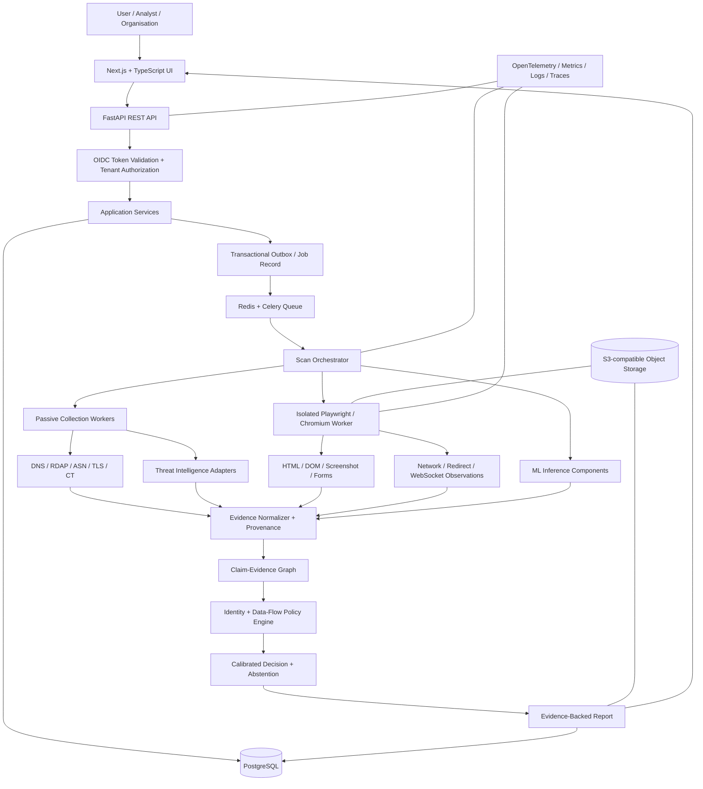
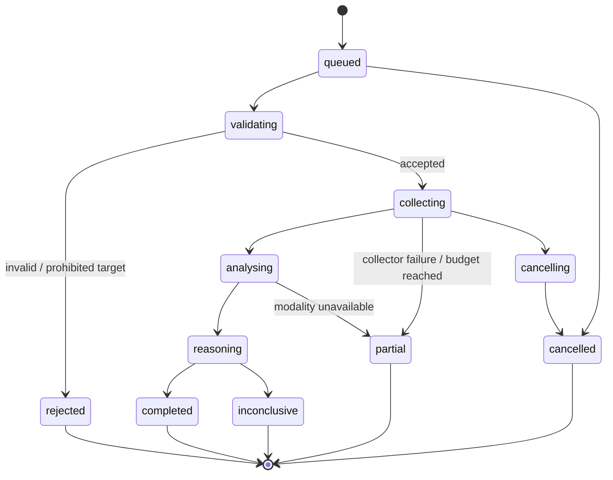
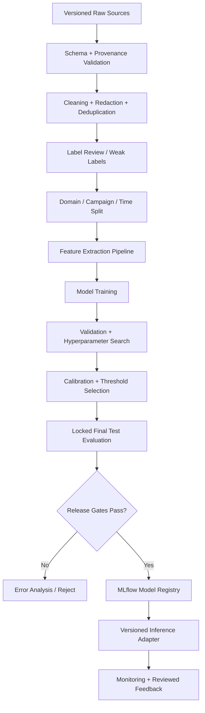
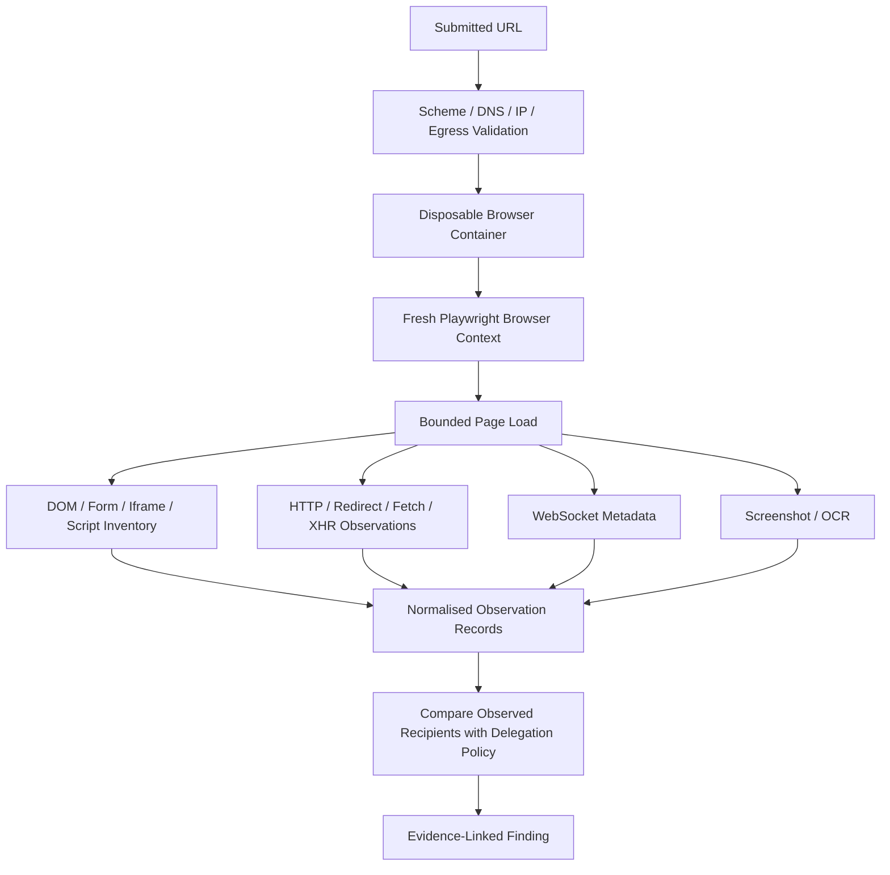

# TRUSTTRACE
## Complete Technical Build Specification
### Backend Engineering • Data Engineering • Machine Learning • Runtime Web Security • Graph Intelligence • MLOps

**Project:** AI-Powered Web Threat Detection & Digital Trust Intelligence  
**Working title:** TRUSTTRACE — Adaptive Web Identity and Runtime Trust Assurance  
**Document:** Consolidated technical architecture and implementation blueprint  
**Version:** 1.1  
**Prepared:** 9 November 2026  
**Status:** Proposed architecture and research plan; implementation and experimental results must be established separately.

---

# 0. How to use this specification

This document consolidates and expands the two supplied TRUSTTRACE research documents. It is intended to answer four engineering questions:

1. **What are we building?** The modules, data contracts, interfaces, models and security boundaries.
2. **How will it work?** The request lifecycle, collection pipeline, training workflow, inference path and reasoning logic.
3. **Which technologies will implement it?** The recommended stack, why each component is used, and what should be deferred.
4. **How will we prove it works?** Tests, baselines, metrics, ablations, security validation and reproducibility requirements.

The document separates:

- **Established engineering practice:** e.g. REST APIs, PostgreSQL, OAuth/OIDC, supervised classification, browser isolation and model calibration.
- **Engineering integration:** connecting collectors, browser observations, models and evidence into one platform.
- **Proposed research contribution:** organisational service delegation, synthetic sensitive-data-flow assurance and cost-aware adaptive investigation. These remain hypotheses until evaluated against prior work and baselines.

A technology is not a research contribution merely because it is included. TRUSTTRACE must demonstrate a measurable capability or improvement over simpler alternatives.

## 0.1 Research centre of gravity

The technical architecture must serve three primary research contributions:

**C1 — Organisational identity and service delegation.** Determine whether a website is authorised to represent the organisation it claims to represent, while distinguishing canonical domains, delegated login providers, payment processors and other third-party services.

**C2 — Runtime sensitive-data destination assurance.** Observe what a website does during controlled browser sessions and compare observed destinations with verified, purpose-scoped service delegations. Use synthetic canary values only in explicitly authorised test environments.

**C3 — Adaptive evidence acquisition.** Select the next safe investigation action based on expected decision improvement, cost, privacy impact and scanner risk. Support a defensible inconclusive/abstain outcome.

Supporting systems are a provenance-aware temporal Claim–Evidence Graph, multimodal phishing/impersonation detection, cross-script identity analysis and evidence-calibrated reporting.

---

# Part I — Product definition and end-to-end system behaviour

# 1. What TRUSTTRACE actually builds

TRUSTTRACE is not just a phishing classifier, a URL blacklist, an ML notebook or a dashboard. It is a web investigation platform that accepts a URL or domain, safely collects evidence, analyses identity and behaviour, evaluates data-flow policy, and returns an evidence-backed assessment.

## 1.1 Primary user journey

1. A user or analyst signs in.
2. They submit a URL and choose an analysis profile.
3. The backend validates the request, checks permissions and quotas, creates a scan resource and queues a job.
4. Passive collectors gather URL, DNS, RDAP, IP/ASN, TLS/X.509, Certificate Transparency and threat-intelligence observations.
5. A separate isolated browser worker renders the page within a strict security policy.
6. Static and rendered page analysis extracts text, DOM structure, forms, scripts, iframes, screenshot and network metadata.
7. Feature pipelines transform observations into structured model inputs.
8. ML components produce modality-specific predictions, anomaly signals and embeddings.
9. Identity verification and delegation-policy checks reason over organisational claims and service relationships.
10. The Claim–Evidence Graph correlates observations while preserving source, time, independence and contradiction.
11. The decision layer evaluates identity assurance, behavioural security, data-flow policy and evidence quality separately.
12. The report explains what was observed, what was not observed, which model version contributed, and why the system classified or abstained.
13. An analyst may review the case and submit adjudicated feedback. Feedback is not automatically trusted as a training label.

## 1.2 What the user receives

A report should not say only “Safe: 92/100”. It should provide separate outputs:

| Dimension | Example states | What it means |
|---|---|---|
| Identity assurance | `supported`, `unverified`, `contradicted`, `unknown`, `not_applicable` | Whether evidence supports the organisation/service identity claim |
| Behavioural security | `no_threat_observed`, `suspicious`, `malicious_evidence`, `unknown` | What risky behaviour was observed within the actual test scope |
| Data-flow assessment | `policy_consistent`, `policy_violation`, `destination_unverified`, `not_observed`, `not_applicable` | Whether observed destinations match an applicable delegation policy |
| Evidence quality | `strong`, `partial`, `weak`, `unavailable` | Freshness, completeness, provenance, independence and reliability |
| Decision | `likely_impersonation`, `suspicious`, `inconclusive`, etc. | A conservative policy result derived from the dimensions above |

`no_threat_observed` does not mean “safe”. `unverified` does not mean “malicious”. A valid TLS certificate does not prove organisational endorsement. A legitimate domain may be compromised. A legitimate service may use an external identity or payment provider.

## 1.3 Initial use cases

- URL/domain triage.
- Brand and organisational impersonation assessment.
- Suspicious login-form and payment-flow destination inspection.
- Passive infrastructure and certificate intelligence.
- Controlled browser rendering and page analysis.
- Time-aware monitoring of explicitly authorised domains.
- Analyst investigation with evidence lineage and correction workflow.

## 1.4 Explicit first-release boundaries

The first release is not a universal malware detector, exploit scanner, endpoint detection platform or legal-identity authority. It will not submit genuine passwords, OTPs, payment data or personal data to suspicious websites. It will not perform intrusive tests on arbitrary public targets. It will not automatically declare a new domain malicious, infer guilt from shared hosting, or claim complete browser-wide taint analysis from ordinary network logs.

---

# Part II — Architecture and technology decisions

# 2. Recommended architecture: modular monolith + isolated workers

Start with a modular monolith for the API and business logic, plus separate processes/containers for background jobs and browser execution. This preserves clear module boundaries without forcing the team to operate a distributed microservice estate prematurely.



## 2.1 Why not microservices immediately?

Microservices introduce independent deployment, network failure, service authentication, schema evolution, retries, tracing, version compatibility and operational overhead. A research prototype needs reliable experimental iteration more than service count.

Split a module into an independently deployed service only when there is a measured reason:

- Browser workers require a stronger isolation boundary and independent scaling.
- Model inference requires GPU-specific machines or a separate release cadence.
- A collector needs a different egress policy or secret boundary.
- A queue or worker pool must scale independently.
- Ownership and deployment responsibilities genuinely differ.

The browser worker is separate from day one because it visits untrusted content. That is a security boundary, not simply a microservice preference.

# 3. Technology stack — final recommendation

| Layer | Primary technology | Purpose | Defer / alternative |
|---|---|---|---|
| Frontend | Next.js, React, TypeScript | User interface, scan lifecycle, evidence, report and graph views | Plain React/Vite is also viable for a smaller UI |
| Styling/components | Tailwind CSS, accessible component primitives | Consistent interface and responsive layout | Do not let UI work delay core scanning |
| Backend language | Python | Security collectors, orchestration and ML integration | Keep frontend TypeScript separate |
| API framework | FastAPI | Typed HTTP API, dependency injection, request validation and OpenAPI | Django REST Framework if a full admin-heavy application becomes the priority |
| API schema | Pydantic | Request/response and internal data-contract validation | Never confuse Pydantic models with database tables |
| ORM / SQL layer | SQLAlchemy 2.x | Database access and explicit transactions | Use raw SQL for specialised queries when justified |
| Migrations | Alembic | Versioned schema evolution | Never manually edit production schema without a migration |
| Main database | PostgreSQL | Users, tenants, scans, observations, evidence, findings and audit events | Do not start with multiple databases |
| Cache / broker | Redis | Rate-limit counters, short-lived cache, queue broker and progress hints | RabbitMQ if broker semantics/throughput later require it |
| Background tasks | Celery | Asynchronous collection, browser jobs, model inference and report tasks | RQ is a simpler alternative; select one queue framework |
| Browser automation | Playwright + Chromium | Controlled rendering and network observation | Browser version must be pinned and recorded |
| Static HTML parsing | BeautifulSoup + lxml or Selectolax | DOM, text, forms and resource extraction | Benchmark parser throughput before switching |
| URL / IDN | Python URL parsing, `idna`, Public Suffix List library | Canonical parsing, IDNA and registrable-domain logic | Do not hand-roll the Public Suffix List |
| DNS | dnspython | DNS record observations | Record resolver and collection time |
| RDAP | HTTP adapter to RDAP services | Registration and lifecycle observations | Respect registry response limits and missing fields |
| TLS / X.509 | Python `ssl`, `cryptography`, OpenSSL | Certificate parsing and validation | Keep validation policy and trust-store version explicit |
| CT | Certificate Transparency source adapter | Certificate issuance history | Source-specific limits and coverage must be recorded |
| OCR / vision | OpenCV + PaddleOCR or evaluated equivalent | Screenshot preprocessing, text extraction and visual features | Do not fine-tune vision models before the dataset supports it |
| Classical ML | scikit-learn, LightGBM, XGBoost | Baselines and tabular classification | Logistic regression and character n-grams first |
| Deep learning | PyTorch | ANN/MLP, CNN, Transformer and graph experiments | GPU is optional for initial baselines |
| Text models | Hugging Face Transformers | Text embedding and language-aware classifiers | Verify model license and provenance |
| Graph prototype | PostgreSQL edge tables + NetworkX | Typed relationship storage and graph analysis | Neo4j only if interactive traversals justify it |
| GNN framework | PyTorch Geometric | GCN, GraphSAGE, GAT, R-GCN and heterogeneous graph experiments | Later research layer, not MVP requirement |
| Explainability | SHAP + evidence-linked rules | Explain structured/tabular model contributions | Do not invent causal explanations from saliency maps |
| Data processing | Pandas or Polars, PyArrow, Parquet | ETL, feature tables and reproducible data artifacts | Use one primary dataframe library initially |
| Data quality | Pandera or Great Expectations | Schema and dataset checks | Add only checks the team will maintain |
| Data versioning | DVC + immutable manifests | Dataset and pipeline reproducibility | Git does not store every large dataset efficiently |
| Experiment tracking | MLflow | Run parameters, metrics, artifacts and model lineage | Use a local tracking store first |
| Containers | Docker + Compose | Repeatable runtime and local integration environment | Kubernetes later only if operationally necessary |
| Object storage | MinIO locally; S3-compatible storage later | Screenshots, bounded HTML, traces and model artifacts | Keep object blobs outside relational rows |
| Testing | pytest, HTTPX, Hypothesis, Playwright, Schemathesis | Unit, integration, property, browser and API-fuzz tests | Security tests are mandatory, not optional |
| Observability | OpenTelemetry, Prometheus, Grafana | Logs/metrics/traces and operational dashboards | Centralised log store can be added when needed |
| Packaging | `uv` or equivalent lockfile-based tool | Reproducible Python environments | Pin exact versions after compatibility tests |

**Architecture rule:** do not deploy Neo4j, Kubernetes, a GPU service, Kafka, a feature store, a vector database or an LLM agent just because they appear in modern architecture diagrams. Each adds cost and failure modes. Every later component needs a specific requirement and a measurable benefit.

---

# Part III — Backend engineering: concepts, contracts and implementation

# 4. Backend fundamentals

The backend is the server-side application that accepts requests, enforces policy, persists state, schedules work, calls collectors/models and returns results. The ML model is only one subsystem inside the backend-controlled workflow.

## 4.1 Core terminology

| Term | Technical meaning | TRUSTTRACE example |
|---|---|---|
| Client | Software initiating a request | Browser UI, CLI or approved integration |
| Server | Software receiving and processing requests | FastAPI application |
| Frontend | Presentation and interaction layer | Next.js application |
| Backend | Server-side application and business logic | API, services, repositories and workers |
| API | Contract through which components communicate | Public REST API and internal interfaces |
| Endpoint | HTTP method + route | `POST /api/v1/scans` |
| HTTP | Application-layer request/response protocol | Transport for API calls and web content |
| REST | Architectural style based on resources and uniform interface semantics | Scan, report, organisation and evidence resources |
| CRUD | Create, Read, Update, Delete | Scan records, organisations, saved domains, manifests and feedback |
| JSON | Structured text data interchange | API payloads and observation schemas |
| Schema | Formal description of allowed structure and constraints | Pydantic schemas and database constraints |
| Middleware | Logic executed around request handling | Request ID, logging, CORS and security headers |
| Dependency injection | Framework supplies required objects to a handler | Current user, DB session, service and settings |
| ORM | Object-relational mapping between code objects and SQL tables | SQLAlchemy |
| Migration | Versioned change to database schema | Alembic revision |
| Transaction | Atomic group of database operations | Persist scan + audit record + outbox event |
| Cache | Temporary reusable data with expiry policy | DNS/RDAP response cache |
| Queue / broker | Coordinates asynchronous task delivery | Redis broker for Celery |
| Worker | Background process consuming jobs | Browser scan or passive collection worker |
| Idempotency | Repeating an operation has no unintended duplicate effect | Retried scan-creation request does not queue a second scan |
| Concurrency | Multiple tasks execute at overlapping times | Parallel DNS, RDAP and TLS collectors |
| Rate limiting | Bounds request volume | Per-user, tenant and IP scan limits |
| Pagination | Splits large results into manageable pages | Evidence timeline pagination |
| Observability | Ability to understand runtime behaviour | Logs, metrics and distributed traces |
| BOLA | Broken Object Level Authorization | User guesses another tenant's scan ID and reads its report |

## 4.2 Request-response lifecycle

A normal API request travels through the following sequence:

1. Reverse proxy/TLS termination receives the HTTPS request.
2. Middleware assigns or validates a request/correlation ID.
3. Authentication dependency validates the access token.
4. Authorisation checks role, scope, tenant and object ownership.
5. Pydantic validates the incoming request body and path/query parameters.
6. Route handler calls an application service.
7. Application service enforces domain rules and opens a database transaction.
8. Repository/SQLAlchemy layer reads or writes PostgreSQL.
9. The service returns a typed response object.
10. FastAPI serialises the response and emits the HTTP status code.
11. Logs and traces record execution metadata without secrets.

The route should remain thin. URL safety policy, scan lifecycle rules and job orchestration belong in application/domain services, not in a 300-line route function.

# 5. HTTP, REST and CRUD

## 5.1 HTTP request anatomy

An HTTP request has a method, request target, headers and an optional body.

```http
POST /api/v1/scans HTTP/1.1
Host: api.trusttrace.example
Authorization: Bearer <access-token>
Content-Type: application/json
Idempotency-Key: 8b4e...unique-key

{
  "url": "https://example.org/login",
  "analysis_profile": "standard",
  "requested_modules": ["url", "dns", "tls", "html"]
}
```

- **Method:** what operation is requested.
- **Path:** which resource is targeted.
- **Headers:** metadata such as content type, auth, caching and request correlation.
- **Body:** structured input data, often JSON.
- **Response status:** whether the operation succeeded, failed or was accepted for asynchronous processing.

## 5.2 REST methods and semantics

| Method | Main semantics | TRUSTTRACE use | Important detail |
|---|---|---|---|
| GET | Read a resource; safe and idempotent | `GET /scans/{id}` | Must not create a scan or mutate state |
| POST | Submit a command or create a resource | `POST /scans` | Not inherently idempotent; use an idempotency key for expensive creation |
| PUT | Replace a resource representation | `PUT /organisations/{id}/manifest` | Use for a complete manifest revision |
| PATCH | Partially update a resource | `PATCH /organisations/{id}` | Define patch semantics precisely |
| DELETE | Remove or deactivate a resource | `DELETE /saved-domains/{id}` | Respect retention, audit and soft-delete policy |
| HEAD | Get headers without representation body | Cache/health metadata | Optional |
| OPTIONS | Discover supported methods / CORS preflight | Browser API integration | Not a business operation |

CRUD maps to HTTP approximately, not mechanically:

- Create a scan: `POST /scans`.
- Read a scan: `GET /scans/{scan_id}`.
- Update organisation metadata: `PATCH /organisations/{org_id}`.
- Replace a signed manifest revision: `PUT /organisations/{org_id}/manifest`.
- Delete a saved domain: `DELETE /saved-domains/{domain_id}`.

Do not use `GET` to trigger a scan, revoke a manifest or create feedback. Automated clients, caches and prefetchers may issue GET requests without a user intending a state change.

## 5.3 HTTP status codes

| Code | Meaning | Example |
|---|---|---|
| 200 | Success | Return scan details |
| 201 | Created | Organisation created |
| 202 | Accepted | Scan queued for asynchronous processing |
| 204 | Success, no response body | Saved-domain deletion completed |
| 400 | Malformed request | Invalid JSON syntax |
| 401 | Authentication missing/invalid | Expired or invalid access token |
| 403 | Authenticated but forbidden | User does not have analyst permission |
| 404 | Resource unavailable/not found | Scan does not exist or is intentionally hidden from another tenant |
| 409 | Conflict | Manifest revision conflict or invalid state transition |
| 413 | Payload too large | Uploaded artefact exceeds maximum size |
| 422 | Valid syntax but invalid field semantics | Unsupported URL scheme or invalid analysis profile |
| 429 | Rate/quota exceeded | Tenant reached scan quota |
| 500 | Unexpected server failure | Unhandled internal error |
| 502 / 503 / 504 | Upstream failure, unavailable service or timeout | RDAP provider or browser worker unavailable |

Never expose raw stack traces, tokens, private IP details, secrets or upstream response bodies to an ordinary API client.

## 5.4 API versioning and pagination

Use `/api/v1` as the public contract prefix. Treat response fields and meanings as versioned contracts. Use cursor pagination for scan history and evidence timelines:

```http
GET /api/v1/scans?limit=50&cursor=<opaque-cursor>&status=completed&sort=-created_at
```

Return a stable envelope:

```json
{
  "items": [],
  "next_cursor": null,
  "has_more": false
}
```

Do not fetch all observations in a single unbounded response.

# 6. Proposed TRUSTTRACE API surface

All routes below are proposed contracts, not claims of implemented endpoints. Every resource access must check tenant and object-level permissions.

## 6.1 Scan lifecycle endpoints

| Method | Endpoint | Function |
|---|---|---|
| POST | `/api/v1/scans` | Create and queue a scan |
| GET | `/api/v1/scans` | List scans visible to current tenant |
| GET | `/api/v1/scans/{scan_id}` | Read status, summary and timestamps |
| POST | `/api/v1/scans/{scan_id}/cancel` | Request cancellation |
| GET | `/api/v1/scans/{scan_id}/report` | Retrieve final report |
| GET | `/api/v1/scans/{scan_id}/evidence` | Retrieve evidence with cursor pagination |
| GET | `/api/v1/scans/{scan_id}/findings` | Retrieve structured findings |
| GET | `/api/v1/scans/{scan_id}/graph` | Retrieve bounded graph subgraph |
| GET | `/api/v1/scans/{scan_id}/events` | Stream progress using SSE or WebSocket |

## 6.2 Organisation and identity endpoints

| Method | Endpoint | Function |
|---|---|---|
| POST | `/api/v1/organisations` | Create organisation workspace record |
| GET | `/api/v1/organisations/{org_id}` | Read organisation |
| PATCH | `/api/v1/organisations/{org_id}` | Update non-cryptographic metadata |
| POST | `/api/v1/organisations/{org_id}/domains` | Add a candidate/claimed domain |
| GET | `/api/v1/organisations/{org_id}/domains` | List domain claims and verification states |
| PUT | `/api/v1/organisations/{org_id}/manifest` | Publish a signed manifest revision |
| GET | `/api/v1/organisations/{org_id}/manifest` | Read current manifest and status |
| POST | `/api/v1/organisations/{org_id}/manifest/verify` | Trigger verification workflow |
| POST | `/api/v1/organisations/{org_id}/manifest/revoke` | Revoke or supersede an existing revision |

## 6.3 Analyst, audit and platform endpoints

| Method | Endpoint | Function |
|---|---|---|
| POST | `/api/v1/scans/{scan_id}/feedback` | Submit label, evidence and rationale |
| GET | `/api/v1/feedback` | Review feedback in permitted scope |
| POST | `/api/v1/reports/{report_id}/appeals` | Request correction/review |
| GET | `/api/v1/audit-events` | Read permitted audit history |
| GET | `/api/v1/system/health` | Health and readiness checks |
| GET | `/api/v1/system/model-versions` | Report active model metadata |

## 6.4 Scan creation contract

Request:

```json
{
  "url": "https://example.org/login",
  "analysis_profile": "standard",
  "requested_modules": ["url", "dns", "rdap", "tls", "html", "screenshot"],
  "purpose": "user_submitted_url_check",
  "consent": {
    "allow_third_party_reputation_lookup": false,
    "allow_browser_rendering": true
  }
}
```

Response:

```http
HTTP/1.1 202 Accepted
Content-Type: application/json
```

```json
{
  "scan_id": "scn_01JABC...",
  "status": "queued",
  "created_at": "2026-11-09T10:00:00Z",
  "status_url": "/api/v1/scans/scn_01JABC..."
}
```

A scan is an asynchronous job. The HTTP request should return quickly; the UI polls or subscribes for status. The API should report observed progress, not promise a speculative fixed completion time.

## 6.5 API error envelope

Use a stable, machine-readable error response:

```json
{
  "error": {
    "code": "TARGET_NOT_ALLOWED",
    "message": "The submitted target is not eligible for scanning.",
    "request_id": "req_01J...",
    "details": []
  }
}
```

The public message must not reveal internal network topology or private target addresses.

# 7. FastAPI application design

## 7.1 Internal layers

Recommended request path:

```text
HTTP Router
  -> Pydantic Request Schema
  -> Authentication / Authorization Dependencies
  -> Application Service
  -> Domain Policy / Validation
  -> Repository (SQLAlchemy)
  -> PostgreSQL Transaction
  -> Outbox / Queue Publisher
  -> Typed Response Schema
```

- **Router:** maps method and path to a function.
- **Schema:** validates input and shapes output.
- **Dependency:** supplies current user, DB session, configuration and service.
- **Application service:** orchestrates a use case such as creating a scan.
- **Domain service:** applies business/security rules independent of HTTP.
- **Repository:** encapsulates persistence operations.
- **Unit of work:** groups database writes into one transaction.

## 7.2 Illustrative FastAPI pattern

This is a minimal architectural example. Authentication dependency, tenant policy, URL safety validation, quota logic, transaction/outbox implementation and exception mapping must be real implementations before deployment.

```python
from typing import Literal
from uuid import UUID
from datetime import datetime

from fastapi import APIRouter, Depends, status
from pydantic import BaseModel, ConfigDict, Field, HttpUrl

router = APIRouter(prefix="/api/v1/scans", tags=["scans"])

AnalysisModule = Literal[
    "url", "dns", "rdap", "tls", "ct", "html", "screenshot", "behaviour"
]

class ScanCreateRequest(BaseModel):
    model_config = ConfigDict(extra="forbid")
    url: HttpUrl
    analysis_profile: Literal["quick", "standard", "deep"] = "standard"
    requested_modules: list[AnalysisModule] = Field(
        default_factory=lambda: ["url", "dns", "tls", "html"]
    )

class ScanAcceptedResponse(BaseModel):
    scan_id: UUID
    status: str
    status_url: str
    created_at: datetime

@router.post("", response_model=ScanAcceptedResponse,
             status_code=status.HTTP_202_ACCEPTED)
async def create_scan(
    request: ScanCreateRequest,
    current_user = Depends(...),       # real OIDC-backed identity dependency
    scan_service = Depends(...),       # application service dependency
):
    result = await scan_service.create_scan(
        tenant_id=current_user.tenant_id,
        submitted_by=current_user.id,
        request=request,
    )
    return ScanAcceptedResponse(
        scan_id=result.scan_id,
        status=result.status,
        status_url=f"/api/v1/scans/{result.scan_id}",
        created_at=result.created_at,
    )
```

Do not pass an arbitrary URL directly to a browser process simply because Pydantic accepted it as an `HttpUrl`. Syntax validation and safe network destination validation are different checks.

# 8. Authentication, authorization and account security

## 8.1 Three distinct concepts

- **Authentication (AuthN):** establishes who is making the request.
- **Authorization (AuthZ):** determines what that authenticated principal may do.
- **Accounting/auditing:** records who performed which action, on what resource and when.

They must not be collapsed into a single “auth” feature.

## 8.2 Recommended protocol: OpenID Connect + OAuth 2.0

Use a trusted external identity provider. For a browser-based application, use OpenID Connect (OIDC) with the Authorization Code Flow and PKCE.

- **OAuth 2.0** is an authorisation framework: it allows a client to obtain scoped access to a resource.
- **OpenID Connect** adds an identity layer: it allows the client to establish an authenticated user identity.
- **Authorization Code Flow** returns a short-lived code that is exchanged for tokens.
- **PKCE** binds the authorisation-code exchange to the initiating client so an intercepted code is harder to redeem.
- **Access token** is presented to the API to authorise a request.
- **ID token** communicates authentication claims to the client; it is not a generic API bearer token.
- **Refresh token** obtains a new access token under controlled policy.

Do not invent a password or login protocol. Validate the provider's issuer, audience, expiry, not-before time, signature, key ID/JWKS rotation and allowed algorithms.

## 8.3 JWT details

A JSON Web Token commonly contains claims such as:

| Claim | Meaning | Server validation |
|---|---|---|
| `iss` | Issuer | Exact trusted identity provider |
| `sub` | Subject | Stable user identity key |
| `aud` | Audience | Must identify this API/resource server |
| `exp` | Expiration | Reject expired token |
| `nbf` | Not valid before | Reject too-early token |
| `iat` | Issued at | Check plausible issuance time |
| `jti` | Token identifier | Optional replay/revocation correlation |
| `scope` | Granted permissions | Enforce least privilege |

A JWT is often signed, not encrypted. Base64-decoding it does not verify it. The server must cryptographically validate the signature and claims. Never accept an algorithm solely because the token requested it.

## 8.4 Browser session storage and CSRF

For a browser frontend, evaluate a Backend-for-Frontend (BFF) pattern where the server maintains the token/session and the browser holds a `Secure`, `HttpOnly`, `SameSite` cookie. If cookies authenticate state-changing requests, implement CSRF protection and origin policy. Avoid storing long-lived bearer tokens in browser local storage by default.

## 8.5 RBAC and ABAC

**RBAC — Role-Based Access Control:** permissions are grouped by role.

Suggested roles:

- `user`: create scans and view their tenant's permitted reports.
- `analyst`: review assigned cases and submit adjudicated feedback.
- `org_admin`: manage organisation members, domain claims and manifests.
- `platform_admin`: manage global configuration and platform operations.
- `service_worker`: machine identity with narrowly scoped internal permissions.

**ABAC — Attribute-Based Access Control:** access depends on attributes such as tenant, ownership, assignment, resource sensitivity, action and status.

Use RBAC for broad capabilities and ABAC/object checks for resource-level policy. A user with the `user` role must still not be able to read every scan. Every scan/report/evidence query must enforce tenant ownership or an explicitly authorised sharing relationship. This prevents BOLA.

## 8.6 API keys, service credentials and passwords

API keys are for approved integrations, not a substitute for user login. Store only a hash, show the secret once, scope it, rotate it and support revocation. Use workload identity or mutual TLS for higher-trust service-to-service communication where appropriate.

If local passwords are unavoidable, store Argon2id password hashes using a maintained library, enforce rate limits and MFA for privileged accounts, and never log passwords or reset tokens. Prefer OIDC for the first research release.

# 9. Database engineering: SQL, ORM, transactions and persistence

## 9.1 PostgreSQL is the source of truth

PostgreSQL stores durable system state. Redis is not the permanent evidence store. Object storage holds large binary artefacts; PostgreSQL holds their metadata, hashes, access controls and references.

Use relational columns and constraints for important invariants. Use JSONB only for selected variable provider payloads or extensible attributes—not as a substitute for a thought-through schema.

## 9.2 SQL and ORM terminology

- **Table:** collection of typed records.
- **Row:** one record.
- **Column:** typed attribute.
- **Primary key:** unique record identifier.
- **Foreign key:** referential relationship to another table.
- **Unique constraint:** prevents duplicate business identifiers.
- **Check constraint:** enforces a condition such as an allowed state.
- **Index:** accelerates selected query patterns at storage/write cost.
- **JOIN:** combines rows across related tables.
- **Transaction:** atomic commit/rollback boundary.
- **Isolation level:** defines how concurrent transactions observe data.
- **ORM:** maps application objects to relational structures.
- **Migration:** versioned schema change.

Use SQLAlchemy for normal application persistence and explicit SQL for complex/optimised queries when warranted. Pydantic validates API contracts; SQLAlchemy maps database objects. They serve different responsibilities.

## 9.3 Main relational entities

| Table | Main fields | Purpose |
|---|---|---|
| `users` | id, OIDC subject, email, status, created_at | Internal user mapping |
| `tenants` | id, name, status, created_at | Workspace/account security boundary |
| `memberships` | tenant_id, user_id, role, status | Tenant membership and role |
| `organisations` | id, canonical_name, jurisdiction, verification_state | Real-world identity subject under review |
| `domain_claims` | id, organisation_id, domain, claim_type, source, validity | Candidate/verified organisation-domain claims |
| `identity_manifests` | id, organisation_id, revision, hash, issuer_key_id, signature, validity, status | Signed declaration history |
| `scans` | id, tenant_id, submitted_by, URL fields, profile, status, timestamps | Investigation resource |
| `scan_jobs` | id, scan_id, task_type, state, attempt, lease, timestamps | Worker execution lifecycle |
| `observations` | id, scan_id, kind, source, observed_at, payload, hash | Immutable collected fact |
| `evidence` | id, subject, predicate, object, source_id, observed_at, validity, integrity_hash | Provenance-backed claim/evidence unit |
| `findings` | id, scan_id, category, severity, status, summary | Human-readable structured conclusion |
| `finding_evidence` | finding_id, evidence_id, relation | Supports/contradicts/context references |
| `predictions` | id, scan_id, model_version_id, task, score, class, output_json | Model outputs and lineage |
| `model_versions` | id, name, version, artifact_uri, dataset_version, metrics | Model registry mirror / inference metadata |
| `graph_nodes` | id, node_type, canonical_key, attributes | Optional graph persistence |
| `graph_edges` | id, src, edge_type, dst, valid_from, valid_to, evidence_id | Typed temporal graph relationships |
| `feedback` | id, scan_id, reviewer_id, label, rationale, adjudication_state | Human review workflow |
| `audit_events` | id, tenant_id, actor_id, action, resource, timestamp | Append-only audit record |
| `idempotency_keys` | tenant_id, key, request_hash, response_ref, expiry | Safe retry of scan creation |
| `outbox_events` | id, event_type, aggregate_id, payload, published_at | Reliable database-to-queue publication |

## 9.4 Transactional outbox pattern

A common failure occurs when the API commits a scan row but crashes before publishing the queue message. The scan remains stuck. The transactional outbox pattern resolves this class of inconsistency:

1. Begin one PostgreSQL transaction.
2. Insert the scan row.
3. Insert an audit event.
4. Insert an outbox event such as `scan.created`.
5. Commit.
6. A publisher process reads unpublished outbox rows and publishes queue messages.
7. The publisher marks the event published after successful delivery.
8. Workers process the message idempotently.

This is not exactly-once delivery. Design for at-least-once delivery and deduplicate worker effects.

## 9.5 Indexes and retention

Index the fields used in common access paths: `tenant_id`, `created_at`, `status`, `scan_id`, `observed_at`, `domain`, model version and foreign keys. Use composite indexes based on actual query plans. Add retention policies for raw URLs, screenshots and HTML because they can contain tokens or personal information. Retention must preserve required audit and research provenance without retaining unnecessary secrets.

# 10. Background jobs, Redis and worker orchestration

A browser scan can take longer than an ordinary HTTP request. Heavy work belongs in asynchronous jobs.

## 10.1 Job types

- `validate_target`
- `collect_url_features`
- `collect_dns`
- `collect_rdap`
- `collect_tls`
- `collect_ct`
- `query_reputation`
- `render_browser`
- `extract_static_content`
- `extract_visual_features`
- `inspect_runtime_network`
- `run_model_inference`
- `update_claim_evidence_graph`
- `evaluate_policy`
- `generate_report`

A job has a stable identifier, scan ID, tenant ID, type, input reference, attempt count, deadline, budget and state.

## 10.2 Celery and Redis responsibilities

- Celery schedules and executes background work.
- Redis acts as broker/cache/progress transport in the initial deployment.
- PostgreSQL remains the authoritative record of scan/job state and evidence.
- Object storage holds large screenshots and capture artefacts.

## 10.3 Queue reliability concepts

| Term | Meaning | TRUSTTRACE rule |
|---|---|---|
| Retry | Re-attempt after transient failure | Bounded attempts, exponential backoff and jitter |
| Dead-letter queue | Quarantine repeatedly failing work | Preserve failure metadata for inspection |
| Timeout | Maximum allowed execution time | Every network/browser operation needs one |
| Idempotent task | Duplicate delivery has no duplicate effect | Deterministic observation keys and unique constraints |
| Lease / visibility timeout | Period during which a worker owns a task | Reclaim tasks from dead workers |
| Concurrency limit | Bounds simultaneous execution | Protect browser CPU and memory |
| Circuit breaker | Temporarily stop calls to failing provider | Prevent repeated provider overload |
| Backpressure | Slow/reject work when saturated | Avoid unbounded queue growth |
| Priority | Relative scheduling importance | Interactive user scans may outrank bulk monitoring |

## 10.4 Scan state machine



Do not confuse `partial` with `failed`. If DNS, TLS and HTML succeeded but one provider timed out, preserve the available evidence and report incomplete coverage.

---

# Part IV — Data engineering and dataset construction

# 11. Data acquisition: what data is required and where it comes from

The quality and provenance of the data will constrain the project more than the sophistication of the neural architecture. Establish a source registry before building large ingestion jobs.

## 11.1 Data source categories

| Category | Candidate sources / mechanism | Data acquired | Critical caveat |
|---|---|---|---|
| Phishing URLs/pages | PhishTank, OpenPhish, PhreshPhish, curated feeds | URL, label, timestamp, sometimes HTML | Terms, freshness, coverage and label semantics differ |
| Malware URLs | URLhaus | URL and malware-delivery classification | Malware delivery is not identical to phishing |
| Candidate benign domains | Tranco, verified official-domain list, curated benign sites | Candidate benign domain and page | Popularity is not proof of legitimacy |
| Public web content | Common Crawl or permitted controlled crawling | HTML, text and structural artefacts | Licensing, robots, privacy and page age matter |
| Registration data | RDAP | Registrar/status/date/name-server fields where available | Privacy-redacted or incomplete records are normal |
| DNS | Public/authoritative resolvers | A, AAAA, CNAME, MX, NS, TXT, SOA and TTL | Time and resolver dependent |
| IP/ASN | RIR/RPKI/routing metadata | Address prefix, ASN and network context | Shared cloud/CDN infrastructure is common |
| TLS and certificates | Direct handshake, X.509 chain, CT logs | SAN, issuer, validity, key and issuance history | A valid certificate does not prove brand endorsement |
| Web content | Controlled browser and static fetch | DOM, form, script, iframe, screenshot and redirect metadata | Public page changes and may target scanners differently |
| Controlled lab | Synthetic authorised websites and phishing simulations | Exact labels and known data-flow ground truth | Keep separate from uncontrolled public-web data |
| Analyst review | Expert or adjudicated feedback | Label, rationale, evidence and disagreement | User reports can be false or poisoned |

## 11.2 Collection modes

1. **Snapshot collection:** one scan of a submitted target.
2. **Scheduled monitoring:** repeat observations for an explicitly authorised domain.
3. **Feed ingestion:** periodic pull or controlled receipt of third-party indicators.
4. **Research corpus construction:** documented, approved collection for model training/evaluation.
5. **Controlled adversarial test:** synthetic or owned test pages with known ground truth.

Production telemetry, third-party public datasets and controlled attacks must remain logically separated. They have different legal, privacy, label-quality and generalisation properties.

## 11.3 Source registry

For every provider, record:

- provider and endpoint;
- terms and permitted use;
- commercial/non-commercial restriction if applicable;
- attribution requirements;
- redistribution rights;
- API quota/rate limit;
- update frequency and data age;
- data fields and semantics;
- collection timestamp and provider timestamp;
- availability/failure behaviour;
- confidence and known bias;
- retention and deletion requirements.

A blacklist match is one evidence item. A non-match is not evidence that the site is benign.

# 12. Data pipeline: raw → normalized → curated → features

Use a layered, reproducible pipeline. The point is not the name “medallion architecture”; it is preserving raw evidence and making every derived dataset reproducible.

```mermaid
flowchart LR
    SRC[Feeds / DNS / RDAP / TLS / Browser / Analyst] --> RAW[RAW / BRONZE]
    RAW --> VALID[Validation + Parsing]
    VALID --> NORM[NORMALIZED / SILVER]
    NORM --> CLEAN[Redaction + Deduplication + Label Review]
    CLEAN --> CURATED[CURATED / GOLD]
    CURATED --> FEAT[Feature Tables / Embeddings]
    FEAT --> SPLIT[Leakage-Audited Splits]
    SPLIT --> TRAIN[Training + Validation]
    TRAIN --> CAL[Calibration + Evaluation]
    CAL --> REG[Model Registry]
```



## 12.1 RAW / BRONZE layer

Store original permitted source records, raw provider responses, response hashes, collection method, collector version and timestamps. Preserve raw inputs separately from derived transformations. Do not overwrite the original artefact when a cleaning rule changes.

Raw records may contain sensitive query parameters, tokens, personal data or page content. Keep the raw layer encrypted, access-controlled and subject to retention limits. General-purpose analysts and model training should use redacted/derived data by default.

## 12.2 NORMALIZED / SILVER layer

Normalize representation without destroying security-relevant information:

- timestamps to UTC, retaining original timezone if known;
- domain names to explicit ASCII/IDNA and Unicode representations;
- IP addresses to canonical forms;
- URL into scheme, host, port, path and query components;
- registrable domain/eTLD+1 using a maintained Public Suffix List;
- certificate serial numbers and fingerprints;
- provider IDs to internal source IDs;
- labels to a documented taxonomy;
- missing values to explicit null/reason codes.

Do not over-normalize URLs. Paths and query parameters can contain malicious indicators or unique tokens. Maintain a protected raw representation and a safe, redacted model/display representation.

## 12.3 CURATED / GOLD layer

This layer contains quality-checked, deduplicated, labelled records ready for training and evaluation. Each row must have a stable sample ID, source lineage, timestamp, label status, label confidence, split group and feature schema version.

## 12.4 Data cleaning protocol

1. Validate record structure and required fields.
2. Record malformed URL/HTML cases with a reason; do not silently discard them.
3. Detect corrupt/empty HTML and MIME-type mismatch.
4. Redact passwords, cookies, session IDs, reset tokens, API keys and personal data.
5. Normalize text encoding and HTML entities.
6. Remove boilerplate only in derived features; preserve original raw content when lawful.
7. Treat missing values as missing, not as zero.
8. Detect duplicates and near-duplicates.
9. verify label provenance and conflicts.
10. Generate a quality report before every training run.

## 12.5 Deduplication and split leakage

Deduplicate at multiple levels:

- exact raw URL hash;
- canonical redacted URL hash;
- registrable domain grouping;
- HTML content hash;
- DOM structure fingerprint;
- screenshot perceptual hash or embedding-neighbour review;
- URL path/template similarity;
- campaign/source grouping.

The same phishing kit or domain template must not leak across training and test partitions and inflate performance. A random row-level split may be reported for comparison, but it must not be the headline generalisation result.

Required evaluation splits:

- domain-disjoint;
- campaign-disjoint;
- organisation-disjoint;
- chronological/time-disjoint;
- cross-script/language where feasible;
- controlled lab split with exact data-flow ground truth;
- low-prevalence test set.

Store sample IDs and split assignments in versioned manifests.

# 13. Labels, ground truth and annotation quality

## 13.1 Do not force all samples into benign/phishing

Recommended label states:

- `confirmed_phishing`
- `confirmed_malware_delivery`
- `confirmed_brand_impersonation`
- `compromised_legitimate_site`
- `verified_legitimate`
- `suspicious_unconfirmed`
- `unknown_or_unlabelled`
- `unavailable_or_inaccessible`

These labels describe evidence and review status. Do not make unsupported claims about the attacker's intent.

## 13.2 Ground truth vs weak labels

- **Ground truth:** high-confidence label established by controlled ground truth or documented expert adjudication.
- **Weak label:** derived from threat feeds, heuristics or noisy sources.
- **Unknown/unlabelled:** no defensible class is currently available.
- **Adjudicated set:** a double-reviewed evaluation subset used to assess label quality.

The absence of a URL from a threat feed does not make it a verified benign sample.

## 13.3 Label provenance schema

Store:

- label and taxonomy version;
- label source/provider;
- source timestamp and retrieval timestamp;
- reviewer and reviewer role;
- rationale and evidence IDs;
- confidence/quality class;
- disagreement/adjudication history;
- expiry or revalidation policy.

Use Cohen's kappa for two annotators or Fleiss' kappa for multiple annotators where the study design fits. Report disagreement rather than hiding it.

## 13.4 Quality gates for a dataset release

- sample counts per class, source and time period;
- missingness by modality;
- exact/near-duplicate rate;
- duplicate cluster size;
- campaign/domain/organisation overlap by split;
- class prevalence;
- label-source and confidence distribution;
- provider licence/use permission status;
- corrupted sample count;
- privacy-redaction count;
- data hash and dataset version;
- collection and preprocessing code version.

Do not train on a dataset release until source permissions and split audits pass.

# 14. Data engineering technologies

| Tool | Role |
|---|---|
| Pandas | Exploratory analysis and small/medium tabular processing |
| Polars | Efficient columnar ETL at larger local-data scale |
| PyArrow | Typed columnar interchange and Parquet operations |
| Parquet | Compressed, columnar, versionable feature datasets |
| Hugging Face Datasets | Streaming/loading large ML corpora and mapped transforms |
| BeautifulSoup/lxml/Selectolax | HTML extraction and parsing |
| Pydantic | Runtime validation of data contracts |
| Pandera / Great Expectations | Dataset schema and quality assertions |
| DVC | Versioned data references and pipeline reproducibility |

Choose Pandas or Polars as the default dataframe workflow; do not build duplicate transformation stacks without a throughput need.

---

# Part V — Feature engineering and modality extraction

# 15. What information should be extracted from a website?

Each modality becomes an evidence package and a versioned feature vector/embedding. Features should retain lineage to source observation IDs.

## 15.1 URL and lexical features

Potential features:

- URL length, hostname length, path length and query length;
- number of hostname labels and subdomain depth;
- digits, hyphens, unusual separators and percent-encoding ratio;
- suspicious tokens and path patterns;
- use of IP literal or unusual port;
- userinfo component presence;
- path/query entropy;
- character n-grams;
- IDNA/Punycode status;
- mixed-script indicators and Unicode confusable similarity;
- organisation/brand string similarity.

Do not treat a long URL, hyphenated domain, Punycode label or non-Latin script as proof of abuse. These are candidate signals requiring context.

## 15.2 Domain and infrastructure features

- RDAP creation/update/expiry timestamps where available;
- registrar and nameserver patterns;
- DNS record set and TTL distribution;
- A/AAAA/CNAME changes across time;
- IP and ASN context;
- number of domains sharing IP/ASN, with generic infrastructure treated cautiously;
- certificate SAN count and overlap;
- issuer, validity, key and signature metadata;
- CT first-seen and issuance timeline;
- reputation source result and source timestamp;
- domain/infrastructure change frequency.

A new domain is not automatically malicious. Shared cloud/CDN infrastructure is not evidence of common ownership or campaign membership.

## 15.3 HTML and DOM features

- page title and visible text;
- language and charset;
- password/email/OTP input presence;
- form action, method and field names (never capture real field values);
- iframe origins;
- script count, hashes and origin diversity;
- external resource origins;
- hidden elements and suspicious overlays;
- link text vs destination consistency;
- favicon/logo source;
- DOM tree depth, node counts and structural fingerprints;
- authentication/payment wording and claimed organisation identity.

## 15.4 Visual and OCR features

- OCR text and detected language/script;
- logo/object region candidates;
- screenshot perceptual hash;
- layout and region embeddings;
- visual similarity to verified brand reference material;
- screenshot-to-text consistency;
- image and page region features.

Visual similarity is evidence of resemblance, not proof of maliciousness. Common templates and legitimate embedded content can create similarity.

## 15.5 Runtime behavioural features

- navigation and redirect chain;
- form destination origin and method;
- fetch/XHR request destinations;
- script and iframe relationships;
- network request/response metadata;
- WebSocket destination metadata;
- download event and MIME metadata;
- popup/permission prompt metadata;
- cookie/storage event metadata where privacy policy permits;
- page changes across browser contexts;
- synthetic canary match in controlled outgoing requests.

## 15.6 Identity/delegation features

- claimed organisation and claimed service purpose;
- canonical domain status;
- manifest signature and issuer status;
- delegation scope, purpose and data-category match;
- delegation validity interval;
- revocation/status result;
- key rotation history;
- domain-control evidence vs organisation endorsement evidence;
- independent corroborating sources.

## 15.7 Temporal and graph features

- domain age and time since first observed;
- rate of DNS/certificate/script changes;
- evidence freshness;
- time gap between observations;
- typed neighbourhood counts;
- relation paths between claimed organisation and service endpoint;
- provenance source-dependency groups;
- rare subgraph/edge patterns.

Graph features must account for high-degree infrastructure nodes. A CDN, registrar, CA or cloud provider shared by thousands of domains must not propagate guilt by association.

---

# Part VI — Machine learning: paradigms and algorithms

# 16. ML task decomposition

Do not start by training one model to output a universal `safe` or `malicious` label. Split the tasks so each model has a precise input, target and output.

| Task | Input | Output | Initial method |
|---|---|---|---|
| URL risk classification | URL/domain features | Risk score/class | Logistic regression, character n-gram linear model, LightGBM |
| Page/intent classification | DOM/text features | Login/credential-harvesting/brand claim indicators | TF-IDF + linear model; later Transformer |
| Visual brand similarity | Screenshot and reference assets | Similarity/possible impersonation signal | Pretrained image embeddings + similarity model |
| Infrastructure anomaly | DNS/TLS/RDAP/time features | Anomaly score | Isolation Forest or statistical baseline |
| Runtime behaviour classification | Redirect/form/network metadata | Suspicious behaviour categories | Rules + supervised tabular model |
| Evidence/identity policy | Claims, signed manifests, delegation and provenance | Supported/unverified/contradicted | Deterministic verification and explicit rules first |
| Multimodal fusion | Modality outputs/embeddings/reliability | Combined behavioural-risk estimate | Logistic/LightGBM fusion baseline; later gated fusion neural net |
| Adaptive action selection | Current evidence, budget and uncertainty | Next investigation action or stop | Greedy value-of-information; later contextual bandit |

The identity manifest verifier and data-flow policy evaluator are not purely ML problems. Cryptographic validation and policy rules should be deterministic. ML may rank or detect patterns, but it must not replace signature validation or policy enforcement.

# 17. Learning paradigms: what each means and where it belongs

| Paradigm | Training signal | TRUSTTRACE use | Main risk |
|---|---|---|---|
| Supervised learning | Labelled `(x, y)` examples | Initial phishing/impersonation/behaviour classifiers | Noisy, delayed and biased labels |
| Unsupervised learning | No target labels | Anomaly signals for unusual infrastructure or site behaviour | Unusual does not equal malicious |
| Semi-supervised learning | Few labels plus many unlabelled samples | Exploit a large unlabeled page corpus with a smaller adjudicated set | Pseudo-label feedback loops |
| Self-supervised learning | Pretext task generated from raw data | Learn URL/page representations without manual labels for each record | Pretext task may not improve security objective |
| Weak supervision | Heuristic/program-generated labels | Combine feeds, organisation lists and rule-based labellers | Sources can conflict or be correlated |
| Positive–unlabelled learning | Positives plus an unlabeled pool | Known phishing positives vs unknown web observations | Positive sampling assumptions may be violated |
| Transfer learning | Pretrained model adapted to a target task | Multilingual text/vision encoders | Model licence and domain shift |
| Active learning | Model prioritises samples for human labelling | Analyst queues high-uncertainty/high-impact cases | Selection bias |
| Online learning | Sequential updates | Drift-aware adaptation after verified labels | Poisoning and catastrophic forgetting |
| Reinforcement learning / bandits | Reward from sequential decisions | Select the next evidence-gathering action | Reward and safe-exploration design |

**Recommended use:** supervised learning for initial classification; unsupervised detection as contextual evidence; weak/PU learning for incomplete labels; active learning for expert annotation; bandit/value-of-information methods for investigation scheduling. Deep reinforcement learning is not the starting point.

# 18. Supervised learning in detail

## 18.1 Binary, multiclass and multilabel formulation

- **Binary classification:** e.g. confirmed phishing vs verified legitimate. Useful for a tightly defined benchmark only.
- **Multiclass classification:** e.g. phishing, malware delivery, compromised legitimate, verified legitimate, unknown.
- **Multilabel classification:** a page may simultaneously be brand-impersonating, credential-collecting and redirecting to a suspicious endpoint.
- **Multi-task learning:** shared representation with separate heads for identity claim, page intent, credential form and behaviour categories.

The taxonomy must distinguish `unknown` from benign and malicious. In many cases, `unknown` is an annotation/coverage state, not a semantic class that should be learned as if it were an attack type.

## 18.2 Training examples

For a supervised sample:

- `x`: input features or modality representation;
- `y`: reviewed label;
- `w`: optional sample/label confidence weight;
- `g`: grouping key (domain, campaign, organisation);
- `t`: observation time;
- `source`: provenance.

A sample is not just `(URL, label)`. It must include source and grouping metadata to prevent leakage.

## 18.3 Classical ML baseline ladder

Build in this order:

1. Majority-class baseline.
2. Simple deterministic rules and reputation-only baseline.
3. Logistic Regression.
4. TF-IDF character n-gram + Linear SVM for URL/text strings.
5. Decision Tree for an inspectable rule-like baseline.
6. Random Forest.
7. LightGBM or XGBoost for tabular features.
8. Modality-specific deep learning.
9. Multimodal fusion.
10. Graph-aware model, only if simple baselines leave a clear gap.

### Logistic Regression

A linear model that estimates class probability from a weighted feature combination. Useful as an interpretable baseline and often surprisingly competitive with character n-grams.

### Decision Tree

A tree partitions feature space through rules such as `if feature <= threshold`. It is understandable and useful for demonstrating interactions, but can overfit and become unstable. Control depth, leaf size and pruning.

### Random Forest

An ensemble of decision trees trained with sampling/random feature subsets. It reduces variance compared with a single tree and is a strong tabular benchmark.

### Gradient Boosting: LightGBM / XGBoost

Boosted trees are added sequentially to reduce residual error or optimise a loss. They are strong candidates for mixed tabular signals such as URL, DNS, TLS and DOM statistics. Tune only on validation partitions and compare operational latency/size.

### Linear SVM

Useful for sparse high-dimensional TF-IDF character n-gram vectors. It can learn URL/string patterns without hand-coding every lexical rule. It does not automatically provide calibrated probabilities; calibration must be added and evaluated.

# 19. Decision Tree vs ANN/MLP vs Decision Engine

These terms sound similar but refer to different layers.

## 19.1 Decision Tree (classical ML)

A Decision Tree is a supervised model that learns a sequence of feature tests. Example:

```text
IF form_has_password_input = true
  AND form_destination_is_unverified = true
  THEN suspicious_credential_collection
ELSE evaluate other evidence
```

The example is conceptual. A production finding must point to the actual observations and policy context; simple rules alone are not sufficient proof.

## 19.2 ANN / MLP (neural network)

An Artificial Neural Network (ANN), commonly a Multi-Layer Perceptron (MLP) for tabular vectors, learns nonlinear transformations.

A layer is:

\[
\mathbf{h}^{(l)} = \phi(W^{(l)}\mathbf{h}^{(l-1)} + \mathbf{b}^{(l)})
\]

where `W` is the learned weight matrix, `b` is bias and `φ` is an activation such as ReLU or GELU. The output layer produces logits; sigmoid or softmax maps logits to scores depending on the task.

Use an MLP on engineered tabular features as a neural baseline, but do not assume it will outperform LightGBM/XGBoost on medium-sized structured data.

## 19.3 Decision/reasoning engine (application policy layer)

The decision engine is not another name for a Decision Tree or ANN. It combines:

- deterministic cryptographic verification;
- service-delegation policy checks;
- model predictions;
- source reliability and freshness;
- evidence dependencies and contradictions;
- confidence calibration;
- risk thresholds and abstention rules.

This separation is essential. A neural score must not override an invalid signature check, and a rule should not turn an uncertain infrastructure signal into a definitive malicious verdict.

# 20. Unsupervised learning and anomaly detection

Unsupervised models find samples that differ from a reference population or historical baseline. They do not prove that a website is malicious.

## 20.1 Use cases

- unusual certificate attributes compared with a site's history;
- abrupt DNS or nameserver changes;
- rare redirect-chain topology;
- newly observed external script origin;
- unusual page structure compared with verified site history;
- rare graph neighbourhood or temporal event pattern.

## 20.2 Candidate algorithms

| Algorithm | Principle | Use | Caution |
|---|---|---|---|
| Isolation Forest | Isolates rare points using random partitions | Mixed infrastructure/tabular anomaly signals | Score depends on reference population |
| Local Outlier Factor (LOF) | Compares local density to neighbours | Local clusters of unusual samples | Sensitive to feature scaling and neighbourhood choice |
| One-Class SVM | Learns a boundary around a selected normal set | Novelty detection in selected feature spaces | Scaling and kernel selection matter; can be expensive |
| Robust covariance | Models central distribution while resisting some outliers | Numeric features with suitable distribution assumptions | Assumptions often fail for mixed web data |
| Autoencoder | Learns to reconstruct normal input | Sequence/tabular/embedding anomaly signal | Reconstruction error is not inherently malicious probability |
| Graph anomaly methods | Score rare nodes/edges/subgraphs | Rare infrastructure/relationship structures | Shared services create false positives |

An anomaly should become an `anomaly_observation` with model version, score, reference population, feature schema and limitations. It should not automatically become a malicious finding.

# 21. Semi-supervised, weakly supervised and self-supervised learning

## 21.1 Semi-supervised learning

Use a small, reviewed labelled set and a much larger unlabeled corpus. Possible methods include consistency regularisation, pseudo-labelling and graph-based label propagation. Pseudo-labels must be recorded as weak/generated labels, never silently converted to ground truth. Evaluate on a separate adjudicated test set.

## 21.2 Positive–unlabelled learning

Known phishing positives are available, but the web corpus is not fully verified benign. PU learning avoids treating every unlabelled page as a negative. It requires assumptions about how positives were sampled and must be compared with a supervised baseline on identical held-out examples.

## 21.3 Weak supervision

Create independent labelling functions, for example:

- trusted phishing feed match;
- trusted malware-feed match;
- verified official-domain match;
- identity claim conflicts with independently verified domain evidence;
- password form submits to a domain not covered by verified delegation;
- expert analyst adjudication.

Functions can conflict and can share the same upstream source. Record lineage and dependencies. Keep a double-reviewed test set that is not generated by the same rules being evaluated.

## 21.4 Self-supervised representation learning

Candidate tasks:

- masked language modelling on page text;
- contrastive learning between URL and HTML views of the same page;
- positive pairs from repeated observations of the same verified site;
- graph contrastive representation learning;
- temporal prediction of next certificate/DNS event.

The research question is not whether pretraining loss decreases. It is whether learned representations improve performance on unseen domains, future periods and new organisations.

## 21.5 Transfer learning

Start from pretrained encoders rather than training a large Transformer from scratch. Verify model card, licence, training-data provenance, language coverage and security limitations. Freeze the backbone first, then evaluate lightweight fine-tuning only where the data justifies it.

# 22. Neural network families and their responsibilities

## 22.1 ANN / MLP for tabular data

Input: engineered numeric/categorical features.  
Output: logits for one or more classification tasks.  
Framework: PyTorch.

Training concepts:

- **Tensor:** multidimensional numeric array used by the model.
- **Forward pass:** compute output from input.
- **Logits:** raw output scores before probability transformation.
- **Loss function:** objective measuring prediction error.
- **Backpropagation:** compute gradients of the loss with respect to parameters.
- **Optimizer:** update model weights using gradients (e.g. SGD or AdamW).
- **Epoch:** one pass through training data.
- **Batch:** subset used for one update.
- **Learning rate:** optimisation step scale.
- **Regularisation:** control overfitting (weight decay, dropout, augmentation, early stopping).
- **Checkpoint:** saved model state and metadata.

For binary classification, weighted binary cross-entropy is a baseline:

\[
\mathcal{L}_{BCE}=-\frac{1}{N}\sum_{i=1}^{N}w_i[y_i\log p_i+(1-y_i)\log(1-p_i)]
\]

Focal loss can be tested when easy examples dominate, but it must be compared empirically and followed by probability calibration.

## 22.2 CNN for screenshots and logos

A Convolutional Neural Network applies learned filters over local spatial regions. It can detect local patterns such as logo shapes, layout components and visual artefacts. Use pretrained image encoders and controlled screenshot crops initially. Capture viewport, device scale, font/render settings and browser version so screenshot-derived features are reproducible.

## 22.3 Vision Transformer (ViT)

A ViT divides an image into patches, embeds them and applies self-attention to model long-range relationships. It can capture page-level layout and relative visual structure. It is more data/compute intensive than a simple image-embedding baseline and should be introduced only after a robust screenshot dataset and baseline exist.

## 22.4 NLP Transformer

Use a text encoder for visible webpage text, title, login prompts, organisation names, multilingual page content and suspicious lures.

Pipeline:

1. Extract visible text and page metadata.
2. Redact secrets and personally identifiable information.
3. Detect language/script.
4. Tokenize using a pinned model/tokenizer version.
5. Generate embeddings or fine-tune a classification head.
6. Evaluate domain-disjoint and language/script-held-out performance.
7. Calibrate the output.

Do not send arbitrary page text to an external LLM without assessing privacy, retention, prompt-injection and data-handling implications.

## 22.5 Character-level CNN/Transformer for URLs

Character-based models learn URL/domain string patterns directly. Compare them with TF-IDF character n-grams + linear models and engineered URL features. They may learn artefacts of the dataset and can be evaded by adversarial mutations, so test homoglyphs, inserted tokens, encoding changes and domain-generation variants.

## 22.6 Graph Neural Networks

Potential families:

| Model | Core operation | Potential role |
|---|---|---|
| GCN | Neighbour aggregation over graph structure | Simple GNN baseline |
| GraphSAGE | Sampled, inductive neighbourhood aggregation | Represent unseen domains/nodes |
| GAT | Attention-weighted neighbour aggregation | Learn which neighbours matter |
| R-GCN | Relation-specific aggregation | Heterogeneous typed edges |
| HGT | Transformer-style heterogeneous node/edge processing | Rich typed entity graph |
| TGN/TGAT-like models | Time-stamped event/message processing | Dynamic relationship history |
| Graph autoencoder | Reconstruct links or graph structure | Graph anomaly signal |

Do not train a GNN merely because the system contains a graph. Start with transparent graph-derived features and graph rules. Introduce a GNN only if it beats those baselines on leakage-resistant splits and maintains useful explanations.

# 23. Multimodal ML architecture

The principal modalities are:

1. URL/domain.
2. HTML/DOM/text.
3. Screenshot/visual/OCR.
4. Runtime behaviour/network observation.
5. Infrastructure/identity/temporal graph context.

## 23.1 Recommended progression: late fusion first

Build a separate encoder/classifier for each modality. Persist each output with model version, feature schema, evidence IDs, modality availability and data quality. Then train a fusion model over those outputs.

For modality `m`, define:

- `z_m`: embedding or modality representation;
- `r_m`: reliability/quality metadata;
- `a_m`: availability mask.

A gated fusion layer can use:

\[
g_m=\frac{a_m\exp(s_m)}{\sum_j a_j\exp(s_j)},\quad s_m=f_m(z_m,r_m,a_m)
\]

\[
z_{fusion}=\sum_m g_m z_m
\]

The availability mask prevents a failed screenshot or unavailable browser observation from being treated as a zero-valued observation. Reliability can encode freshness, parse success, confidence and source quality.

## 23.2 Missing-modality experiments

Evaluate:

- URL only;
- URL + HTML;
- URL + HTML + screenshot;
- URL + HTML + behaviour;
- all modalities;
- one or more modalities unavailable;
- deliberately degraded input.

Report performance and coverage. The platform must distinguish “feature not observed” from “feature observed and absent”.

## 23.3 Model output contract

A modality model returns a structured signal, not a final trust verdict:

```json
{
  "model_name": "visual_brand_similarity",
  "model_version": "0.1.0",
  "task": "possible_visual_impersonation",
  "raw_score": 0.91,
  "calibrated_probability": null,
  "evidence_ids": ["ev_123", "ev_124"],
  "modality_available": true,
  "feature_schema_version": "visual-v1",
  "limitations": ["reference_brand_asset_may_be_outdated"]
}
```

The `0.91` is an illustrative raw score, not an experimentally established probability.

---

# Part VII — ML training, evaluation and inference

# 24. Complete training pipeline



## 24.1 Step-by-step

1. Freeze the dataset manifest and label policy.
2. Validate schema and source permissions.
3. Redact sensitive content.
4. Deduplicate and group by domain/campaign/organisation.
5. Create domain-disjoint and temporal partitions.
6. Fit preprocessing only on training data.
7. Train simple baselines.
8. Tune hyperparameters against validation data only.
9. Examine error slices and leakage indicators.
10. Fit calibration on validation/calibration data, not final test data.
11. Select policy threshold according to error costs.
12. Run the locked final test exactly as pre-registered.
13. Save model weights, code commit, data version, feature schema, tokenizer and environment metadata.
14. Register the model and deploy to staging.
15. Run shadow/limited canary evaluation before promoting to production.

## 24.2 Validation and leakage

Do not fit normalisation, vocabulary, imputation or feature selection on the entire dataset before splitting. Do not let repeated campaign templates or the same registrable domain cross the headline train/test boundary. Do not repeatedly tune against the final test set.

# 25. Evaluation metrics and decision thresholds

## 25.1 Classification metrics

\[
Precision=\frac{TP}{TP+FP},\qquad Recall=\frac{TP}{TP+FN}
\]

\[
F_1=2\frac{Precision\cdot Recall}{Precision+Recall}
\]

\[
FPR=\frac{FP}{FP+TN},\qquad FNR=\frac{FN}{FN+TP}
\]

Report:

- PR-AUC, especially under class imbalance;
- ROC-AUC, with appropriate prevalence caveats;
- precision at fixed recall;
- recall at a pre-defined low false-positive rate;
- FPR/FNR and confusion matrix;
- per-class/per-domain/per-script metrics;
- latency and cost per scan;
- coverage and abstention rate.

Accuracy alone is inadequate for a low-prevalence security problem.

## 25.2 Base-rate example

Suppose malicious prevalence is 0.1%, recall is 95% and false-positive rate is 0.1% over 100,000 URLs:

- 100 URLs are malicious;
- approximately 95 are true positives;
- 99,900 are legitimate;
- approximately 100 legitimate URLs are false positives;
- precision is approximately `95 / (95 + 100) = 48.7%`.

A small false-positive rate can still create a large false-alert burden. Evaluate low-prevalence test conditions.

## 25.3 Calibration

A model can rank cases well but output overconfident probabilities. Compare:

- uncalibrated model output;
- Platt/logistic calibration;
- isotonic regression;
- temperature scaling for neural networks.

Measure Brier score, log loss and Expected Calibration Error (ECE). Fit calibrators using validation data only. Recalibrate when the data distribution or model changes.

## 25.4 Thresholds and abstention

Use at least three operational zones:

- low evidence/risk zone: no threat evidence detected within the tested scope;
- intermediate zone: inconclusive or analyst review required;
- high evidence/risk zone: strong threat evidence under the validated operating policy.

Thresholds should be selected on validation data based on the cost of false positives and false negatives. Different applications (consumer warning, analyst queue, enterprise block policy) may require different thresholds. Do not hard-code a threshold to maximise demo accuracy.

## 25.5 Explainability

- Use SHAP for selected tabular models.
- Use neural saliency/attention only as diagnostic evidence, not definitive causal explanation.
- Generate user-facing explanations from structured findings and actual evidence IDs.
- Include observation time, source, method and limitation.
- Counterfactuals may show which feature change alters a prediction; they are not guaranteed remediation instructions.

---

# Part VIII — Browser runtime analysis and sensitive-data destination assurance

# 26. Why static page inspection is not enough

Static HTML and screenshots cannot show every runtime action. JavaScript may use `fetch`, XMLHttpRequest, dynamic form actions, redirects, service workers, WebSockets, script-generated requests and delayed events. TRUSTTRACE therefore needs a browser-observation module, but ordinary browser network logs do not equal complete taint tracking.

# 27. Safe browser-analysis architecture



## 27.1 Browser context and isolation

Create a fresh browser context per scan or per tightly scoped job. It should have no user cookies, no stored credentials, no extensions, no shared persistent profile and no access to internal application services. Close and destroy the context after the scan.

## 27.2 Capture only what is required

Collect:

- request URL/origin and method;
- response status and relevant safe metadata;
- redirect chain;
- content type and bounded body size;
- frame and resource origin;
- form action/method and input *types*;
- script URLs and hashes where permitted;
- WebSocket destination and bounded metadata;
- screenshot/DOM hashes;
- browser version, viewport, locale and user-agent profile.

Do not indiscriminately persist cookies, full request bodies, credentials or personal content.

## 27.3 Synthetic canary workflow

The proposed sensitive-data-flow research contribution uses a non-secret marker in a controlled test environment:

1. Use an owned/authorised synthetic login page or test site.
2. Generate a random, unique canary string with no relationship to any real account.
3. Insert it into a designated synthetic input.
4. Execute only pre-approved test interactions.
5. Observe whether the marker appears in an outgoing request or a safely inspectable payload.
6. Immediately redact the canary from retained artefacts.
7. Record source element, action context, destination origin, request time and collection method.
8. Compare the destination with a verified delegation policy.

Never enter real credentials or OTPs into arbitrary public sites. Never submit forms on arbitrary public websites. Active interactions are restricted to authorised laboratory targets.

## 27.4 Levels of claim strength

Distinguish these categories in the report:

- **Observed destination:** an HTTP(S) request to origin X was observed.
- **Observed form action:** the DOM form declares destination Y.
- **Canary flow observed:** a synthetic marker was found in a controlled outgoing request.
- **Inferred flow:** the instrumentation suggests a value may influence a sink but does not prove the complete path.
- **Verified complete taint flow:** use this phrase only if instrumentation genuinely tracks source-to-sink propagation across the relevant execution model.

The first implementation should claim destination observation and controlled canary evidence, not universal browser-wide taint analysis.

## 27.5 Playwright limitations and design notes

Playwright exposes request/response events and supports WebSocket observation, but service-worker behaviour and interception configuration need deliberate handling. Record whether service workers were allowed, blocked or observed through context-level events. The exact instrumentation mode is part of the experiment and must be documented.

## 27.6 Multi-context analysis

Observe a bounded set of authorised contexts:

- desktop vs mobile viewport;
- selected language/locale;
- clean browser context vs controlled session;
- repeated observation over time;
- permitted user-agent variation.

Compare visible text, DOM fingerprint, screenshot embedding, redirects, form actions, script origins and network destinations. Divergence may reflect localisation, A/B testing, consent, personalisation or cloaking. A difference is not automatically malicious.

---

# Part IX — Identity, cryptography and Claim–Evidence Graph

# 28. Web Identity Manifest (WIM) and delegation

## 28.1 Why this module exists

Domain registration, DNS control and TLS validation establish useful facts, but none alone proves that a named organisation authorised a website or a particular endpoint to receive a particular data category.

A legitimate service may use:

- an organisation's canonical domain;
- a delegated admissions subdomain;
- an external identity provider;
- an external payment processor;
- a service-provider API endpoint.

The system needs to represent the delegation and its purpose, not simply compare hostnames.

## 28.2 Manifest fields

An experimental manifest should include:

- organisation identifier and display name;
- canonical domains;
- delegated domain/endpoint;
- delegate/service identifier;
- service purpose;
- allowed data categories;
- validity interval;
- issue time and expiry;
- issuer key ID;
- signature format and verification method;
- status/revocation endpoint or status mechanism;
- revision and supersession link.

Example only:

```json
{
  "manifest_version": "0.1",
  "organisation": {"identifier": "urn:example:org:123", "display_name": "Example University"},
  "canonical_domains": ["example.edu"],
  "delegations": [
    {
      "domain": "login-provider.example.net",
      "service": "authentication",
      "purposes": ["authentication"],
      "data_categories": ["authentication_assertion"],
      "valid_from": "2026-11-01T00:00:00Z",
      "valid_until": "2027-02-01T00:00:00Z"
    }
  ],
  "issuer_key_id": "key-2026-01",
  "issued_at": "2026-11-01T00:00:00Z",
  "expires_at": "2027-11-01T00:00:00Z"
}
```

## 28.3 Cryptographic verification vs identity bootstrap

A digital signature verifies that a particular key signed a particular document. It does not, by itself, prove that the key belongs to the legal organisation named inside the document.

Prototype trust layers:

1. Manually verified research trust anchors for a small benchmark set.
2. Domain-control challenge to verify control of a domain.
3. Authoritative organisational corroboration.
4. Key binding and documented issuance process.
5. Key rotation, expiry, revocation and supersession.
6. Delegation scope checks for endpoint, purpose and data category.

A DNS TXT record proves a form of domain control at an observed time; it is not automatically proof of brand/legal authority. Use established signed-credential or signed-document mechanisms such as JOSE/JWS, COSE and W3C verifiable credential data models where suitable. Do not invent cryptographic primitives.

## 28.4 Required adversarial tests

- stolen issuer key;
- expired manifest;
- revoked delegation;
- replayed old revision;
- delayed status propagation;
- key rotation;
- compromised canonical domain;
- malicious delegate;
- wildcard over-delegation;
- legitimate provider migration;
- conflicting organisation claims.

# 29. Claim–Evidence Graph

The graph is a provenance-aware knowledge representation, not merely a list of domains linked to IP addresses.

## 29.1 Node types

- Organisation
- Identity claim
- Domain
- URL
- IP address
- ASN
- Certificate
- Certificate authority
- Webpage snapshot
- Script/resource
- Form/API/WebSocket endpoint
- Identity manifest
- Evidence observation
- Threat-intelligence report
- Model prediction
- Finding

## 29.2 Typed edge vocabulary

- `CLAIMS_TO_REPRESENT`
- `CONTROLS_DOMAIN`
- `DELEGATES_TO`
- `AUTHORISED_FOR_PURPOSE`
- `RESOLVES_TO`
- `ANNOUNCED_BY`
- `PRESENTS_CERTIFICATE`
- `ISSUED_BY`
- `LOADS_RESOURCE`
- `REDIRECTS_TO`
- `SUBMITS_TO`
- `OBSERVED_IN`
- `SUPPORTS_CLAIM`
- `CONTRADICTS_CLAIM`
- `REPORTED_BY`
- `SUPERSEDES`
- `REVOKES`

Every edge should have source evidence, observed time, optional validity window and relation semantics. Avoid ambiguous generic `RELATED_TO` edges.

## 29.3 Evidence record

```json
{
  "evidence_id": "ev_01J...",
  "subject": "domain:login.example.org",
  "predicate": "resolves_to",
  "object": "ip:203.0.113.10",
  "source": {"kind": "dns_resolver", "name": "resolver-adapter", "version": "1.0"},
  "observed_at": "2026-11-09T10:00:00Z",
  "collected_at": "2026-11-09T10:00:01Z",
  "method": "A_lookup",
  "response_hash": "sha256:...",
  "integrity_status": "recorded",
  "limitations": ["single_resolver_observation"]
}
```

A record can have high confidence that a DNS answer was faithfully captured while providing weak evidence of malicious intent. Observation confidence and threat probability are different variables.

## 29.4 Evidence quality dimensions

Track independently:

- source authenticity;
- collection integrity;
- timestamp/freshness;
- coverage/completeness;
- independence/dependency;
- relevance to the claim;
- reproducibility;
- validity interval.

A screenshot, OCR text and screenshot embedding may all come from one underlying page. They should not automatically count as three independent confirmations.

## 29.5 Temporal graph

Represent relationships as time-bounded events:

\[
e=(v_s,r,v_o,t_{start},t_{end},source,evidence\_id)
\]

DNS, certificate, delegated service and page-content relationships change. Preserve historical events rather than overwriting previous values.

## 29.6 Graph technology progression

1. PostgreSQL node/edge tables for persistence.
2. NetworkX for prototype graph construction, traversal and analysis.
3. PyTorch Geometric for GNN research.
4. Neo4j only if interactive traversal and analyst query workloads justify an additional database.
5. Temporal GNNs only after a defensible event-time benchmark exists.

---

# Part X — Decision reasoning and adaptive investigation

# 30. Evidence fusion and policy engine

TRUSTTRACE must keep deterministic facts and probabilistic model outputs distinct.

## 30.1 Separate assessment vector

Let:

\[
\mathbf{z}(x,t)=[I(x,t),B(x,t),F(x,t),Q(x,t)]
\]

where:

- `I`: identity assurance;
- `B`: behavioural security;
- `F`: flow-policy assessment;
- `Q`: evidence quality.

Infrastructure posture may be represented separately if useful. Do not confuse it with a phishing probability.

## 30.2 Bayesian-style evidence fusion

For a malicious-behaviour hypothesis `H` and evidence groups `E_g`, a conceptual log-odds model is:

\[
\log\frac{P(H\mid E)}{1-P(H\mid E)}=
\log\frac{P(H)}{1-P(H)}+\sum_g w_g\log LR_g(E_g)
\]

Here `LR_g` is a likelihood ratio for a defined evidence group and `w_g` represents validated reliability/dependency treatment. These terms must be estimated from data or a justified probabilistic model. Hand-picked weights do not become probabilities simply because they are placed in an equation.

## 30.3 Freshness

A candidate decay function is:

\[
q_e(t)=q_{e,0}\exp[-\lambda_e(t-t_e)]
\]

Different evidence classes decay at different rates. DNS observations can become stale faster than an organisation's formal identity record. Fit or justify decay constants using observed change rates and sensitivity analysis.

## 30.4 Abstention

For class posterior `P(Y=k | E)`, predict only when confidence and evidence-quality conditions pass:

\[
\hat{Y}=\begin{cases}
\arg\max_k P(Y=k\mid E), & \max_k P(Y=k\mid E)\geq \tau_k\;\land\;Q(E)\geq q_{min}\\
\text{ABSTAIN}, & \text{otherwise}
\end{cases}
\]

The threshold is chosen on validation data and by application risk policy. If collection failed or the evidence is stale/incomplete, the system should be able to abstain even when a model emits a high raw score.

# 31. Active Trust Investigator

The investigator chooses which safe observation to collect next.

## 31.1 Candidate actions

- parse URL/IDN;
- query RDAP;
- query DNS;
- inspect TLS/X.509;
- query CT;
- check a permitted reputation source;
- retrieve static HTML;
- render screenshot;
- inspect DOM/forms/iframes;
- compare a second controlled browser context;
- run an authorised synthetic-canary interaction;
- stop and return inconclusive.

## 31.2 Value of information

A simple utility function is:

\[
VOI(a)=\mathbb{E}[L(d_t)-L(d_{t+1}\mid a)]-\lambda C(a)-\mu P(a)-\nu R(a)
\]

where:

- `L` is expected decision loss;
- `C(a)` is time/network/compute cost;
- `P(a)` is privacy impact;
- `R(a)` is scanner execution/safety risk;
- `λ, μ, ν` are policy costs validated against the use case.

Choose the permitted action with the highest positive expected value. Stop if all actions have negative value or a budget boundary is reached.

## 31.3 Research progression

1. Fixed lightweight scan baseline.
2. Fixed exhaustive scan baseline.
3. Random action policy.
4. Heuristic-priority policy.
5. Greedy uncertainty/value-of-information policy.
6. Cost-sensitive contextual bandit using logged safe action outcomes.
7. Constrained POMDP/RL only if the state, action and reward definitions are defensible.

Do not give an LLM unrestricted browser or network authority. The action set, target scope, time budget and safety policy must be enforced by deterministic code.

---

# Part XI — Security engineering for the scanner itself

# 32. Threat model

The scanner visits adversarial websites. It must be treated as a high-risk component and potential target.

## 32.1 Threats

- SSRF to loopback, private networks and cloud metadata services;
- DNS rebinding between validation and connection;
- redirects from a public host to private/internal addresses;
- IPv6 bypass of IPv4-only filtering;
- browser exploitation and sandbox escape;
- malicious downloads and oversized bodies;
- infinite redirects or resource exhaustion;
- service-worker and JavaScript evasion;
- cross-tenant evidence leakage;
- prompt injection into an LLM summariser;
- poisoning of labels and analyst feedback;
- API abuse, credential leakage and log leakage.

## 32.2 Mandatory controls

1. Allow only explicitly supported URL schemes, normally HTTP/HTTPS.
2. Reject unsupported schemes, embedded userinfo and malformed host representations unless a reviewed use case exists.
3. Canonicalise hostnames and handle IDNs safely.
4. Resolve A and AAAA records and reject prohibited ranges.
5. Enforce restrictions at an egress proxy/firewall, not only in Python validation.
6. Revalidate every redirect target.
7. Prevent DNS rebinding by validating the actual connected address against the policy.
8. Block loopback, private, link-local, multicast, reserved and metadata ranges.
9. Deny browser-worker network access to the API, database, Redis and internal control plane.
10. Run non-root with restricted capabilities, no privileged container and no ambient credentials.
11. Use disposable browser profiles and per-job isolation.
12. Apply CPU, memory, wall-clock, response-size and download-size limits.
13. Disable downloads by default; quarantine any explicitly permitted artefact.
14. Do not submit forms or execute transactions on arbitrary public websites.
15. Treat webpage text/HTML/OCR as untrusted data, never trusted instructions.
16. Audit actions and retain only bounded, necessary evidence.

Application URL validation alone is insufficient. Use a dedicated scanner network namespace/subnet and controlled egress proxy.

## 32.3 Privacy controls

- redact URL tokens, session IDs and reset links;
- never store real passwords or OTPs;
- use canary data only in authorised tests;
- encrypt sensitive rows and object storage;
- enforce tenant/evidence access restrictions;
- define retention and deletion policy;
- make third-party lookups/submissions explicit and consent-based;
- keep secrets out of logs, traces and error messages;
- assess applicable privacy/cyber requirements with qualified institutional guidance.

## 32.4 LLM security boundaries

If an LLM is used, restrict it to summarising structured evidence or drafting analyst prose. It must not:

- be the sole phishing classifier;
- receive unrestricted network tools;
- execute commands found in the page;
- decide that an unknown fact is true;
- write directly into authoritative observation/evidence tables;
- fabricate evidence citations.

The application should validate any generated claim against real evidence IDs and use constrained output schemas.

---

# Part XII — Testing, MLOps, DevOps and deployment

# 33. Testing strategy

Testing must cover not only whether a page loads but whether each component respects its contract and security boundary.

## 33.1 Backend/API tests

- unit tests for URL validators and policy functions;
- route tests for request/response schemas and status codes;
- database integration tests with a real test PostgreSQL instance;
- transaction rollback and outbox publishing tests;
- object-level tenant isolation tests;
- JWT validation tests including wrong issuer/audience/expiry;
- idempotency and retry tests;
- rate-limit and quota tests;
- pagination and filtering tests;
- schema contract tests and API fuzzing.

## 33.2 Collector tests

Use recorded fixtures and controlled test domains. Test provider timeout, malformed response, missing fields, stale response, conflicting response and rate-limit behaviour. Every collector returns a typed outcome, not an unstructured exception that crashes the whole scan.

## 33.3 Browser/scanner security tests

Build controlled negative tests for:

- loopback and private IPv4/IPv6 targets;
- link-local and metadata addresses;
- DNS rebinding;
- public-to-private redirect;
- redirect loops;
- oversized HTML/assets;
- download attempt;
- endless script/page load;
- popup and iframe behaviour;
- service-worker traffic;
- cross-scan browser-state leakage;
- attempted access to internal API/DB/Redis.

## 33.4 ML tests

- data schema and feature invariants;
- train/test leakage audit;
- deterministic preprocessing tests;
- model input/output contract tests;
- model regression test on a fixed evaluation set;
- calibration regression test;
- missing-modality robustness;
- adversarial URL mutation tests;
- drift detection tests;
- model artifact checksum and load tests.

## 33.5 Research reproducibility

Record dataset version, source licences, sample IDs, split manifest, code commit, library lockfile, seed, feature schema, model parameters, calibration object, test metrics and model hash. A research result must be repeatable from these artefacts.

# 34. MLOps lifecycle

MLOps is the engineering discipline for versioning, training, evaluating, releasing and monitoring ML systems.

## 34.1 Tools and responsibilities

- **Git:** source code and configuration history.
- **DVC:** data references, feature pipeline dependencies and experiment reproducibility.
- **MLflow Tracking:** parameters, code/data references, metrics and training artefacts.
- **MLflow Model Registry:** model versions, lineage, aliases/tags and release governance.
- **Docker:** repeatable runtime environment.
- **CI:** automatically run tests, data-quality checks and build validation.
- **CD:** promote a validated artefact through controlled deployment stages.

## 34.2 Model release manifest

For every released model store:

- model name and semantic version;
- architecture and code commit;
- training dataset version and label policy;
- split IDs;
- preprocessing and feature-schema version;
- tokenizer and pretrained-backbone identifier;
- hyperparameters and random seeds;
- metrics and calibration results;
- model artefact URI and cryptographic hash;
- intended use and prohibited use;
- known limitations and approval date.

## 34.3 Drift and poisoning monitoring

Monitor:

- input-feature distribution changes;
- class prevalence when delayed labels arrive;
- prediction-score distribution;
- calibration drift;
- false-positive/false-negative feedback;
- modality availability and collector failure rates;
- source provider changes;
- adversarial mutation success.

Algorithms to study include ADWIN, Page-Hinkley, DDM/EDDM and distribution tests. A drift alert does not automatically mean retrain. Investigate data changes, poisoning risk and label quality, then re-evaluate on a time-separated set.

# 35. DevOps and deployment topology

## 35.1 Local development

Use Docker Compose for:

- API;
- PostgreSQL;
- Redis;
- Celery worker;
- object store such as MinIO;
- optional MLflow server;
- observability services when useful.

Use a Python lockfile, separate `.env` files for local development, seed data, synthetic authorised test websites and explicit dev/test/staging configuration. Never commit secrets.

## 35.2 Later production topology

- frontend deployment;
- API behind HTTPS reverse proxy/load balancer;
- managed PostgreSQL with backups;
- Redis or a dedicated broker;
- S3-compatible encrypted object store;
- passive collector worker pool;
- separate network-restricted browser worker pool;
- model inference worker(s), GPU only if measured need exists;
- secrets manager and key-management service;
- centralised logs/metrics/traces;
- backup and recovery testing.

## 35.3 Kubernetes decision

Kubernetes is not required for the initial release. Introduce it only if many isolated scanner jobs, autoscaling, multi-node resilience or independent service deployment justify the operational cost. Docker, Linux networking, process isolation, container permissions and egress controls come first.

# 36. Observability and operational health

## 36.1 Three pillars

- **Logs:** structured event records containing scan ID, tenant ID, module, event type, error code and correlation ID. Redact secrets.
- **Metrics:** API latency, queue depth, job duration, collector success rate, browser crash rate, CPU/RAM, model latency, partial scan rate and cost per scan.
- **Traces:** end-to-end spans across API, queue, collectors, browser, inference, graph and report generation.

Use OpenTelemetry-compatible instrumentation and Prometheus/Grafana dashboards. Avoid high-cardinality metric labels such as full URLs, raw query strings or user identifiers.

## 36.2 Operational measurements

Establish targets only after measuring the prototype:

- API p50/p95 latency;
- queue wait time;
- scan median/p95 duration by profile;
- successful/partial/inconclusive scan ratio;
- per-provider timeout and error rate;
- browser worker crashes and forced terminations;
- model inference error/latency;
- cost and resource use per scan;
- report/evidence completeness.

---

# Part XIII — Repository structure and engineering workflow

# 37. Proposed repository layout

```text
trusttrace/
├── apps/
│   ├── api/                         # FastAPI entry point and routers
│   ├── worker/                      # Celery worker entry points
│   └── web/                         # Next.js + TypeScript frontend
├── backend/
│   ├── core/                        # config, logging, errors, security
│   ├── auth/                        # OIDC, JWT verification, tenant context
│   ├── users/                       # users, tenants, memberships
│   ├── organisations/               # organisation records and domain claims
│   ├── scans/                       # scan lifecycle and state machine
│   ├── jobs/                        # queue tasks, retries, idempotency
│   ├── collectors/
│   │   ├── url/
│   │   ├── dns/
│   │   ├── rdap/
│   │   ├── ip_asn/
│   │   ├── tls/
│   │   ├── ct/
│   │   └── reputation/
│   ├── browser/                     # browser worker client and contracts
│   ├── content/                     # HTML, DOM, text and OCR
│   ├── flow/                        # form/network destination observations
│   ├── identity/                    # manifest, trust anchors, delegation
│   ├── evidence/                    # observation schemas and provenance
│   ├── graph/                       # graph entities, edges, traversals
│   ├── ml/                          # inference adapters and schemas
│   ├── reasoning/                   # policy engine, calibration, abstention
│   ├── reports/                     # report assembly and export
│   ├── feedback/                    # analyst review/adjudication
│   └── audit/                       # append-only audit events
├── ml/
│   ├── data/                        # ingestion, manifests and quality checks
│   ├── cleaning/                    # redaction, parsing, deduplication
│   ├── features/                    # modality-specific feature builders
│   ├── baselines/                   # rules, linear models, trees, boosting
│   ├── vision/                      # screenshot and logo experiments
│   ├── nlp/                         # text and URL encoders
│   ├── multimodal/                  # late-fusion experiments
│   ├── graph/                       # graph datasets and GNN experiments
│   ├── calibration/                 # probability calibration/thresholds
│   ├── evaluation/                  # splits, metrics and statistical tests
│   └── registry/                    # model cards/manifests
├── infra/
│   ├── docker/                      # Dockerfiles and Compose
│   ├── scanner-network/             # egress proxy and network policy
│   ├── migrations/                  # Alembic migrations
│   └── monitoring/                  # dashboards and alerts
├── research/
│   ├── literature-review/
│   ├── protocols/
│   ├── threat-models/
│   ├── data-cards/
│   ├── model-cards/
│   └── experiment-reports/
├── tests/
│   ├── unit/
│   ├── integration/
│   ├── api/
│   ├── security/
│   ├── browser/
│   └── fixtures/
├── pyproject.toml
├── uv.lock
├── dvc.yaml
├── alembic.ini
└── README.md
```

## 37.1 Engineering conventions

- Type hints and Pydantic contracts at boundaries.
- Domain services should not depend directly on FastAPI request objects.
- Database writes go through explicit transactions.
- Every observation has provenance and a stable identifier.
- Models are called through versioned inference adapters.
- Raw source data and derived features remain separate.
- Each module exposes a narrow interface and typed failure states.
- No collector may bypass scanner egress policy.
- Every research experiment has a protocol and report.

---

# Part XIV — Concrete implementation plan

# 38. Build sequence and exit criteria

The order is deliberate. The first goal is a safe, evidence-producing end-to-end pipeline. Advanced learning architectures follow only when the data and system interfaces are ready.

## Stage 0 — Research and system freeze

**Build:** threat taxonomy, requirements, source registry, architecture, data schema, API contracts, safe lab environment, experiment protocol.  
**Learn:** HTTP, REST, URL parsing, security threat modelling, statistics, data provenance.  
**Exit criteria:** reviewed scope, permitted data sources, state machine, schema and evaluation plan.

## Stage 1 — Backend skeleton

**Build:** FastAPI app, Pydantic request/response schemas, OIDC integration, tenant model, PostgreSQL schema, Alembic migrations, scan create/read endpoints, audit records, Celery/Redis queue.  
**Test:** authenticated user creates scan, receives 202, checks status, and cannot access another tenant's scan.  
**Exit criteria:** API contract and authorisation tests pass; queued test job is visible and recoverable.

## Stage 2 — Safe passive collectors

**Build:** URL/IDN parser, DNS, RDAP, IP/ASN, TLS/X.509, CT and selected reputation adapters. Add timeouts, caching, retries, source metadata and partial-failure handling.  
**Test:** malformed, missing and timed-out provider responses.  
**Exit criteria:** all observations include source, timestamp, method, collector version and coverage/error state.

## Stage 3 — Isolated browser and static analysis

**Build:** isolated Chromium/Playwright worker, egress proxy, SSRF/DNS-rebinding defence, HTML/DOM parser, screenshot and OCR capture, form/iframe/script inventory, bounded redirects and response capture.  
**Test:** negative network access, resource limits, downloads, redirect attacks, worker crash and browser-state leakage.  
**Exit criteria:** controlled sites produce reproducible evidence packages and the scanner passes isolation tests.

## Stage 4 — Dataset and classical ML baselines

**Build:** dataset manifests, source/licence registry, cleaning, redaction, duplicate grouping, adjudicated subset, URL features, TF-IDF character baseline, logistic regression, Decision Tree, Random Forest, LightGBM/XGBoost.  
**Test:** domain/campaign/time leakage audit, low-prevalence evaluation and error analysis.  
**Exit criteria:** reproducible baseline report with metrics, confidence intervals, split manifest and limitations.

## Stage 5 — Evidence model, identity policy and report

**Build:** typed evidence schema, provenance links, temporal graph persistence, organisation/domain claims, deterministic manifest verifier, delegation policy checks, separate identity/behaviour/flow/evidence-quality outputs, calibration and abstention.  
**Test:** expired/revoked/forged manifest, delegated SSO/payment service, valid TLS on unauthorised domain, contradictory/stale observations.  
**Exit criteria:** every finding links to real evidence and unsupported cases return unknown/inconclusive.

## Stage 6 — Runtime flow research and adaptive investigation

**Build:** controlled synthetic-canary tests, destination-to-delegation comparison, multi-context profiles, fixed/adaptive investigation policies and resource budgets.  
**Test:** authorised synthetic credential collection scenarios, WebSocket/service-worker scenarios, legitimate A/B/localisation controls, cost and privacy budgets.  
**Exit criteria:** controlled evaluation demonstrates what flow evidence the instrumentation can and cannot observe; adaptive policy is compared with fixed baselines.

## Stage 7 — Deep and multimodal ML

**Build only where a measured gap justifies it:** NLP Transformer, screenshot embedding/CNN/ViT, ANN/MLP, gated late fusion, graph-derived features, then GNN experiments.  
**Test:** missing-modality robustness, cross-domain/campaign/time tests, script/language slices, calibration and latency.  
**Exit criteria:** deep model adds measurable generalisation or operational value over simpler baselines.

## Stage 8 — MLOps, hardening and research release

**Build:** MLflow tracking/registry, DVC pipeline, model release manifest, CI test gates, staging release, model monitoring, dashboards, data/model cards and reproducibility package.  
**Test:** rollback, model mismatch, drift alert, poisoned feedback, source outage and full scan replay.  
**Exit criteria:** complete system is safe to run, reproducible and supported by evidence rather than demo-only claims.

# 39. What should be built first — strict priority

**Do first:** authenticated scan API → scan state machine → PostgreSQL persistence → job queue → passive collectors → safe browser worker → evidence schema → basic report → supervised URL/HTML baseline.

**Do second:** identity claims and signed manifest verifier → purpose-scoped delegation → controlled synthetic canary flow observer → temporal evidence graph → calibrated decision/abstention.

**Do third:** adaptive action selection → screenshot/text deep models → multimodal fusion → graph neural models → continuous monitoring.

**Do not build initially:** blockchain reputation, federated learning, unrestricted LLM agent, browser extension, Kubernetes cluster, full temporal GNN architecture or universal organisational identity registry.

---

# Part XV — Learning syllabus aligned to the implementation

# 40. Backend and security learning topics

Study these in roughly this order:

1. Internet and web foundations: DNS, IP, ports, TCP/TLS, HTTP/HTTPS, URL anatomy, cookies and browser origins.
2. Python application engineering: modules, typing, async/await, exceptions, packaging, testing and logging.
3. HTTP and REST: methods, status codes, headers, JSON, idempotency, pagination and API versioning.
4. FastAPI: routers, Pydantic, dependency injection, middleware, OpenAPI and exception handling.
5. SQL: SELECT, INSERT, UPDATE, DELETE, JOIN, indexes, constraints and transactions.
6. SQLAlchemy/Alembic: ORM models, session lifecycle, repository pattern and migrations.
7. Authentication: OIDC, OAuth 2.0, JWT verification, PKCE, session security, CSRF and MFA concepts.
8. Authorisation: RBAC, ABAC, tenant isolation, BOLA and least privilege.
9. Background tasks: queues, Celery, Redis, retry, backoff, idempotency, dead-letter and circuit breaker.
10. Docker/Linux: processes, filesystems, namespaces, networks, resource limits, non-root containers and secrets.
11. Testing: pytest, API integration, contract tests, property tests and security tests.
12. Observability: structured logs, metrics, traces and operational alerts.

# 41. Data engineering and ML learning topics

1. Python numerical stack: NumPy, Pandas/Polars, plotting and basic statistics.
2. Data engineering: schema, ingestion, ETL, raw/normalised/curated layers, Parquet and data lineage.
3. Data quality: missingness, duplicates, label noise, class prevalence and leakage.
4. Probability/statistics: conditional probability, Bayes' rule, distributions, sampling, confidence intervals and hypothesis tests.
5. Linear algebra: vectors, matrices, dot products, norms, eigenvectors and embeddings.
6. Classical supervised learning: regression, classification, logistic regression, SVM, Decision Tree, Random Forest and boosting.
7. Model validation: cross-validation, group splits, temporal splits, leakage and hyperparameter tuning.
8. Feature engineering: URL, tabular, text, time, visual and graph features.
9. Imbalanced learning: class weights, resampling caution, threshold choice and PR curves.
10. Unsupervised learning: clustering, novelty detection, Isolation Forest, LOF, One-Class SVM and autoencoders.
11. Neural networks: tensors, forward pass, loss, autograd, backpropagation, optimisers and regularisation.
12. CNNs and vision: image preprocessing, screenshot regions, OCR, embeddings and similarity metrics.
13. NLP Transformers: tokenisation, attention, fine-tuning and multilingual evaluation.
14. Graph learning: node/edge types, message passing, inductive learning and temporal graphs.
15. Calibration and uncertainty: Brier score, ECE, abstention and selective risk.
16. MLOps: versioning, experiment tracking, model registry, deployment and drift monitoring.
17. Adversarial ML: evasion, poisoning, distribution shift and robustness evaluation.

# 42. Core maths

| Subject | Why it matters |
|---|---|
| Probability and statistics | Base rates, calibration, uncertainty and evaluation design |
| Linear algebra | Embeddings, neural layers and GNNs |
| Calculus and optimisation | Gradients, backpropagation and training dynamics |
| Information theory | Entropy, mutual information and value of information |
| Graph theory | Typed networks, connectivity, paths and temporal relations |
| Experimental design | Controlled comparisons, confidence intervals and ablations |

---

# Part XVI — Technical glossary

# 43. Backend, network and API terminology

| Term | Definition |
|---|---|
| API | A defined contract through which software components request data or actions. |
| REST | Architectural style using resources, representations and standard HTTP semantics. |
| Endpoint | A specific API method and route. |
| CRUD | Create, Read, Update and Delete operations. |
| HTTP method | Verb defining request semantics, e.g. GET, POST, PUT, PATCH, DELETE. |
| Status code | Numeric result of an HTTP request. |
| Header | Metadata sent with an HTTP request or response. |
| JSON | Text-based structured data interchange format. |
| Schema | Formal rules defining valid data shape and constraints. |
| Serialization | Conversion of objects/data structures into a transferable representation. |
| Deserialization | Parsing a serialized representation into structured data. |
| Middleware | Cross-cutting code around request/response handling. |
| Dependency injection | Supplying required dependencies to a function or component. |
| ORM | Object-relational mapping between application objects and database tables. |
| Migration | Versioned database schema update. |
| Transaction | Atomic set of database operations committed or rolled back together. |
| ACID | Atomicity, Consistency, Isolation and Durability transaction properties. |
| Index | Data structure improving selected query performance. |
| Cache | Temporary store for reusable data, usually with a time-to-live. |
| TTL | Time to live; duration before a cached/valid item expires. |
| Queue | Mechanism for asynchronous work delivery. |
| Worker | Process that consumes and executes queued jobs. |
| Idempotency | Repeating the same operation has the same intended effect without duplicate side effects. |
| Retry/backoff | Reattempting a failed action after a controlled delay. |
| Circuit breaker | Stops repeated requests to a failing dependency for a period. |
| Rate limit | Maximum permitted request frequency. |
| CORS | Browser policy governing cross-origin access to resources. |
| CSRF | Cross-Site Request Forgery; abuse of a browser's authenticated session to trigger an unintended action. |
| SSRF | Server-Side Request Forgery; attacker-influenced server request to unintended destinations. |
| BOLA | Broken Object Level Authorization; accessing another user's/tenant's object due to missing ownership checks. |
| DNS rebinding | Technique that changes DNS answers to bypass naïve destination validation. |
| TLS | Protocol protecting communication and authenticating a server under certificate-validation rules. |
| X.509 | Certificate format/profile used in public-key infrastructure. |
| ASN | Autonomous System Number identifying a routing domain. |
| RDAP | Registration Data Access Protocol for domain/IP registration data. |
| CT | Certificate Transparency; publicly auditable certificate issuance records. |
| IDNA | Internationalized Domain Names in Applications; mapping international domain names for DNS-compatible use. |
| eTLD+1 | Registrable domain boundary derived using the Public Suffix List. |

# 44. Authentication and identity terminology

| Term | Definition |
|---|---|
| AuthN | Authentication: establishing requester identity. |
| AuthZ | Authorization: deciding what the identity may do. |
| OAuth 2.0 | Authorisation framework for scoped access delegation. |
| OIDC | Identity layer on top of OAuth 2.0. |
| PKCE | Proof Key for Code Exchange; protects authorisation-code flow. |
| JWT | JSON Web Token; compact claim representation, commonly signed. |
| JWS | JSON Web Signature. |
| JWKS | JSON Web Key Set used to publish verification keys. |
| RBAC | Role-Based Access Control. |
| ABAC | Attribute-Based Access Control. |
| MFA | Multi-Factor Authentication. |
| BFF | Backend-for-Frontend; server-side session/token mediation pattern. |
| CSRF token | Secret or request-bound value used to mitigate forged cross-site state-changing requests. |
| Manifest | Structured declaration of identity/service claims and delegations. |
| Delegation | Explicit authority granted to a service/domain for a defined scope and purpose. |
| Revocation | Withdrawal of a key, credential or delegation before/at expiry. |

# 45. Data and machine-learning terminology

| Term | Definition |
|---|---|
| ETL | Extract, Transform, Load data pipeline. |
| Data lineage | Record of where data originated and how it was transformed. |
| Data provenance | Evidence of source, collection method, time and transformations. |
| Feature | Input variable used by a model. |
| Feature engineering | Converting raw observations into useful model inputs. |
| Label | Target class/value used for training or evaluation. |
| Ground truth | Carefully established reference label. |
| Weak label | Noisy label produced by heuristic or external source. |
| Data leakage | Information from validation/test or future data improperly influences training. |
| Overfitting | Model memorises training patterns and generalises poorly. |
| Underfitting | Model is too simple to capture useful signal. |
| Supervised learning | Learning from labelled examples. |
| Unsupervised learning | Finding patterns without target labels. |
| Semi-supervised learning | Learning from a small labelled set plus unlabelled data. |
| Self-supervised learning | Learning a representation through a pretext task generated from data itself. |
| PU learning | Positive–unlabelled learning; positives plus an unlabelled pool. |
| Active learning | Model selects samples for human annotation. |
| Transfer learning | Adapting a model pretrained on another task/domain. |
| Online learning | Updating from sequential data. |
| Anomaly detection | Finding observations unusual relative to a model/reference distribution. |
| Decision Tree | Model that partitions features through learned if/then splits. |
| Random Forest | Ensemble of trees trained with sampling and feature randomness. |
| Gradient Boosting | Sequential ensemble that adds learners to optimise a loss. |
| ANN / MLP | Artificial Neural Network / Multi-Layer Perceptron. |
| CNN | Convolutional Neural Network. |
| ViT | Vision Transformer. |
| Transformer | Neural architecture based on attention mechanisms. |
| Embedding | Learned vector representation of an object such as text, image or graph node. |
| Logit | Raw model output before probability transformation. |
| Softmax | Function mapping a vector of scores to a normalised probability-like distribution. |
| Sigmoid | Function mapping a scalar score to the interval (0,1). |
| Loss function | Objective optimised during training. |
| Backpropagation | Gradient computation through the network using the chain rule. |
| Optimizer | Algorithm that updates trainable parameters using gradients. |
| Epoch | One full pass through the training set. |
| Batch | Subset of examples processed for one training update. |
| Regularisation | Techniques that reduce overfitting. |
| Calibration | Alignment between predicted probabilities and empirical frequencies. |
| PR-AUC | Area under precision-recall curve. |
| ROC-AUC | Area under receiver operating characteristic curve. |
| FPR | False Positive Rate. |
| FNR | False Negative Rate. |
| ECE | Expected Calibration Error. |
| Abstention | Model/system declines to make a categorical prediction due to uncertainty or insufficient evidence. |
| Drift | Change in input, label or relationship distribution over time. |
| Poisoning | Malicious or corrupted data contaminates training or feedback. |
| Adversarial example | Input deliberately modified to mislead a model. |

# 46. Graph and systems terminology

| Term | Definition |
|---|---|
| Knowledge graph | Typed entities connected by explicit relationships. |
| Node | Entity represented in a graph. |
| Edge | Typed relationship between nodes. |
| Heterogeneous graph | Graph with multiple node and/or edge types. |
| Temporal graph | Graph whose nodes/edges/events have time information. |
| GNN | Graph Neural Network. |
| Message passing | GNN mechanism where nodes aggregate information from neighbours. |
| Inductive learning | Ability to derive representations for previously unseen nodes. |
| Provenance edge | Relationship grounded in a recorded evidence source. |
| High-degree node | Node connected to many others; shared infrastructure often has high degree. |
| MLOps | Operational practices for reproducible ML lifecycle management. |
| DevOps | Engineering practices connecting development, testing, deployment and operations. |
| CI/CD | Continuous Integration / Continuous Delivery or Deployment. |
| Container | Isolated packaged runtime environment. |
| Egress filtering | Controls restricting outbound network destinations. |
| OpenTelemetry | Framework/specifications for application traces, metrics and logs. |
| SLO | Service Level Objective; measurable service reliability target. |

---

# Part XVII — Research validation and claims discipline

# 47. Research questions and experiments

| ID | Research question | Required comparison |
|---|---|---|
| RQ1 | Does organisation/service delegation improve identity assessment? | Domain similarity, TLS and visual baselines vs signed scoped delegation evidence |
| RQ2 | Does runtime destination observation identify credential collection missed by static models? | URL/HTML/screenshot baselines vs form/network/canary evidence in controlled tests |
| RQ3 | Does adaptive acquisition reduce cost at comparable decision utility? | Fixed lightweight, exhaustive, random, heuristic and adaptive policies |
| RQ4 | Does provenance/dependency-aware reasoning improve calibration? | Unweighted fusion vs dependency-aware calibrated reasoning |
| RQ5 | Can controlled multi-context observation identify selective malicious delivery? | Single-context vs multi-context, with legitimate localisation/A-B controls |
| RQ6 | Does cross-script identity resolution generalise? | Simple Unicode/lexical baselines vs linguistic/visual/delegation evidence |
| RQ7 | Can identity and behaviour axes distinguish impostor sites from compromised legitimate sites? | Single binary classifier vs separate identity/behaviour taxonomy |

## 47.1 Required baselines

- reputation-only;
- URL logistic regression;
- TF-IDF character n-gram linear classifier;
- LightGBM/XGBoost on tabular features;
- HTML/text-only;
- visual-only;
- behaviour-only;
- multimodal late fusion;
- graph-derived features;
- full proposed system.

## 47.2 Ablations

Remove one contribution at a time:

- without manifest/delegation;
- without runtime flow evidence;
- without temporal evidence;
- without provenance/dependency treatment;
- without multi-context observation;
- without adaptive action selection;
- without calibration/abstention.

If removal does not meaningfully degrade the claimed capability, reconsider whether the component is needed.

## 47.3 Statistical reporting

- confidence intervals, using bootstrap where appropriate;
- paired comparisons on identical samples;
- per-class, per-source, per-domain and per-script slices;
- multiple random seeds for stochastic training;
- documented hyperparameter protocol;
- locked final test set;
- negative results and failure cases;
- latency, cost and coverage alongside accuracy metrics.

# 48. Benchmark proposal: WITNESS

**WITNESS — Web Identity, Trust, Interaction and Evidence Security Benchmark** is a proposed benchmark asset, not an existing validated dataset. Build it only with clear provenance, labels, consent/licensing and reproducibility.

Scenario families:

1. Authentic organisation with authorised login provider.
2. Visually cloned login portal on an unauthorised domain.
3. Valid TLS but no verified identity delegation.
4. Legitimate third-party SSO or payment service.
5. Compromised legitimate domain.
6. Form action to an unrelated destination.
7. JavaScript/fetch synthetic-canary flow in controlled lab.
8. WebSocket or service-worker test case in controlled lab.
9. IDN/homoglyph impersonation.
10. Cloaked/selectively served page.
11. Legitimate localisation/A-B variation.
12. Benign DNS/certificate/provider migration.
13. Prompt-injection text aimed at an optional browsing agent.

Each case should include case ID, claimed organisation/service, verified identity source, URL/domain, observation time/context, expected destination policy, evidence hashes, ground-truth label, reviewer, confidence, licence/scope and limitations. Do not publish active malicious URLs or live attack material in a way that increases abuse risk.

---

# Part XVIII — Final engineering decisions

# 49. Non-negotiable architecture decisions

1. **Backend:** FastAPI + Pydantic + SQLAlchemy + Alembic.
2. **Database:** PostgreSQL as the durable source of truth.
3. **Authentication:** external OIDC identity provider; OAuth authorisation code + PKCE; API-side JWT validation.
4. **Authorization:** RBAC plus tenant/object-level ABAC checks; deny by default.
5. **Async work:** Celery + Redis initially; idempotent tasks and bounded retries.
6. **Browser:** Playwright + Chromium in a separate network-restricted worker.
7. **Evidence:** immutable observation/provenance records; blobs in object storage.
8. **Data:** raw/normalised/curated layers; source and licence registry; domain/campaign/time split audits.
9. **ML baseline:** scikit-learn + LightGBM/XGBoost before deep learning.
10. **Deep learning:** PyTorch for ANN/CNN/Transformer/fusion experiments when a measured need exists.
11. **Graph:** PostgreSQL + NetworkX first; PyTorch Geometric for later GNN research.
12. **MLOps:** DVC + MLflow.
13. **Observability:** OpenTelemetry + Prometheus/Grafana.
14. **Deployment:** Docker Compose first; Kubernetes only when justified.
15. **Decision:** deterministic identity/policy checks plus calibrated model signals, provenance and abstention.

# 50. Definition of done

TRUSTTRACE is not complete merely because the UI opens and a model returns a score. A credible technical release requires:

- API request/response schemas and OpenAPI contract;
- authentication and cross-tenant authorisation tests;
- database migrations and audit trail;
- reliable asynchronous lifecycle and retries;
- safe URL/network policy and isolated browser worker;
- collectors with timestamps, provenance and failure states;
- reproducible raw-to-curated data pipeline;
- licence/consent and privacy controls;
- leakage-resistant ML evaluation;
- calibrated outputs and abstention policy;
- evidence-linked report and limitations;
- security tests for SSRF, DNS rebinding, redirect abuse and isolation;
- model/data version manifests;
- repeatable experiment reports and ablation studies.

**The intended research centre remains:** verifiable organisational service delegation, runtime sensitive-data destination observation in controlled settings, and adaptive evidence acquisition with provenance-aware uncertainty. All other technologies support, benchmark or extend those contributions.

---

# References and technical documentation

The following official documentation is useful for implementation details. Exact dependency versions should be selected and pinned when the build environment is frozen; this document intentionally avoids asserting a single package version as permanently current.

- FastAPI dependency injection and OpenAPI integration: https://fastapi.tiangolo.com/tutorial/dependencies/
- Playwright Python browser-context isolation: https://playwright.dev/python/docs/browser-contexts
- Playwright network request/response, redirect and WebSocket observation: https://playwright.dev/python/docs/network
- Playwright service-worker behaviour: https://playwright.dev/python/docs/service-workers
- scikit-learn user guide (supervised, unsupervised, validation and calibration): https://scikit-learn.org/stable/user_guide.html
- PyTorch autograd mechanics: https://docs.pytorch.org/docs/stable/notes/autograd.html
- MLflow experiment tracking: https://mlflow.org/docs/latest/ml/tracking/
- MLflow model registry: https://mlflow.org/docs/latest/model-registry.html
- OAuth 2.0 Security Best Current Practice: RFC 9700, https://www.rfc-editor.org/rfc/rfc9700
- HTTP semantics: RFC 9110, https://www.rfc-editor.org/rfc/rfc9110
- X.509 certificate and CRL profile: RFC 5280, https://www.rfc-editor.org/rfc/rfc5280
- Certificate Transparency v2: RFC 9162, https://www.rfc-editor.org/rfc/rfc9162
- OWASP SSRF Prevention Cheat Sheet: https://cheatsheetseries.owasp.org/cheatsheets/Server_Side_Request_Forgery_Prevention_Cheat_Sheet.html
- W3C Verifiable Credentials Data Model 2.0: https://www.w3.org/TR/vc-data-model-2.0/
- Unicode Security Mechanisms (UTS #39): https://www.unicode.org/reports/tr39/

---

**Document status:** This is a proposed implementation and research specification. It is not evidence that the modules have already been implemented, that all sources are available for every use, or that the proposed contributions are novel. Formal claims require prior-art review, data permission checks, reproducible experiments and independent evaluation.
