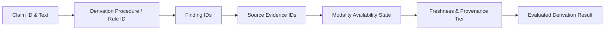

# TRUSTTRACE — Worker 03 Master Execution Plan: Phases 08, 09 & 10
**Workstream:** Risk Policy, Evidence Interpretation, Uncertainty Quantification, Evaluation Benchmarks & Claim Discipline
**Document Status:** PLANNING ONLY — FINAL SOURCE-VERIFIED REVISION (Awaiting User Authorisation)
**Target Canonical Path:** `.brain/.work/webapp/worker_03/phases/phases_08_09_10_master_plan.md`
**Prerequisites Completed:** Phases 01–07 Completed, Verified, and Pushed to `main` (Commits `f5a79f6`, `4590b70`, `01d8597`).
**PostgreSQL Verification Status:** 11/11 PostgreSQL 15 integration tests passing, 327/327 full repository tests passing, 8/8 contract invariants passing.

---

## 1. Executive Summary & Foundational Scope

This document defines the final, technically defensible engineering plan for Worker 03 Phases 08, 09, and 10:
- **Phase 08: Asymmetric Cost Configuration & Minimax Decision Rules**
- **Phase 09: Deterministic Counterfactual Sensitivity & Feasibility Lattice**
- **Phase 10: Complete Traceability Lineage & Epistemic Claim Matrix**

### 1.1 Strict Separation: Handbook Requirements vs. Engineering Recommendations
* **Handbook Requirements (Section 12.6, 13.1–13.3, 17.3):**
  1. Thresholds must be chosen using explicit operational costs across three operational zones (`no_threat_observed`, `inconclusive`, `threat`). Never select thresholds by maximizing accuracy alone.
  2. Statistical calibration (Platt, Isotonic) requires large, domain-disjoint validation sets ($N \ge 200$) with verified ground-truth labels; never evaluate or fit calibration on final test sets. Sample size alone is not proof of calibration validity.
  3. Every report explanation must identify what was observed, when, by which collector, and which evidence IDs support it. Counterfactuals are mathematical sensitivity checks, not remediation guarantees.
  4. Claim-to-evidence discipline requires that no factual claim be asserted without verifiable, scoped evidence records.
* **Engineering Recommendations & Operational Presets:**
  1. Specific numerical cost values ($C_{FN}=100, C_{FP}=20, C_A=2$) and specific cost orderings ($C_{FN} > C_{FP}$) are **illustrative deployment configurations**, not universal Handbook constants.
  2. Because the repository currently possesses no trained statistical ML model or large validation dataset, continuous numerical probability estimation is **disabled**. The engine operates on decoupled ordinal confidence and deterministic policy gates.

---

## 2. Decoupled Architecture: Probability vs. Ordinal Uncertainty

### 2.1 The Repository Reality
A complete audit of `src/trusttrace/` confirms:
1. **Zero Statistical Probability Models:** There is no logistic regression, neural network, or calibrated probabilistic classifier running in the triage pipeline.
2. **Explicit Codebase Invariant:** In [`src/trusttrace/policy/uncertainty.py#L38-L44`](file:///c:/Users/parin/Downloads/hacker%20matrix%20adamas/trusttrace/src/trusttrace/policy/uncertainty.py#L38-L44):
   ```python
   class ConfidenceBand(str, Enum):
       """Ordinal confidence band representing assessment grounding.
       CRITICAL INVARIANT: These are policy categories, NOT calibrated numeric probabilities.
       Never present weighted scores or heuristic metrics as mathematical probabilities.
       """
   ```
3. **Explicit Overclaim Prohibition:** In [`src/trusttrace/policy/evaluation.py#L48-L58`](file:///c:/Users/parin/Downloads/hacker%20matrix%20adamas/trusttrace/src/trusttrace/policy/evaluation.py#L48-L58), `ClaimAuditor` explicitly blocks presenting heuristic scores or policy rankings as mathematical probabilities or likelihoods.

### 2.2 Five Decoupled Dimensions
To avoid inventing pseudo-probabilities while retaining rigorous cost-awareness:
1. **Dimension 1 — Triage Disposition:** Deterministic rule outcome (`confirmed_threat`, `suspicious_threat`, `inconclusive`, `no_threat_observed`).
2. **Dimension 2 — Modality Availability Vector:** Discrete observation states from Phase 07 (`OBSERVED_COMPLETE`, `OBSERVED_PARTIAL`, `BLOCKED`, `FAILED`, `UNAVAILABLE`, `NOT_RUN`, `MISSING`).
3. **Dimension 3 — Evidence Quality & Provenance:** Upstream reliability tier (`authoritative_feed`, `direct_observation`, `corroborated_community`, etc.) and observation status.
4. **Dimension 4 — Ordinal Confidence (ConfidenceBand):** Qualitative grounding category (`SUFFICIENT_FOR_SCOPED_OBSERVATION`, `LIMITED_OBSERVATION`, `INSUFFICIENT_EVIDENCE`, `CONTRADICTORY_EVIDENCE`). Ordinal categories **never map to continuous numerical probability intervals**.
5. **Dimension 5 — Configurable Operational Costs & Statistical Calibration:**
   * **Live Runtime Operation:** Executes via **Configurable Cost-Sensitive Policy Analysis** using supported deterministic inputs (verified signals, availability masks, ordinal categories).
   * **Continuous Minimax Risk Engine:** The mathematical minimax formulation is fully implemented in `calibration.py` with strict boundary tests, but continuous probability inputs are **explicitly gated/disabled** (`statistical_calibration_available = False`). It will remain inactive for production triage until a statistically valid model is trained and calibrated against an authorized holdout set.

> [!IMPORTANT]
> **No Automatic Proof via $N \ge 200$:** A sample size of $N \ge 200$ is a necessary pre-condition, but **never automatic proof** of calibration validity. True statistical validity requires domain-disjoint splitting, temporal stability, absence of label leakage, and verified Brier/ECE scores evaluated under bootstrap confidence intervals (Handbook 12.4, 12.5).

---

## 3. Phase 08 — Mathematical Completeness & Cost Configuration

### 3.1 Cost Configuration: Validation & Presets

#### A. Rationality Invariants vs. Universal Orderings
The Handbook does **not** mandate universal cost inequalities (such as $C_{FN} > C_{FP}$ or $C_A < \text{both error costs}$). Universal validation is strictly restricted to fundamental rationality:
1. **Finiteness & Non-NaN:** All costs must be finite, real numeric values (`math.isfinite(x)`). Any NaN, $+\infty$, or $-\infty$ raises `ValueError`.
2. **Non-negativity:** $C(d, y) \ge 0$ for all decisions $d$ and states $y$.
3. **Strict Error Penalty Dominance:**
   - False positive cost strictly exceeds true positive cost: $C_{FP} > C_{TP}$.
   - False negative cost strictly exceeds true negative cost: $C_{FN} > C_{TN}$.
   *(Guarantees denominators $C_{FP} - C_{TP} > 0$ and $C_{FN} - C_{TN} > 0$, preventing zero or negative denominators).*
4. **Strictly Positive Review Cost:** $C_A > 0$.

```python
@dataclass(frozen=True)
class AsymmetricCostConfig:
    profile_name: str
    cost_false_negative: float   # C_FN: missed malicious domain
    cost_false_positive: float   # C_FP: legitimate domain falsely blocked
    cost_abstain: float          # C_A: routing to human analyst review queue
    cost_true_positive: float = 0.0
    cost_true_negative: float = 0.0

    def validate(self) -> None:
        for name, val in [
            ("cost_false_negative", self.cost_false_negative),
            ("cost_false_positive", self.cost_false_positive),
            ("cost_abstain", self.cost_abstain),
            ("cost_true_positive", self.cost_true_positive),
            ("cost_true_negative", self.cost_true_negative),
        ]:
            if not isinstance(val, (int, float)) or not math.isfinite(val) or math.isnan(val) or val < 0.0:
                raise ValueError(f"{name} must be a finite, non-negative real number, got {val}")
        if self.cost_abstain <= 0.0:
            raise ValueError(f"cost_abstain must be strictly positive (> 0.0), got {self.cost_abstain}")
        if self.cost_false_positive <= self.cost_true_positive:
            raise ValueError(f"C_FP ({self.cost_false_positive}) must strictly exceed C_TP ({self.cost_true_positive})")
        if self.cost_false_negative <= self.cost_true_negative:
            raise ValueError(f"C_FN ({self.cost_false_negative}) must strictly exceed C_TN ({self.cost_true_negative})")
```

#### B. Illustrative Deployment Presets (Non-Mandatory)
* **`AnalystTriageProfile` (Illustrative):** $C_{FN}=50.0, C_{FP}=10.0, C_A=2.0, C_{TP}=0.0, C_{TN}=0.0$ (High review capacity).
* **`UserWarningProfile` (Illustrative):** $C_{FN}=80.0, C_{FP}=15.0, C_A=5.0, C_{TP}=0.0, C_{TN}=0.0$ (End-user warning banner).
* **`EnterpriseBlockingProfile` (Illustrative):** $C_{FN}=100.0, C_{FP}=40.0, C_A=10.0, C_{TP}=0.0, C_{TN}=0.0$ (Active perimeter blocking).

---

### 3.2 Complete Mathematical Model for Minimax Expected Cost

Let true state be $y \in \{M, B\}$ ($M$ = malicious, $B$ = benign).
Let action be $d \in \{D_M, D_I, D_B\}$ ($D_M$ = threat, $D_I$ = abstain/inconclusive, $D_B$ = clean).
Let bounded risk interval be $p = P(y = M) \in [\underline{p}, \overline{p}] \subseteq [0, 1]$.

#### A. Complete Expected-Cost Equations
$$R(D_M, p) = p \cdot C_{TP} + (1 - p) \cdot C_{FP}$$
$$R(D_B, p) = p \cdot C_{FN} + (1 - p) \cdot C_{TN}$$
$$R(D_I, p) = p \cdot C_{A,M} + (1 - p) \cdot C_{A,B}$$

Under standard review triage, review cost is state-independent: $C_{A,M} = C_{A,B} = C_A$, yielding $R(D_I, p) = C_A$.

#### B. Worst-Case Costs Over Uncertainty Interval $[\underline{p}, \overline{p}]$
Because $C_{FP} > C_{TP}$, $R(D_M, p)$ is strictly decreasing in $p$; the worst-case occurs at $\underline{p}$:
$$\overline{R}(D_M) = \max_{p \in [\underline{p}, \overline{p}]} R(D_M, p) = R(D_M, \underline{p}) = \underline{p} \cdot C_{TP} + (1 - \underline{p}) \cdot C_{FP}$$

Because $C_{FN} > C_{TN}$, $R(D_B, p)$ is strictly increasing in $p$; the worst-case occurs at $\overline{p}$:
$$\overline{R}(D_B) = \max_{p \in [\underline{p}, \overline{p}]} R(D_B, p) = R(D_B, \overline{p}) = \overline{p} \cdot C_{FN} + (1 - \overline{p}) \cdot C_{TN}$$

Worst-case review cost:
$$\overline{R}(D_I) = \max_{p \in [\underline{p}, \overline{p}]} R(D_I, p) = C_A$$

*(Documented Zero-Regret Normalization: When $C_{TP} = C_{TN} = 0$, these simplify directly to $\overline{R}(D_M) = (1 - \underline{p})C_{FP}$ and $\overline{R}(D_B) = \overline{p} \cdot C_{FN}$).*

#### C. Decision Rule and Raw Worst-Case Cost Dominance
Decisions are determined **strictly by comparing raw worst-case costs**:
$$d^* = \arg\min_{d \in \{D_M, D_I, D_B\}} \overline{R}(d)$$
Thresholds are mathematical characterizations and presentation metrics, **never** the primary evaluation mechanism.

#### D. Threshold Derivations & Clamping Edge Cases
Setting $\overline{R}(D_I) < \overline{R}(D_M)$ and $\overline{R}(D_I) < \overline{R}(D_B)$:
$$\theta_{\text{threat}} \equiv \frac{C_{FP} - C_A}{C_{FP} - C_{TP}}, \qquad \theta_{\text{clean}} \equiv \frac{C_A - C_{TN}}{C_{FN} - C_{TN}}$$

1. **Thresholds Outside $[0, 1]$:**
   - If $C_A \ge C_{FP}$, then $\theta_{\text{threat}} \le 0$. Since $\underline{p} \ge 0$, $\underline{p} < \theta_{\text{threat}}$ is impossible. Raw cost $\overline{R}(D_M) \le C_{FP} \le C_A = \overline{R}(D_I)$, so $D_M$ always beats or ties $D_I$.
   - If $C_A \ge C_{FN}$, then $\theta_{\text{clean}} \ge 1$. Since $\overline{p} \le 1$, $\overline{p} > \theta_{\text{clean}}$ is impossible. Raw cost $\overline{R}(D_B) \le C_{FN} \le C_A = \overline{R}(D_I)$, so $D_B$ always beats or ties $D_I$.
   - **Clamping for Diagnostic Reporting:**
     $$\theta_{\text{threat, clamped}} = \max(0.0, \min(1.0, \theta_{\text{threat}})), \qquad \theta_{\text{clean, clamped}} = \max(0.0, \min(1.0, \theta_{\text{clean}}))$$
2. **Interval Endpoint Validation:**
   - Evaluator strictly requires $0.0 \le \underline{p} \le \overline{p} \le 1.0$ with all endpoints finite (`math.isfinite`).
   - If non-finite values, NaN, or ordinal `ConfidenceBand` strings are provided, the engine raises `ValueError` or `TypeError`.

---

### 3.3 Unified Numerical Tie Comparison & Deterministic Precedence

To eliminate inconsistencies across small and large cost scales, all cost comparisons are governed by a single, unified mathematical definition:

$$\text{is\_cost\_close}(a, b) \iff |a - b| \le \max(10^{-9} \cdot \max(|a|, |b|), 10^{-9})$$

This formulation matches Python's standard `math.isclose(a, b, rel_tol=1e-9, abs_tol=1e-9)`:
- **Small Cost Magnitudes ($r \approx 0$ or $r \approx 10^{-6}$):** The absolute tolerance $10^{-9}$ dominates, ensuring stable comparison without floating-point underflow or zero-division.
- **Large Cost Magnitudes ($r \approx 10^6$ or $r \approx 10^9$):** The relative tolerance $10^{-9} \cdot \max(|a|, |b|)$ scales dynamically, ensuring that floating-point precision limits on large numbers do not break tie detection.

#### Decision Selection Procedure:
Let candidate actions be $\mathcal{D} = \{D_M, D_I, D_B\}$ with worst-case costs $r_M = \overline{R}(D_M)$, $r_I = \overline{R}(D_I)$, and $r_B = \overline{R}(D_B)$.
1. Compute true scalar minimum:
   $$r_{\min} = \min(r_M, r_I, r_B)$$
2. Form the near-optimal tie candidate set:
   $$\mathcal{A}^* = \{ d \in \mathcal{D} : \text{math.isclose}(r_d, r_{\min}, \text{rel\_tol}=10^{-9}, \text{abs\_tol}=10^{-9}) \}$$
3. **Unique Optimum ($|\mathcal{A}^*| = 1$):** Select the single action in $\mathcal{A}^*$.
4. **Tie Resolution ($|\mathcal{A}^*| > 1$):**
   Ties are resolved using the **Deterministic Safety-First Precedence Hierarchy**:
   $$D_I \ (\text{Inconclusive / Abstain}) \ \succ \ D_M \ (\text{Threat}) \ \succ \ D_B \ (\text{Clean})$$
   Select the first action in $[D_I, D_M, D_B]$ that belongs to $\mathcal{A}^*$:
   * **Two-Way Tie $\{D_I, D_B\}$:** Select $D_I$. Never risk an unvetted clean claim on a tie.
   * **Two-Way Tie $\{D_I, D_M\}$:** Select $D_I$. Human review takes precedence over automatic blocking on equal cost.
   * **Two-Way Tie $\{D_M, D_B\}$:** Select $D_M$. Precautionary containment takes precedence over clean throughput.
   * **Three-Way Tie $\{D_I, D_M, D_B\}$:** Select **$D_I$ (`inconclusive`)**.

---

## 4. Phase 09 — Deterministic Counterfactual Explanations & Boundary Sensitivity

### 4.1 Strict Conceptual Separation
* **Mathematical Sensitivity Analysis (Permitted Scope):** Evaluates the policy function $f: \mathcal{X} \to \mathcal{Y}$. Identifies minimal signal modifications $\Delta x$ required to transition the output:
  $$f(x \oplus \Delta x) \ne f(x)$$
* **Real-World Remediation (Prohibited Inference):** A counterfactual must **never** imply or claim that making the suggested modification guarantees that a site is harmless or secure in the physical world. (e.g. Validating a TLS certificate removes a technical warning, but does not prove the website is not a phishing campaign).
* **Mandatory Serialization Disclaimer:**
  ```python
  COUNTERFACTUAL_DISCLAIMER = (
      "Hypothetical scenario based strictly on mathematical decision-boundary sensitivity. "
      "This analysis illustrates policy mechanics and does NOT constitute an operational "
      "security guarantee, endorsement, or remediation certificate."
  )
  ```

### 4.2 Actual Codebase Signal Taxonomy & Perturbation Operations
Audit of `src/trusttrace/policy/signal_taxonomy.py` confirms exactly 18 `SignalKind` values:
- **Identity:** `TLS_HOSTNAME_MATCH`, `AUTHORIZATION_EVIDENCE`, `IDN_LOOKALIKE`
- **Certificate:** `TLS_VALID`, `TLS_EXPIRED`, `TLS_MISMATCH`, `TLS_UNAVAILABLE`
- **Behavior:** `THREAT_FEED_MATCH`, `SUSPICIOUS_REDIRECT`, `SUSPICIOUS_HEADERS`, `NO_THREAT_MATCH`, `COMMUNITY_REPORT_UNVERIFIED`, `COMMUNITY_REPORT_CORROBORATED`, `COMMUNITY_REPORT_DISPUTED`
- **Evidence Quality:** `COLLECTOR_SUCCESS`, `COLLECTOR_FAILURE`, `STALE_EVIDENCE`, `CONFLICTING_SIGNALS`

#### A. Perturbation Action Model
To preserve taxonomy integrity, `REMOVED` is modeled as a **`PerturbationAction` operation**, **never** an invented `SignalKind`:

```python
class PerturbationAction(str, Enum):
    REPLACE_SIGNAL = "replace_signal"          # Swaps one SignalKind for another
    REMOVE_SIGNAL = "remove_signal"            # Eliminates an artifact signal
    COORDINATED_MUTATION = "coordinated_mut"   # Multi-signal coordinated swap
```

#### B. Verified Permitted Perturbations
1. **`MUTABLE_CONFIG` (Weight = 1.0):**
   * **Coordinated Hostname / Certificate Correction:**
     `SignalKind.TLS_MISMATCH` $\to$ `SignalKind.TLS_VALID` (Represents reissuing/reconfiguring certificate with matching hostname).
     `SignalKind.TLS_EXPIRED` $\to$ `SignalKind.TLS_VALID` (Represents renewing expired certificate).
   * **Coordinated Modality Completion (TLS):**
     In `signal_extractor.py#L90-L105`, TLS failure emits **both** `TLS_UNAVAILABLE` and `COLLECTOR_FAILURE`. Simulated modality completion requires the coordinated pair:
     $$\{ \text{TLS\_UNAVAILABLE}, \text{COLLECTOR\_FAILURE} \} \xrightarrow{\text{COORDINATED}} \{ \text{TLS\_VALID}, \text{COLLECTOR\_SUCCESS} \}$$
   * **HTTP Artifact Elimination:**
     In `signal_extractor.py#L125-L140`, clean HTTP omit suspicious flags. Therefore:
     `SignalKind.SUSPICIOUS_REDIRECT` $\xrightarrow{\text{REMOVE\_SIGNAL}}$ (clean redirect hops)
     `SignalKind.SUSPICIOUS_HEADERS` $\xrightarrow{\text{REMOVE\_SIGNAL}}$ (clean response headers)
     *(Never conflated with threat feed `NO_THREAT_MATCH`).*
2. **`REPUTATION_DEPENDENT` (Weight = 5.0):**
   * `SignalKind.THREAT_FEED_MATCH` $\to$ `SignalKind.NO_THREAT_MATCH` (Simulates external provider delisting; carries high latency and dispute prerequisites).
   * `SignalKind.COMMUNITY_REPORT_DISPUTED` $\to$ `SignalKind.COMMUNITY_REPORT_CORROBORATED`
   * `SignalKind.COMMUNITY_REPORT_UNVERIFIED` $\xrightarrow{\text{REMOVE\_SIGNAL}}$
3. **`IMMUTABLE_INTRINSIC` (STRICTLY PROHIBITED FROM PERTURBATION):**
   * In `signal_taxonomy.py`, the only intrinsic identity signal is **`SignalKind.IDN_LOOKALIKE`** (Unicode/punycode homograph structure).
   * Registration age and ASN do not exist as signals in `signal_taxonomy.py`; if present in raw payload metadata, they are categorized as intrinsic and barred from perturbation.
   * `SignalKind.IDN_LOOKALIKE` is **permanently prohibited from mutation**.

### 4.3 Deterministic Search Guarantees & Termination
1. **Isolated In-Memory Simulation:** Hypothetical modality completion and signal perturbations execute strictly on an ephemeral copy of the signal vector. **Zero simulated evidence records are ever written to the database, cache, or report.**
2. **Full Policy Re-Evaluation:** After every candidate perturbation $\Delta x$, the resulting signal vector is passed through the complete policy pipeline (`TriageEngine.evaluate()` and `ModalityAvailabilityGate.evaluate_gate()`). No shortcutting of Rules 1–6 or Step 7.
3. **Search Limits & Termination:**
   * Maximum search depth: $k = 3$ concurrent perturbations.
   * If all combinations of size $k \le 3$ fail to achieve the target disposition, search terminates immediately and emits `status = UNREACHABLE_TARGET_DISPOSITION`.
4. **Deterministic Tie-Breaking Among Multiple Minimal Counterfactuals:**
   * **Primary Criterion:** Minimality of Hamming distance ($k$).
   * **Secondary Criterion:** Minimality of composite feasibility penalty:
     $$\text{Penalty} = \sum_{s \in \Delta x} \text{Weight}(\text{feasibility}(s))$$
   * **Tertiary Criterion:** Deterministic lexicographical tie-breaker based on sorted tuples: `(dimension, signal_kind, target_value)`.

---

## 5. Phase 10 — Complete Traceability Lineage & Epistemic Claim Matrix

### 5.1 The Lineage Invariant
> [!IMPORTANT]
> A genuine evidence ID alone does **not** establish that a resulting claim is supported. If the evidence is stale, from an unverified tier, scoped to a mismatched target, contradicted by other observations, or fails to meet rule prerequisites, the claim support degrades.

### 5.2 Deterministic Structured Claim Extraction
Claims are extracted deterministically from structured report fields (never relying on unconstrained NLP extraction):
1. **Dispositions:** `decision`
2. **Confidence:** `confidence_band`
3. **Dimension States:** `dimensions.identity`, `dimensions.certificate`, `dimensions.behavior`, `dimensions.evidence_quality`
4. **Findings:** `findings[i].kind`, `findings[i].description`
5. **Diagnostics:** `diagnostics[i].code`, `diagnostics[i].message`

### 5.3 Complete Lineage Trace for `DERIVED_ASSESSMENT` Claims
Every derived claim $C_k$ in the report is traced across seven mandatory lineage fields:



```python
@dataclass(frozen=True)
class DerivedClaimLineage:
    claim_id: str
    claim_text: str
    derivation_procedure: str       # e.g., "Rule 1 (Threat Intel Override)", "Step 7 (Modality Gate)"
    finding_ids: Tuple[str, ...]    # Intermediate finding references
    evidence_ids: Tuple[str, ...]   # Non-empty raw evidence IDs
    modality_status: str            # ModalityStatus (e.g. OBSERVED_COMPLETE, OBSERVED_PARTIAL)
    freshness_state: str            # "fresh" vs "stale" (evaluated against FreshnessPolicy TTL)
    provenance_reliability: str     # Reliability tier (e.g. "authoritative_feed", "direct_observation")
    derivation_result: str          # ClaimSupportStatus
```

### 5.4 Exact Evidence Model & Verification Semantics
Grounded in `src/trusttrace/policy/policy_input.py` (`EvidenceItem`) and `src/trusttrace/policy/uncertainty.py` (`FreshnessPolicy`):

#### A. Mandatory Six-Field Verification for `FACTUAL_OBSERVATION`
Every factual observation claim must rigorously verify all six properties against the referenced `EvidenceItem`:
1. **Exact Target:** Normalized target matching `policy_input.target` (`input_validation.py#L110-L125`).
2. **Correct Modality:** `ModalityClassifier.classify_kind(item.kind)` matching claim modality.
3. **Exact Attribute:** Specific asserted payload attribute key (e.g., `not_after`, `san`, `issuer`, `a_records`, `feed_matches`).
4. **Observed Value:** Specific value in `item.value` matching the asserted observation.
5. **Observation Timestamp:** Valid, parseable ISO-8601 timestamp.
6. **Provenance & Freshness:** Source reliability tier and observation age $\le \text{FreshnessPolicy.get_window(item.kind)}$.

> [!CAUTION]
> **Attribute-Level Specificity:** An existing evidence ID or matching target alone **never** establishes factual support. For example, evidence that a TLS certificate exists on `example.com` must **not** automatically support a claim about its expiry date (`not_after`) or its SAN list (`san`) if those attributes are absent or unverified in the payload.

#### B. Deterministic Behavior on Value/Attribute Deficiencies:
When an evidence record supports the target and modality, but fails on the specific attribute or value:
1. **Direct Value Conflict:** If the payload contains the attribute but with a **differing or conflicting value** (e.g. claim asserts "cert expired on 2026-05-01" but payload has `not_after="2027-11-01"`), the claim is classified as **`CONTRADICTED`** (`VALUE_MISMATCH_DIRECT_CONFLICT`).
2. **Attribute Absence:** If the payload lacks the asserted attribute entirely (e.g. claim asserts a DNS TTL extension, but the DNS payload omits that key), the claim is classified as **`UNSUPPORTED`** (`ATTRIBUTE_ABSENT_IN_EVIDENCE`).
3. **Propagation to `DERIVED_ASSESSMENT`:** If a derived finding relies on parent evidence, each parent evidence item must genuinely contain the attributes and values that justify that finding. If parent evidence lacks the required attributes, the derived claim degrades to **`UNSUPPORTED`** (`PARENT_EVIDENCE_ATTRIBUTE_DEFICIENT`).

#### C. Actual Codebase Freshness Windows (`DEFAULT_FRESHNESS_WINDOWS`):
Direct citations from `uncertainty.py#L48-L62`:
* `dns`, `dns_resolution`: **86,400s (24 hours)**
* `threat_intel`, `threat_feed`, `reputation`: **43,200s (12 hours)**
* `http`, `http_headers`, `redirect_chain`: **86,400s (24 hours)**
* `tls`, `tls_certificate`, `tls_hostname_validation`: **604,800s (7 days)**
* `community_report`: **172,800s (48 hours)**
* `default` fallback: **604,800s (7 days)**
*(Universal 12-hour TTL is strictly prohibited).*

#### D. Contemporaneous Contradiction Precedence:
* If contemporaneous evidence records on the same target and modality assert mutually exclusive states, the claim is definitively **`CONTRADICTED`**.
* Contradictory evidence is **never silently downgraded** to `PARTIALLY_SUPPORTED`.
* Stale contrary evidence where contemporaneous observations are clean is classified as **`PARTIALLY_SUPPORTED`** with diagnostic `STALE_HISTORICAL_CONFLICT`.

#### E. Hypothetical Claim Segregation:
* Counterfactual text from Phase 09 is categorized as `EXPLANATORY_OR_HYPOTHETICAL` (`NON_FACTUAL_EXPLANATION`) and cannot enter factual evidence verification.

---

## 6. Implementation Architecture & Conflict Prevention

### 6.1 Planned Files (Worker 03 Permitted Scope)

| Phase | Action | File Path | Scope & Boundary Protection |
|---|---|---|---|
| **Phase 08** | CREATE | `src/trusttrace/policy/calibration.py` | Cost configs, Minimax decision evaluator, empirical risk intervals. |
| **Phase 09** | CREATE | `src/trusttrace/policy/counterfactual.py` | Perturbation lattice, sensitivity generator, disclaimer formatter. |
| **Phase 10** | CREATE | `src/trusttrace/policy/claim_matrix.py` | Claim extractor, lineage evaluator, matrix formatter. |
| **Shared** | MODIFY | `src/trusttrace/policy/__init__.py` | Export new typed dataclasses and public entrypoints. |
| **Shared** | MODIFY | `src/trusttrace/policy/triage_engine.py` | Add optional helper methods without altering Rules 1–6. |
| **Tests** | MODIFY | `tests/test_triage_policy.py` | Append test classes `TestPhase08CostCalibration`, `TestPhase09Counterfactuals`, `TestPhase10ClaimMatrix`. |

### 6.2 Shared File Conflict Prevention
* **`scan_report.schema.json`**: **100% UNTOUCHED.** All Phase 08–10 outputs are exposed via typed dataclasses and optional helper methods.
* **`triage_engine.py`**: Existing evaluation logic (Steps 1–7) remains unaltered. New capabilities are exposed via opt-in helper methods (e.g., `evaluate_with_calibration()`, `generate_claim_matrix()`). Existing `TriageResult` fields and serialization are 100% preserved.
* **Worker Boundaries**: Zero modifications to Worker 01, Worker 02, or Worker 04 files.

---

## 7. Execution Schedule & Comprehensive Test Matrix

### 7.1 Comprehensive Planned Tests (Total = 60 Unit Tests)
1. **Phase 08 (20 Unit Tests in `TestPhase08CostCalibration`):**
   - Cost config validation: finite numbers, non-negativity, $C_{FP} > C_{TP}$, $C_{FN} > C_{TN}$, $C_A > 0$.
   - Rejection of non-finite costs: NaN, $+\infty$, $-\infty$ upfront with `ValueError`.
   - Rejection of invalid probability intervals: non-finite endpoints, $\underline{p} > \overline{p}$, $\underline{p} < 0$, $\overline{p} > 1$.
   - Explicit rejection of ordinal `ConfidenceBand` objects passed into numerical evaluators.
   - Denominator positivity: $C_{FP} = C_{TP}$ or $C_{FN} = C_{TN}$ rejected upfront.
   - Threshold clamping: testing cost profiles where $\theta_{\text{threat}} \le 0$ or $\theta_{\text{clean}} \ge 1$.
   - Decision determination via raw worst-case costs rather than clamped thresholds.
   - Mathematical boundary tests: exact equality $\underline{p} = \theta_{\text{threat}}$ and $\overline{p} = \theta_{\text{clean}}$.
   - Unified tolerance comparison: testing `math.isclose(rel_tol=1e-9, abs_tol=1e-9)` across all candidate action pairs.
   - Scale-invariant tie detection: verifying tie behavior at **small cost scales** ($r \approx 10^{-6}$) and **large cost scales** ($r \approx 10^6$).
   - Deterministic tie-breaking: two-way ties ($\{D_I, D_B\} \to D_I$, $\{D_I, D_M\} \to D_I$, $\{D_M, D_B\} \to D_M$) and three-way tie ($\{D_I, D_M, D_B\} \to D_I$).
   - Verification that statistical calibration remains disabled in runtime mode.
2. **Phase 09 (18 Unit Tests in `TestPhase09Counterfactuals`):**
   - Explicit allowlist mapping: permitted mutations for `MUTABLE_CONFIG` and `REPUTATION_DEPENDENT`.
   - Coordinated modality completion: `{TLS_UNAVAILABLE, COLLECTOR_FAILURE}` $\xrightarrow{\text{COORDINATED}} \{ \text{TLS_VALID}, \text{COLLECTOR_SUCCESS} \}$.
   - Coordinated certificate fix: `TLS_MISMATCH` $\to$ `TLS_VALID`.
   - HTTP artifact removal: `SUSPICIOUS_REDIRECT` $\xrightarrow{\text{REMOVE_SIGNAL}}$ without conflating threat feed signals.
   - Strict immutability: rejection of perturbations targeting `IDN_LOOKALIKE` or historical features.
   - Verification that `REMOVED` is an operation type, not a `SignalKind` member.
   - Simulated-evidence isolation: verification that in-memory simulation never modifies `PolicyInput.evidence_items`.
   - Full policy re-evaluation: verification that all rules and availability gates fire on perturbed vectors.
   - Deterministic search ordering: Hamming minimality, secondary feasibility weighting, tertiary lexicographical tie-break.
   - Termination on unreachable target disposition ($k > 3$).
   - Mandatory disclaimer presence in serialized outputs.
3. **Phase 10 (22 Unit Tests in `TestPhase10ClaimMatrix`):**
   - Deterministic extraction from structured report fragment fields.
   - Verification of complete 7-field lineage for every `DERIVED_ASSESSMENT`.
   - Exact six-field verification for `FACTUAL_OBSERVATION` (target, modality, attribute, value, timestamp, provenance).
   - Rejection of target and modality scope mismatch (`TARGET_OR_MODALITY_MISMATCH`).
   - Attribute absence in evidence payload $\to$ `UNSUPPORTED` (`ATTRIBUTE_ABSENT_IN_EVIDENCE`).
   - Direct value conflict in evidence payload $\to$ `CONTRADICTED` (`VALUE_MISMATCH_DIRECT_CONFLICT`).
   - Propagation of attribute deficiency to parent evidence supporting `DERIVED_ASSESSMENT`.
   - Source-specific freshness TTL evaluation using exact values from `DEFAULT_FRESHNESS_WINDOWS` (DNS 24h, Threat Intel 12h, TLS 7d, HTTP 24h, Community 48h).
   - Strict precedence of `CONTRADICTED` over `PARTIALLY_SUPPORTED` on contemporaneous conflicts.
   - Stale historical conflict handling: `PARTIALLY_SUPPORTED` with `STALE_HISTORICAL_CONFLICT` diagnostic.
   - Degradation to `PARTIALLY_SUPPORTED` on collector warnings or partial modality.
   - Explicit `UNSUPPORTED` on missing IDs, missing finding references, or bypassed rules.
   - Non-factual segregation: exclusion of Phase 09 counterfactual text from factual evidence support.
4. **Full Regression:** 327/327 tests passing; 8/8 contract checks passing.

### 7.2 Time-Boxed Sequence
* **Stage 1 (Phase 08):** Implement `calibration.py`, add 20 unit tests, verify against 7 golden fixtures.
* **Stage 2 (Phase 09):** Implement `counterfactual.py`, add 18 unit tests, verify sensitivity outputs.
* **Stage 3 (Phase 10):** Implement `claim_matrix.py`, add 22 unit tests, verify end-to-end evidence traceability.
* **Stage 4 (Handoff):** Author completion reports, run boundary checks, and submit for commit authorization.

---

## 8. Remaining Blockers & Risk Analysis

| Potential Issue | Impact | Status / Mitigation |
|---|---|---|
| **Lack of Authoritative Calibrated Model** | High for continuous probability triage | **Mitigated:** Statistical calibration explicitly disabled; runtime triage operates on deterministic cost-sensitive logic. |
| **User Misinterpretation of Counterfactuals** | High for security perception | **Mitigated:** Mandatory disclaimer embedded in serialization; strict conceptual separation between sensitivity and remediation. |
| **Worker Boundary Isolation** | High regression risk if external files are modified | **Mitigated:** All new code confined to `src/trusttrace/policy/` and tests in `tests/test_triage_policy.py`. |

**Readiness Verdict: MASTER PLAN VERIFIED & FROZEN FOR PHASE 08 AUTHORIZATION.**
