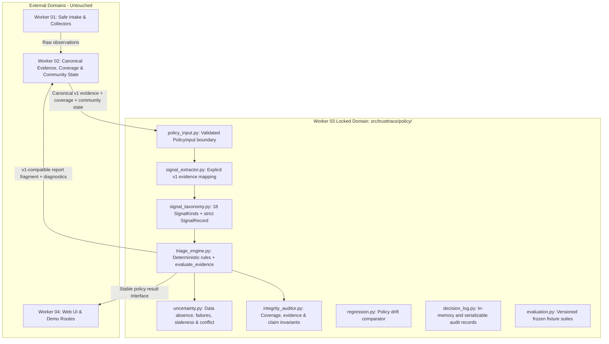

# TRUSTTRACE — Worker 03 Master Execution Blueprint
**Workstream:** Risk Policy, Evidence Interpretation, Uncertainty Quantification, Evaluation Benchmarks & Claim Discipline  
**Baseline Verified:** Gemini's repository-side audit reported `main` at commit `9291e4e` with a clean working tree. The supplied ZIP snapshot does not contain `.git` metadata, so branch and working-tree state cannot be independently rechecked from that archive.  
**Active Policy Baseline:** `w03-v1.0`  
**Phase Status:** Phases 01 & 02 verified complete; Phases 03, 04, 05, and 06 are the proposed execution sequence.  
**Boundaries Enforced:** `scripts/check_worker_boundaries.py` (Worker 03 domain: `src/trusttrace/policy/`, `tests/test_triage_policy.py`, `.brain/.work/webapp/worker_03/`, `.brain/.report/worker_03_*`)

---

## 1. Baseline Verification & Current System Truth

A rigorous audit of the live codebase was conducted to establish exact system state before planning:

| Subsystem / Metric | Repository Reality | Architecture Significance |
|---|---|---|
| **Git Working Tree** | Gemini reported clean `origin/main` at `9291e4e`; the supplied ZIP has no `.git` metadata | Treat this as the repository-side baseline reported by Gemini; re-run `git status --short` and `git rev-parse HEAD` in the actual working clone before execution. |
| **Worker 03 Tests** | `tests/test_triage_policy.py` — **29 tests passing** | Baseline rule composition, 7 frozen golden fixtures, decision log and claim auditor pass in the supplied snapshot. |
| **Full Repository Tests** | `python run_tests.py` — **127 tests passed, 0 failures** | Independently rerun against the supplied source snapshot with the required test dependencies installed. The runner also completed all **8 schema/negative/cross-record fixture checks**. |
| **Boundary Checker** | Gemini reported `python scripts/check_worker_boundaries.py --worker worker_03` returns `[OK]` | The checker permits `src/trusttrace/policy/`, `tests/test_triage_policy.py`, `.brain/.work/webapp/worker_03/`, and `.brain/.report/worker_03_*`. Re-run in the actual Git clone after every change; it cannot meaningfully inspect changed files in a ZIP without `.git` metadata. |
| **Contract Invariants** | `scan_report.schema.json` v1 (`additionalProperties: false`) | Requires all 4 dimensions, coverage arithmetic fields, valid evidence states and findings with non-empty evidence IDs; no unapproved extra report properties. |

---

## 2. Root-Cause Analysis of Interface Gaps

A source-level inspection revealed four concrete integration issues between other workers and Worker 03. The fixes below must remain inside Worker 03's permitted files; any consumer-side correction in Worker 04 or evidence-model change in Worker 02 requires the Ask Twice protocol.

### Gap 1: Argument Transposition in Web Consumer (`src/trusttrace/web/routes.py#L42`)
```python
# Worker 04 current call site in routes.py:
signals = [
    SignalRecord(SignalKind.TLS_VALID, "tls_collector", "Valid DV Cert by Let's Encrypt"),
    ...
]
```
- **The Issue:** In `SignalRecord`, the second positional argument is `evidence_ids: List[str]`, and the third is `source: str`.
- **The Result:** `"tls_collector"` is assigned to `evidence_ids` as a raw string. When `triage_engine.py` calls `ev_ids.extend(s.evidence_ids)`, Python iterates the string character by character, corrupting finding references.
- **Worker 03 Solution:**
  1. Enforce the declared type of `evidence_ids`: it must be a list of non-empty evidence-ID strings. Reject a bare string and invalid element types; do not silently coerce a string into a list, because that can hide a positional-argument mistake.
  2. Use keyword arguments in all Worker 03-owned construction and examples.
  3. Implement `EvidenceSignalExtractor` so downstream consumers use canonical evidence input instead of manually constructing signals.
  4. Record the Worker 04 call-site defect in the handoff. Do not modify `src/trusttrace/web/routes.py` from Worker 03. Worker 04 must correct its call site through its own workstream or an approved cross-boundary change.

### Gap 2: Fragile Finding Evidence Linkage (`src/trusttrace/policy/triage_engine.py#L204`)
- **The Issue:** If a certificate signal arrives with empty `evidence_ids`, `_rule_certificate` can attach `evidence_ids=[]` to a finding.
- **The Result:** Worker 02's `FindingModel` validator explicitly rejects findings where the evidence ID list is empty. An ID that is non-empty but absent from the input batch is also an invalid reference.
- **Worker 03 Solution:** Enforce a hard finding-evidence integrity invariant: every generated finding must carry at least one non-empty evidence ID that exists in the current `PolicyInput` evidence batch. Never generate a fallback, synthetic, or random evidence ID. If a rule would otherwise emit an unsupported finding, suppress that finding and record a structured diagnostic/limitation explaining why.

### Gap 3: Missing Bridge from Canonical Evidence to Policy
- **The Issue:** Worker 01 produces collector observations; Worker 02 normalizes and persists those observations as canonical evidence records. Neither currently produces Worker 03 `SignalRecord` objects.
- **Worker 03 Solution:** Define a Worker 03-owned `PolicyInput` boundary and expose `TriageEngine.evaluate_evidence(policy_input)`. It accepts only the agreed canonical v1 evidence payload plus coverage and community-report context, validates policy-relevant fields, maps recognized evidence into typed signals, and retains unsupported/invalid items as diagnostics rather than guessing their meaning.

### Gap 4: Policy-Side Data Quality and Scope Validation Are Not Explicit
- **The Issue:** Evidence records can be structurally valid yet unusable for a particular policy conclusion because the target, status, timestamp, source, reliability, or scope does not support that conclusion.
- **Worker 03 Solution:** Add policy-boundary validation for schema version, required fields, evidence-ID uniqueness, target matching, timestamp parseability, source/reliability values, observation status, and coverage consistency. Worker 03 must not duplicate Worker 01's URL/SSRF validation, Worker 02's database validation, or Worker 02's community deduplication. It validates the canonical evidence it receives for safe interpretation.

## 3. Boundary & File Ownership Strategy

The current `scripts/check_worker_boundaries.py` explicitly allows Worker 03 changes only in:

- `src/trusttrace/policy/`
- `tests/test_triage_policy.py`
- `.brain/.work/webapp/worker_03/`
- `.brain/.report/worker_03_*`

Therefore, all new automated test classes must initially be added to **`tests/test_triage_policy.py`**. Keep them modular through separate test classes and helper functions. Do not create additional test modules unless the shared boundary checker is formally updated and the required approvals are recorded. This avoids changing the shared checker or weakening worker isolation.



**Ownership rules:**
- Worker 01 remains responsible for URL canonicalization, IDNA interpretation, SSRF/egress decisions and raw bounded collectors.
- Worker 02 remains responsible for evidence persistence, public REST APIs, evidence provenance services, coverage construction, community-report verification and independent-source deduplication.
- Worker 03 owns policy-side validation, evidence-to-signal interpretation, deterministic policy, uncertainty classification, finding-reference validation, evaluation fixtures and policy audit semantics.
- Worker 04 owns UI/routes/demo workflow and must consume Worker 03 through the agreed public interface.
- Worker 03 does not add a REST endpoint or access Worker 02's database directly. API exposure and persistence are coordinated with Worker 02.

## 4. Structured Phase-by-Phase Execution Plan

Following the exact structure of Worker 04's phase specifications (`Objective`, `Inputs and dependencies`, `Tasks`, `Deliverables`, `Validation and acceptance`, `Safety/claim guard`, and `Risks and handoff`), here is the roadmap:

---

### Phase 03: Safe Evidence Interpretation & Signal Extraction Pipeline

#### Objective
Bridge canonical v1 evidence records (from Worker 02's normalization/persistence boundary) into Worker 03's typed signal taxonomy. Establish a validated policy input contract, perform policy-relevant data-quality checks, provide an explicit evidence-to-signal mapping, and guarantee finding-to-evidence referential integrity.

#### Inputs and Dependencies
- `.brain/.work/contracts/v1/scan_report.schema.json`
- `.brain/.work/contracts/v1/community_report.schema.json`
- Worker 02's canonical `EvidenceModel`/`EvidenceBatch` public payload shape and `CoverageModel` fields, consumed as canonical dictionaries or a documented public DTO boundary (no imports from Worker 02 persistence internals).
- Existing `src/trusttrace/policy/signal_taxonomy.py` and `triage_engine.py`.
- Pre-condition: Worker 02 confirms the canonical evidence and coverage fields that Worker 03 may consume. Any contract change requires shared approval; this phase does not modify shared schemas.

#### Tasks
1. **Define the Policy Input Contract (`policy_input.py`):**
   - Define a Worker 03-owned `PolicyInput` data structure containing `schema_version`, `scan_id`, `normalized_host` (when available), `evidence_items`, `coverage`, `community_reports`, and top-level limitations/diagnostics.
   - Accept the current supported schema version (`1.0`) explicitly. Reject unknown versions; do not guess field aliases or silently fall back to another version.
   - Validate non-empty scan/evidence identifiers, known evidence status and reliability values, parseable ISO-8601 timestamps, unique evidence IDs within the batch, expected container types, and coverage arithmetic when coverage is present. The v1 evidence object has no universal `target` field: check target/scope only from the scan-level `normalized_host` and the documented, kind-specific `value` shape; never assume an undocumented generic target field.
   - If coverage is absent, preserve that fact as `UNCHECKED_COVERAGE`; do not infer a complete coverage record by counting received evidence rows.
   - Treat the canonical payload as already schema-validated by its owning boundary, while still performing Worker 03 semantic validation. Do not add a required `jsonschema` dependency to the Worker 03 package solely to repeat upstream schema validation.
2. **Strict `SignalRecord` Validation (`signal_taxonomy.py`):**
   - Add `__post_init__` or an equivalent constructor validation that requires `evidence_ids` to be a list of non-empty strings; reject a bare string rather than coercing it to a list.
   - Validate `kind` and non-empty `source`.
   - The current `confidence` field carries an ordinal reliability label, not a numeric probability. Validate only the supported v1 reliability values (`provider_assertion`, `direct_observation`, `derived_signal`, `user_report`, `unknown`) and do not describe it as calibrated confidence.
   - Use keyword arguments in all Worker 03-owned construction and test examples.
3. **Implement Canonical Signal Extractor (`signal_extractor.py`):**
   - Create `EvidenceSignalExtractor` to map only explicitly recognized v1 `kind`/`status` combinations into `SignalRecord` instances.
   - TLS evidence (`tls_certificate`) may map to `TLS_VALID`, `TLS_EXPIRED`, `TLS_MISMATCH`, `TLS_HOSTNAME_MATCH`, or `TLS_UNAVAILABLE` only when the structured observed value explicitly supports that condition. TLS hostname matching must never imply organizational authorization.
   - DNS/HTTP evidence (`dns_resolution`, `http_headers`, `redirect_chain`) may contribute collector-status or behavioural signals only where the structured value contains the required observation. Do not mark arbitrary headers or any redirect as suspicious without a documented rule predicate.
   - Threat-intelligence evidence may map to `THREAT_FEED_MATCH` only when an observed, authenticated/provenanced provider assertion matches the exact normalized target and relevant scope. `NO_THREAT_MATCH` may be emitted only when the provider query completed successfully for that target/scope and explicitly returned no match. Missing feed evidence is not a no-match.
   - Community reports consume Worker 02's `verification_state`, `independent_source_count`, normalized target and linked evidence IDs. Worker 03 does not independently deduplicate reports or calculate source independence. A `report_id` is not an evidence ID; findings must reference linked evidence records that exist in the input batch.
   - Handle the exact v1 evidence statuses: `observed`, `unavailable`, `failed`, `not_run`, and `blocked`. Preserve `not_run` and `blocked` as distinct diagnostics/coverage context; do not silently map them to ordinary collector failure. `rate_limited` is not a v1 evidence status in the current contract; preserve it in supported value/limitations metadata as supplied by the upstream owner, without inventing a new status.
   - Unknown kinds or unsupported value shapes produce explicit extraction diagnostics and no inferred signal.
4. **Evidence Cleaning and Referential Integrity Gate (`triage_engine.py`):**
   - Validate that each emitted signal's evidence IDs exist in the current evidence batch and that duplicate IDs are not silently merged.
   - Before returning findings, verify every finding has at least one real evidence ID from the current `PolicyInput` batch.
   - If a rule triggers without supporting evidence, suppress the orphan finding and add a diagnostic/limitation. Never generate fallback, synthetic, or random evidence IDs.
   - Preserve multiple legitimate observations with distinct timestamps/sources; do not deduplicate temporal evidence in Worker 03.
5. **Direct Evidence Evaluation Entrypoint (`triage_engine.py`):**
   - Add `TriageEngine.evaluate_evidence(policy_input: PolicyInput) -> TriageResult`.
   - The method validates the policy input, calls the extractor, runs the existing deterministic triage rules, passes coverage/community context into the relevant policy logic, applies finding integrity validation, and returns a result with diagnostics.
   - Preserve `TriageEngine.evaluate(signals)` for backwards compatibility with existing Worker 03 tests and controlled fixtures.
   - Do not create a REST API endpoint. Worker 02 owns REST API exposure; Worker 04 consumes the policy result through the agreed integration interface.

#### Deliverables
- `src/trusttrace/policy/policy_input.py` (New module)
- `src/trusttrace/policy/signal_extractor.py` (New module)
- `src/trusttrace/policy/signal_taxonomy.py` (Updated with strict validation; no string coercion)
- `src/trusttrace/policy/triage_engine.py` (Updated with `evaluate_evidence()` and finding integrity checks)
- `src/trusttrace/policy/__init__.py` (Exports new public policy interfaces)
- `tests/test_triage_policy.py` (Added modular `TestPolicyInput`, `TestSignalExtractor`, and `TestFindingIntegrity` classes; do not create a new test file without boundary approval)
- `.brain/.work/webapp/worker_03/phases/phase_03.md` & `.brain/.report/worker_03_phase_03_report.md`

#### Validation and Acceptance Criteria
- `test_signal_record_rejects_bare_string_evidence_ids`: A string passed as `evidence_ids` is rejected; it is never silently converted.
- `test_signal_record_accepts_keyword_arguments`: Correct keyword-based construction preserves evidence IDs and source.
- `test_policy_input_v1_validation`: Valid v1 input is accepted; unknown schema versions, malformed timestamps, invalid status/reliability values, duplicate evidence IDs and malformed coverage are rejected or explicitly diagnosed.
- `test_signal_extractor_v1_fixtures`: Complete, partial, blocked, unavailable, failed and conflicting fixture records map only to documented signal/diagnostic outcomes.
- `test_no_threat_match_requires_successful_scoped_query`: Missing feed evidence, failed feed checks and wrong-target matches never become `NO_THREAT_MATCH`.
- `test_finding_integrity_invariant`: Zero findings are emitted with empty, fabricated or out-of-batch `evidence_ids`.
- All 29 existing Worker 03 tests pass with 0 regressions.

#### Safety/Claim Guard
- Extractor strictly abstains from inferring organizational authorization from certificate validity.
- Collector failure, blocked state, not-run state, unavailable evidence, or absence of feed evidence never produces a benign/no-threat signal.
- `NO_THREAT_MATCH` is allowed only after a successful, target-scoped provider query explicitly reports no match.
- No source data, evidence ID, timestamp, reliability value or target scope is fabricated by Worker 03.

#### Risks and Handoff
- *Risk:* Worker 02 payload versions or evidence kind/value structures may evolve.
- *Mitigation:* Use an explicit schema-versioned mapping table and reject unsupported versions/shapes with diagnostics; coordinate any contract changes before merging.
- *Risk:* The current Worker 04 positional `SignalRecord` call site will be incompatible with strict validation.
- *Mitigation:* Document the exact call-site correction in the Worker 03 handoff. Worker 04 must update its own file through its owner or approved Ask Twice process; Worker 03 does not edit `src/trusttrace/web/`.
- *Handoff:* Document `PolicyInput` and `TriageEngine.evaluate_evidence()` for Worker 02/04 consumption, including a complete v1 example, an incomplete-coverage example, diagnostics semantics and error behaviour.

---

### Phase 04: Uncertainty Quantification, Abstention Engine & Report Integrity Auditor

#### Objective
Implement structured uncertainty modeling (distinguishing missing data, collection failure, unchecked coverage, temporal staleness and genuine evidence contradiction), generate explicit human-readable abstention notices, and build an automated report integrity auditor that enforces TRUSTTRACE safety invariants before reports are published.

#### Inputs and Dependencies
- Completed Phase 03 `PolicyInput` and signal extractor.
- `.brain/.work/shared/decision_policy_table.md` (read-only unless shared owner approves a change).
- `.brain/.work/contracts/v1/scan_report.schema.json` (read-only; v1 remains strict with `additionalProperties: false`).
- Worker 02-provided coverage and community-report verification metadata.

#### Tasks
1. **Uncertainty Taxonomy & Data Model (`uncertainty.py`):**
   - Define `UncertaintyType` enum:
     - `DATA_ABSENCE`: A required observation was not available or not supplied.
     - `COLLECTION_FAILURE`: A collector explicitly failed or timed out.
     - `UNCHECKED_COVERAGE`: A check was not run, the target was safety-blocked, the budget was exhausted, or coverage metadata is missing/incomplete.
     - `TEMPORAL_STALENESS`: Evidence is outside an explicitly configured, source-specific freshness window.
     - `EVIDENCE_CONFLICT`: Evidence for the same target and relevant scope/time materially contradicts another observation.
   - Do not label every disagreement as aleatoric uncertainty. A disagreement may result from scope/time mismatch, source quality, duplication, or incomplete evidence; classify it only after those factors are examined.
   - Define `ConfidenceBand` as an ordinal policy category, not a calibrated probability:
     - `SUFFICIENT_FOR_SCOPED_OBSERVATION`
     - `LIMITED_OBSERVATION`
     - `INSUFFICIENT_EVIDENCE`
     - `CONTRADICTORY_EVIDENCE`
2. **Abstention Rationale Engine (`uncertainty.py`):**
   - Create `AbstentionNotice` model: captures reason code, affected dimensions, missing/failed/not-run check names, relevant target scope, and whether a safe re-scan could reasonably reduce uncertainty.
   - When `decision == "inconclusive"`, generate an explicit explanation (e.g., *"DNS resolution failed; host reachability could not be established"* or *"Current provider observations disagree for the same target and time window"*).
   - Keep uncertainty and confidence categories ordinal and explainable. Do not introduce an arbitrary numerical uncertainty score or imply probability calibration.
3. **Automated `ReportIntegrityAuditor` (`integrity_auditor.py`):**
   - Build an automated invariant auditor to check generated report fragments against TRUSTTRACE core safety rules:
     - **Rule 1 (TLS-001):** Reject reports where `identity == "supported"` unless explicit, valid authorization evidence is present and linked to the same target/scope.
     - **Rule 2 (EVID-002):** Reject affirmative global claims such as `"safe"` or `"clean"`; a missing feed match is not proof of safety. The auditor must distinguish a positive safety claim from explanatory/negated text such as *"does not establish that the site is safe"*.
     - **Rule 3 (Coverage Invariant):** Do not automatically reject `decision == "no_threat_observed"` merely because `checks_failed > 0`. Check the required-check policy and scope. If required checks are incomplete, the report must retain a partial/limited quality assessment and explicitly limit the statement to the checks actually observed; a global or unqualified no-threat assurance must be rejected.
     - **Rule 4 (Anti-Marketing Guard):** Detect unsupported absolute claims (`"100% secure"`, `"bulletproof"`, `"guaranteed phishing-free"`) using structured claim fields and context-aware text checks. Do not reject every occurrence of words such as `"safe"` without considering negation and context.
     - **Rule 5 (Finding Integrity):** Confirm all finding `evidence_ids` point to declared evidence records in the same scan report.
     - **Rule 6 (Coverage Arithmetic):** Confirm `checks_total == checks_observed + checks_failed + checks_not_run`.
   - Return structured audit findings (rule ID, severity, affected field, evidence references, explanation); do not silently rewrite the report.
4. **Wire Uncertainty into Triage Result (`triage_engine.py`):**
   - Include an internal `uncertainty: Optional[UncertaintyAssessment]` field on `TriageResult`.
   - Maintain strict v1 schema compatibility in `to_report_fragment()` (`additionalProperties: false` preserved). Do not add unapproved uncertainty fields to the v1 report. Encode user-facing abstention explanations only through the existing v1 `limitations` field unless a future shared schema version is approved.
   - Preserve valid scoped observations even when other checks fail; let coverage and policy ceilings constrain the overall disposition.

#### Deliverables
- `src/trusttrace/policy/uncertainty.py` (New module)
- `src/trusttrace/policy/integrity_auditor.py` (New module)
- `src/trusttrace/policy/triage_engine.py` (Updated to integrate uncertainty and abstention)
- `tests/test_triage_policy.py` (Added `TestUncertaintyTaxonomy` and `TestReportIntegrityAuditor` classes)
- `.brain/.work/webapp/worker_03/phases/phase_04.md` & `.brain/.report/worker_03_phase_04_report.md`

#### Validation and Acceptance Criteria
- Conflicting evidence for the same target/scope/time triggers `EVIDENCE_CONFLICT` and `CONTRADICTORY_EVIDENCE`; non-comparable observations are not falsely called conflicts.
- Failed collectors trigger `COLLECTION_FAILURE`; not-run/blocked checks trigger `UNCHECKED_COVERAGE`; stale records trigger `TEMPORAL_STALENESS` only under the configured source-specific freshness policy.
- Partial coverage preserves truthful observations from completed checks but prevents an unqualified overall safety/no-threat conclusion.
- `ReportIntegrityAuditor` catches synthetic report violations of TLS-001, EVID-002, finding reference integrity and coverage arithmetic.
- Prohibited-claim detector distinguishes negated context (*"does not establish that this site is safe"* is accepted; *"this site is 100% safe"* is flagged).
- All emitted report fragments validate against the unchanged `scan_report.schema.json` v1.

#### Safety/Claim Guard
Ensures no report reaches Worker 04 or an external user with an unverified identity assertion, fabricated evidence link, unqualified no-threat assurance under insufficient required coverage, or missing material uncertainty disclosure.

#### Risks and Handoff
- *Risk:* Over-flagging legitimate educational/disclaimer text in findings.
- *Mitigation:* Evaluate structured fields first and use context-aware language checks with explicit positive/negative test cases.
- *Risk:* A global freshness threshold misclassifies source-specific observations.
- *Mitigation:* Use documented source-specific policy configuration; do not hardcode an arbitrary age such as 90 days as universal truth.
- *Handoff:* Provide Worker 02/04 with the uncertainty code meanings, abstention examples, report-integrity audit result shape, and the exact v1-compatible serialization behaviour.

---

### Phase 05: Policy Regression Runner, Audit Serialization & Extended 15-Fixture Benchmark

#### Objective
Implement automated policy drift regression tooling, serializable decision audit records, and an expanded, versioned 15-fixture evaluation benchmark for stress-testing realistic edge cases without changing the frozen Phase 02 baseline.

#### Inputs and Dependencies
- Completed Phase 03 and Phase 04 modules.
- Existing 7 frozen fixtures in `src/trusttrace/policy/evaluation.py`.
- `.brain/.work/shared/decision_policy_table.md` (read-only unless shared owner approves a change).
- Worker 02's evidence/community verification semantics for fixture inputs.

#### Tasks
1. **Serializable Decision Audit Records (`decision_log.py`):**
   - Provide `DecisionAuditRecord` with deterministic JSON serialization (`to_dict()`, `to_json()`, `from_dict()`).
   - Store policy version, canonical input fingerprint, fired rule IDs/versions, uncertainty codes, decision/dimension outputs, and real evidence ID links.
   - Separate semantic decision fields from event metadata such as generated IDs and timestamps. Tests and regression comparisons must not treat random IDs or wall-clock timestamps as policy changes.
   - Keep the existing in-memory `DecisionLog` API compatible. Do not add a second persistent database/file store in Worker 03. Any durable storage or audit-query API must be coordinated with Worker 02 and approved through the shared boundary process.
2. **Policy Drift Regression Engine (`regression.py`):**
   - Implement `PolicyRegressionRunner`:
     - Executes the same frozen versioned fixtures against a recorded baseline outcome set (e.g. `w03-v1.0`) and a candidate policy version.
     - Emits a structured `RegressionDiffReport` highlighting decision shifts, dimension changes, rule/finding semantic changes, and newly introduced diagnostics.
     - Canonicalizes comparisons so nondeterministic finding IDs/timestamps do not create false regression diffs.
     - Requires an explicit approval/reason when a fixture's expected outcome is intentionally changed.
3. **Expand Golden Fixture Suite from 7 to 15 Fixtures (`evaluation.py`):**
   - Preserve the original seven Phase 02 fixtures as an immutable `w03-eval-v1` baseline. Do not append to or mutate a fixture set after it has been frozen.
   - Create a separate versioned `w03-eval-v2` suite containing the original seven cases plus eight new cases (`FIX-008`..`FIX-015`). Keep `is_simulated = True` across all synthetic fixtures:
     - `FIX-008`: Legitimate-site scenario with expired TLS (tests TLS-002: technical caution, not phishing).
     - `FIX-009`: Mixed-script/Punycode IDN lookalike with valid TLS (tests Worker 03's interpretation of an already-derived `IDN_LOOKALIKE` signal; IDN parsing/confusable detection remains Worker 01's responsibility).
     - `FIX-010`: Loopback/private-IP target rejected or blocked upstream (tests Worker 03's interpretation of a canonical `blocked`/rejected observation; IP classification and SSRF prevention remain Worker 01's responsibility).
     - `FIX-011`: Stale threat-feed observation with current observations (tests configured source-specific freshness handling; do not assume a universal 90-day threshold).
     - `FIX-012`: Rate-limited collector represented using valid v1 status plus explicit upstream limitations (do not invent a `rate_limited` v1 evidence status).
     - `FIX-013`: Community reports marked corroborated by Worker 02 using its independent-source logic (Worker 03 consumes verification state/count; it does not deduplicate or calculate independence itself).
     - `FIX-014`: Network timeout across all required collectors (tests complete/near-complete abstention according to coverage).
     - `FIX-015`: Conflicting provider observations for the same target/scope and comparable time window (tests conflict retention; distinct scopes/times are not automatically contradictions).
4. **Deterministic Invariant & Fuzzing Suite (`tests/test_triage_policy.py`):**
   - Permutation test: signal order must never alter the semantic final decision, dimensions, finding meaning or rule outcome. Compare canonical semantic fields; exclude generated IDs and timestamps unless their generation is made deterministic.
   - Robustness test: use a fixed random seed for at least 100 randomized valid signal combinations; ensure no unhandled exception, invalid dimension, orphan finding or disposition-ceiling breach.
   - Add malformed-input cases separately; do not mix arbitrary invalid Python objects into a test whose stated purpose is valid signal permutation.

#### Deliverables
- `src/trusttrace/policy/regression.py` (New module)
- `src/trusttrace/policy/evaluation.py` (Updated with separate immutable v1 and versioned v2 fixture suites)
- `src/trusttrace/policy/decision_log.py` (Updated with serializable audit-record helpers; no independent persistent storage)
- `tests/test_triage_policy.py` (Added `TestPolicyRegression`, `TestExpandedFixtures`, and `TestPolicyInvariants` classes)
- `.brain/.work/webapp/worker_03/phases/phase_05.md` & `.brain/.report/worker_03_phase_05_report.md`
- Updated `.brain/.work/webapp/worker_03/status.md` and `handoff.md`

#### Validation and Acceptance Criteria
- Original seven `w03-eval-v1` fixtures remain frozen and unchanged.
- All 15 `w03-eval-v2` fixtures evaluate to their exact expected semantic decisions and dimensions.
- `PolicyRegressionRunner` accurately identifies deliberate verdict/dimension/rule changes and ignores nondeterministic metadata.
- Permutation invariance holds for canonical semantic results: `normalize(evaluate(signals)) == normalize(evaluate(reversed(signals)))`.
- At least 100 fixed-seed randomized valid signal combinations execute without unhandled exceptions or invariant violations.
- Every fixture is labelled as simulated; fixture pass rate is not presented as real-world detection accuracy.

#### Safety/Claim Guard
- Every fixture is strictly labelled `is_simulated = True` and carries a fixture-set version.
- Evaluation summary explicitly notes that fixture correctness measures policy-regression behaviour, not real-world phishing detection performance.
- Historical baseline fixtures and outputs are retained; no expected result is silently overwritten.

#### Risks and Handoff
- *Risk:* Updating frozen fixtures can erase the ability to compare policy versions.
- *Mitigation:* Keep `w03-eval-v1` immutable and publish additions in `w03-eval-v2`.
- *Risk:* File persistence duplicates Worker 02 audit responsibilities.
- *Mitigation:* Worker 03 provides serializable records; Worker 02 owns durable persistence unless a different owner is formally approved.
- *Handoff:* Supply the fixture-version policy, regression diff format and serializable `DecisionAuditRecord` contract to Worker 02/04.

---

### Phase 06: Cross-Worker Integration, Release Validation & Formal Handoff

#### Objective
Verify the complete evidence-to-policy-to-report path, ensure Worker 03's public interface is consumable by Worker 02 and Worker 04, validate all worker boundaries, and produce a reproducible release/handoff package without taking ownership of another worker's implementation.

#### Inputs and Dependencies
- Completed and accepted Phases 03, 04 and 05.
- Worker 02-approved canonical evidence/coverage/community payload contract.
- Worker 04-approved policy-consumer interface and route integration plan.
- Current v1 scan report and community report schemas.
- Current branch, commit and clean-working-tree baseline from the actual Git repository.

#### Tasks
1. **Public Interface Freeze:**
   - Document `PolicyInput`, `TriageEngine.evaluate(signals)`, `TriageEngine.evaluate_evidence(policy_input)`, `TriageResult`, diagnostics, uncertainty and v1 report serialization.
   - Specify validation errors, unsupported evidence behaviour, missing-coverage behaviour and finding-reference guarantees.
   - Do not introduce a REST API endpoint in Worker 03. Worker 02 owns backend REST APIs; Worker 04 owns its UI route/client integration.
2. **Worker 02 Contract Integration:**
   - Review a canonical example payload and a partial/blocked example with Worker 02.
   - Confirm the meaning of every consumed evidence field, status, reliability value, timestamp, target, coverage count and community verification field.
   - Confirm Worker 03 does not import Worker 02 persistence/database internals or duplicate evidence storage, deduplication or community corroboration.
   - Record any requested shared-contract change in the cross-boundary log and obtain approval before editing shared files.
3. **Worker 04 Consumer Integration:**
   - Provide a small, documented fixture payload and expected `TriageResult`/report fragment for Worker 04.
   - Identify the existing positional `SignalRecord` call-site defect and provide the corrected keyword-based usage or the approved `evaluate_evidence()` usage.
   - Do not edit `src/trusttrace/web/` from Worker 03. Worker 04 must own and test its route/demo changes, or explicitly approve a cross-boundary change using Ask Twice.
4. **End-to-End Contract Tests:**
   - Test canonical complete, partial, failed, blocked and conflicting payloads through `PolicyInput` → extractor → triage engine → finding integrity gate → report fragment.
   - Validate the resulting report fragment against the unchanged v1 schema after it is merged with the owning worker's report envelope.
   - Verify that all finding evidence IDs resolve to evidence in the same scan and no unsupported fields are added.
5. **Release Gate and Handoff:**
   - Run focused Worker 03 tests, boundary checker, contract fixture validator, `git diff --check`, and full repository test runner.
   - Record actual branch/commit, changed files, test counts, known limitations, pending cross-worker approvals and rollback instructions.
   - Update Worker 03 `status.md`, `phase_index.md` and `handoff.md`; create `.brain/.report/worker_03_phase_06_report.md` only after acceptance criteria pass.

#### Deliverables
- `.brain/.work/webapp/worker_03/phases/phase_06.md` (Formal execution specification)
- `.brain/.report/worker_03_phase_06_report.md` (Verified completion report)
- Updated `.brain/.work/webapp/worker_03/status.md`, `phase_index.md`, and `handoff.md`
- Versioned example `PolicyInput` payloads and expected policy outputs stored within Worker 03's permitted documentation/fixture scope
- Final integration checklist and release-readiness summary

#### Validation and Acceptance Criteria
- Worker 02 confirms the consumed canonical evidence/coverage/community payload semantics.
- Worker 04 confirms the public policy interface and completes its own consumer changes under its ownership.
- Complete, partial, failed, blocked and conflicting input scenarios pass end-to-end policy contract tests.
- All findings reference evidence IDs present in the same input batch.
- Output remains valid under the unchanged `scan_report.schema.json` v1 contract.
- Worker 03 targeted tests, boundary checker, contract fixture validator, and full repository tests all pass in the actual Git working clone.
- No unauthorized files outside Worker 03's permitted domain are modified.
- Handoff clearly distinguishes implemented, tested, integrated, deferred and externally owned work.

#### Safety/Claim Guard
- No integration test submits real credentials or performs unsafe browser/network actions.
- No simulated fixture result is represented as real-world detection performance.
- No report claims organizational authorization from TLS alone or overall safety from missing feed matches.
- No shared contract or other worker's code is modified without the required approvals.

#### Risks and Handoff
- *Risk:* Worker 02 or Worker 04 contracts may change while Worker 03 is being implemented.
- *Mitigation:* Freeze the consumed interface at the start of Phase 06; require versioned change notes and re-run contract tests for any approved change.
- *Risk:* The current Worker 04 route relies on malformed positional `SignalRecord` construction.
- *Mitigation:* Keep the defect documented and obtain Worker 04's owned fix; do not bypass the boundary checker.
- *Handoff:* Provide stable interface documentation, contract examples, test evidence, known limitations and explicit ownership notes to the whole team.

---

## 5. File Inventory & Public Interface Changes

All planned file operations reside **strictly within Worker 03's locked boundaries**. The current boundary checker only permits `tests/test_triage_policy.py` for Worker 03 automated tests; keep new test classes in that file unless the shared checker is formally changed with approval.

| File Path | Action | Description & Public Interfaces |
|---|---|---|
| `src/trusttrace/policy/policy_input.py` | **Create** | Worker 03-owned `PolicyInput` boundary; validates canonical v1 metadata, evidence list, coverage and community context without owning persistence. |
| `src/trusttrace/policy/signal_taxonomy.py` | **Modify** | Strict `SignalRecord` validation; reject a bare string for `evidence_ids`; validate source and ordinal reliability value. |
| `src/trusttrace/policy/signal_extractor.py` | **Create** | `EvidenceSignalExtractor`: explicit, schema-versioned mapping from canonical v1 evidence/community state to typed signals and extraction diagnostics. |
| `src/trusttrace/policy/triage_engine.py` | **Modify** | Add `TriageEngine.evaluate_evidence(policy_input)`; preserve `evaluate(signals)`; enforce finding evidence integrity; integrate coverage and uncertainty. |
| `src/trusttrace/policy/uncertainty.py` | **Create** | `UncertaintyType`, ordinal `ConfidenceBand`, `AbstentionNotice`, `UncertaintyAssessment`. |
| `src/trusttrace/policy/integrity_auditor.py` | **Create** | `ReportIntegrityAuditor`: audits report fragments for identity, coverage, evidence-link and claim invariants. |
| `src/trusttrace/policy/regression.py` | **Create** | `PolicyRegressionRunner`, `RegressionDiffReport`: compare canonical semantic outcomes between frozen baseline and candidate policy. |
| `src/trusttrace/policy/evaluation.py` | **Modify** | Preserve immutable 7-fixture `w03-eval-v1`; add separate versioned 15-fixture `w03-eval-v2` suite. |
| `src/trusttrace/policy/decision_log.py` | **Modify** | Add `DecisionAuditRecord` serialization helpers (`to_dict()`, `to_json()`, `from_dict()`); no separate persistent store. |
| `src/trusttrace/policy/__init__.py` | **Modify** | Export new public policy interfaces cleanly. |
| `tests/test_triage_policy.py` | **Modify** | Add modular test classes for policy input, extraction, finding integrity, uncertainty, report auditor, regression, fixtures and invariants. No additional test module without boundary approval. |
| `.brain/.work/webapp/worker_03/phases/worker_03_master_execution_blueprint.md` | **Create** | This master execution blueprint, placed in Worker 03's `phases/` directory. |
| `.brain/.work/webapp/worker_03/phases/phase_03.md` | **Create** | Formal execution specification for Phase 03. |
| `.brain/.work/webapp/worker_03/phases/phase_04.md` | **Create** | Formal execution specification for Phase 04. |
| `.brain/.work/webapp/worker_03/phases/phase_05.md` | **Create** | Formal execution specification for Phase 05. |
| `.brain/.work/webapp/worker_03/phases/phase_06.md` | **Create** | Formal execution specification for Phase 06. |
| `.brain/.work/webapp/worker_03/status.md` | **Modify** | Update live progress as phases pass their acceptance gates. |
| `.brain/.work/webapp/worker_03/phase_index.md` | **Modify** | Link the master blueprint and all phase specifications; preserve Phase 01/02 completion records. |
| `.brain/.work/webapp/worker_03/handoff.md` | **Modify** | Update integration guides, public interface and contract notes for Worker 02/04. |
| `.brain/.report/worker_03_phase_03_report.md` | **Create after completion** | Verified Phase 03 report; never pre-mark as completed. |
| `.brain/.report/worker_03_phase_04_report.md` | **Create after completion** | Verified Phase 04 report; never pre-mark as completed. |
| `.brain/.report/worker_03_phase_05_report.md` | **Create after completion** | Verified Phase 05 report; never pre-mark as completed. |
| `.brain/.report/worker_03_phase_06_report.md` | **Create after completion** | Verified Phase 06 report; never pre-mark as completed. |

**Explicitly excluded:** `src/trusttrace/evidence/`, `src/trusttrace/api/`, `src/trusttrace/web/`, `src/trusttrace/intake/`, `src/trusttrace/collectors/`, `.brain/.work/contracts/`, `.brain/.work/shared/`, `requirements.txt`, `pyproject.toml`, and `scripts/check_worker_boundaries.py`. Changes to these paths require the owning worker/shared owner and the Ask Twice protocol.

**Future ML note:** No trained classifier, model-serving endpoint, feature store or MLOps dependency is introduced by Phases 03–06. Any predictive ML extension requires a separately approved scope, dataset/label governance, evaluation protocol and ownership decision. Worker 03's current scope is deterministic policy and evidence interpretation.

---

## 6. Verification Protocol & Quality Gates

During and after implementation, the following commands must be executed in sequence from the actual Git working clone. Capture the real output in the phase report; do not copy expected counts from this blueprint.

```powershell
# 1. Run Worker 03 targeted test suite
python -m unittest tests.test_triage_policy -v

# 2. Run boundary enforcement check (Must return [OK] with 0 violations)
python scripts/check_worker_boundaries.py --worker worker_03

# 3. Verify whitespace/conflict-marker hygiene
git diff --check

# 4. Verify shared contract fixtures and negative invariants
python .brain/.work/contracts/v1/validate_fixtures.py

# 5. Run the full repository test runner
python run_tests.py

# 6. Inspect the exact changed-file set before committing
git status --short
git diff --name-only
```

Additional phase-specific tests must be added to `tests/test_triage_policy.py` and run through the targeted suite. The full repository count is expected to increase as tests are added; success means all tests pass, not that the count remains fixed.

#### Baseline result observed in the supplied source snapshot
- Worker 03 targeted suite: 29 tests passed.
- Full repository runner: 127 tests passed, 0 failures.
- Contract fixture validator: 8 checks passed.
- Gemini's repository-side audit reported the Worker 03 boundary checker as `[OK]`; re-run it in the actual Git clone after changes. A ZIP export without `.git` metadata cannot independently establish changed-file boundary compliance.

## 7. Ready for Execution

This corrected execution plan provides:
1. **Strict Worker Boundary Compliance:** Touches only Worker 03's assigned files; all new tests remain in the currently permitted test file unless boundary rules are formally approved to change.
2. **Validated Evidence Interpretation:** Introduces an explicit policy input contract and schema-versioned evidence extractor; rejects malformed references instead of hiding them with coercion or fabricated IDs.
3. **Data Quality and Coverage Discipline:** Validates identifiers, timestamps, source/reliability values, statuses, target scope and coverage while preserving the distinction between observed, failed, unavailable, not-run and blocked evidence.
4. **Transparent Uncertainty Modeling:** Distinguishes data absence, collection failure, unchecked coverage, temporal staleness and genuine evidence conflicts.
5. **Report and Finding Integrity:** Preserves v1 schema compatibility, validates every finding reference and detects unsupported assurance/marketing claims without naïve substring rejection.
6. **Reproducible Evaluation:** Preserves the frozen seven-fixture v1 baseline and adds a separate 15-fixture v2 suite, semantic policy regression comparisons and fixed-seed invariant tests.
7. **Cross-Worker Integration:** Adds a dedicated Phase 06 for Worker 02/04 agreement, end-to-end validation, boundary checks, release readiness and formal handoff.
8. **Honest ML Scope:** Keeps predictive ML, model-serving APIs and MLOps deferred until separately approved; the current Worker 03 engine remains deterministic.

**Execution order:** Freeze and approve the Worker 03 blueprint → confirm the Phase 03 `PolicyInput` fields with Worker 02 → implement Phase 03 in small tested increments → complete Phases 04 and 05 → obtain Worker 02/04 integration sign-off for Phase 06.

**The plan is ready for execution planning and Phase 03 kickoff, subject to confirming the current branch/commit and the Worker 02 canonical payload shape in the actual repository. It does not authorize cross-worker edits or mark any future phase as completed.**

